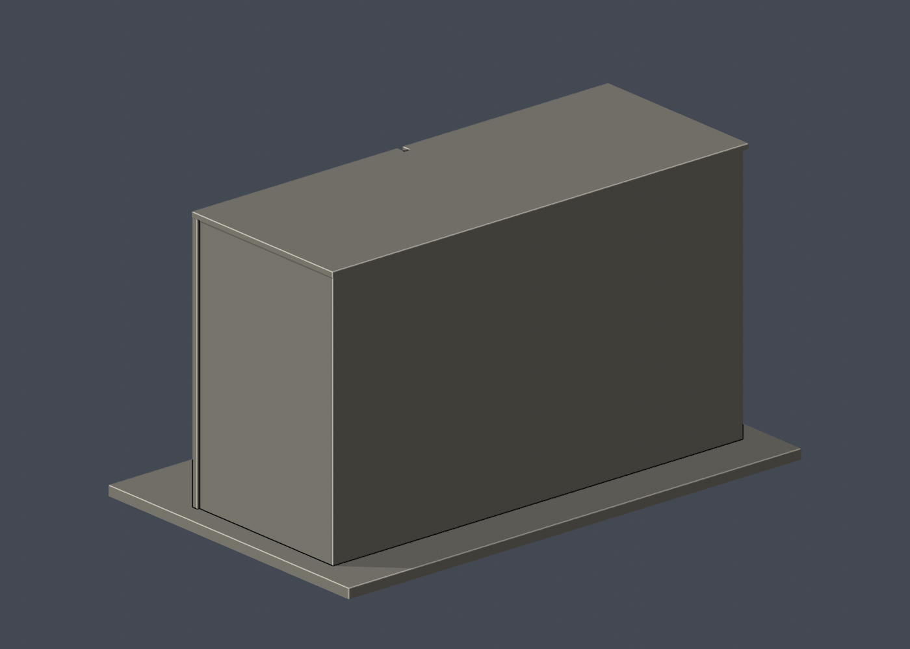

# 國立臺灣大學 語文大樓（前部）

## 模型預覽

| 模型預覽 | 模型預覽 | 模型預覽 |
| :---: | :---: | :---: |
| 正面  | 背面  |  |

[返回校區圖鑑](../../README.md) · [返回臺大總圖鑑](../../../README.md)

## 實際 STL 正面與背面

[下載 STL](model.stl) · [Blender 場景](scene.blend) · [參數化來源](build_model.py) · [驗證結果](validation.json)

本件新增closed/valid與薄篩結果見本資料夾valid-sections.json、thin-feature-check.json。

官方索引代碼 N74。公開外觀近似模型，非測繪或BIM。

## 範圍與比例
以官方中國語文組正面與清楚斜角外照為主，2010官方兩角度為交叉核對。只作四層前部與入口門廊，沒有把照片外的全部長翼、側後配置或鄰近高樓補造。進深、窗距和深凹窗深度目測，端部/背面留白。頁面目前使用的照片未標拍攝日期，不據此保證2026每處外觀現況。

保留辨識特徵：寬橫向灰帶、中央中層窄窗及頂層兩組寬窗、兩側上層深凹窗、磚牆/灰帶的外部凹凸、頂部中央細缺口、兩柱平頂門廊及低弧入口梁。爬藤、招牌文字和鐵窗細網省略。

尺寸 [150.0, 94.0, 83.5] mm，含底座最長150 mm。各館獨立比例，不是可拼接的共同尺度校園沙盤。尺寸、厚度、窗距均為照片目測和列印簡化，不是原建物實測。

## 列印
- 底座向下，毫米單位。參考起點：0.4 mm噴嘴、0.16–0.2 mm層高、3道外牆、15–20%填充。須依自己的切片器調整。
- 門廊平棚與淺拱梁、上層深凹窗上緣需支撐評估；兩根主門柱5mm，凹窗有實心背牆。無封閉內部空殼。
- 新增細浮雕名義最小約0.9 mm；這不是全模型最小壁厚的測量結果。零碎設備、文字招牌、樹木、電線及細緻裝飾沒有加入。
- 門窗背牆與實心量體避免隱藏內殼；實際填充由切片器決定。
- 未實際列印；未用PrusaSlicer、Cura等生成工具路徑。不宣稱無支撐或無風險可印。

## 驗證與檔案
- model.stl、model.obj；scene.blend是由實際STL匯入的可編修網格。
- build_model.py為獨立參數來源；Python3.12，依requirements.txt裝依賴後執行python build_model.py。
- Blender4.3.2：blender -b -t 2 -P render_preview.py。previews/front.png、rear.png、elevation.png均直接渲染交付STL。
- python validate_model.py：原始法向、水密、流形邊／頂點、單一連通表面、無分離封閉內殼、正體積、150mm、獨立重建SHA256及已儲存Blender/STL三角幾何一致性。結果validation.json。
- python check_layers.py：每0.2mm水平截面幾何檢查，共 418 層，所抽樣截面全部閉合。首層採z=0.071mm避免重合平面退化，非實際列印首層設定。
- layer-check.json另記向下超45度面積指標與各層輪廓；它不是切片器、最小壁厚測試或實體試印。閉合截面不保證擠出連續、橋接、支撐可拆、床面附著或局部細節可印。
- SHA256SUMS可核對檔案；更改參數後需重建、重繪、重驗證。

## 公開來源
查閱及圖像像素檢視：2026-10-13。來源照片未隨檔重新散布。
- [官方語文中心環境與N74身份](https://lang.ntu.edu.tw/environment.html)
- [中國語文組官方外觀照片所在頁](https://cld.liberal.ntu.edu.tw/en/about.html)
- [實際檢視官方清楚斜角與門廊](https://cld.liberal.ntu.edu.tw/images/NTULanguageCenter_02.jpg)
- [官方舊網址正面照片所在頁](https://homepage.ntu.edu.tw/~cld222/about.html)
- [實際檢視官方完整正立面](https://homepage.ntu.edu.tw/~cld222/images/NTULanguageCenter_01.jpg)
- [實際檢視2010官方外觀 N74-0.jpg](https://homepage.ntu.edu.tw/~cpo/2010photo/N/N74/IMG_6013.JPG)
- [實際檢視2010官方外觀 N74-1.jpg](https://homepage.ntu.edu.tw/~cpo/2010photo/N/N74/IMG_6014.JPG)
- [臺大官方建物索引，檢索標題2026-08-17](https://cpo.ntu.edu.tw/map/C_01_list.pdf)

照片版權屬原權利人；沒有轉授原建築設計或照片權利。不同拍攝日期不等於已核實目前全部外觀。

## 新增有效輪廓及薄篩
- python check_valid_sections.py：0.2mm間距、z=0.071mm起，全部個別輪廓及組合多邊形均須closed/valid，沒有polygon repair。結果valid-sections.json。
- python thin_canonical_v2.py：1mm間距有效截面作0.8mm參考opening；這是輔助特徵指標，不是全面壁厚、切片器或實體試印。
- 薄篩84層，最大面積損失0.1422%，超過1%指標層0個。
