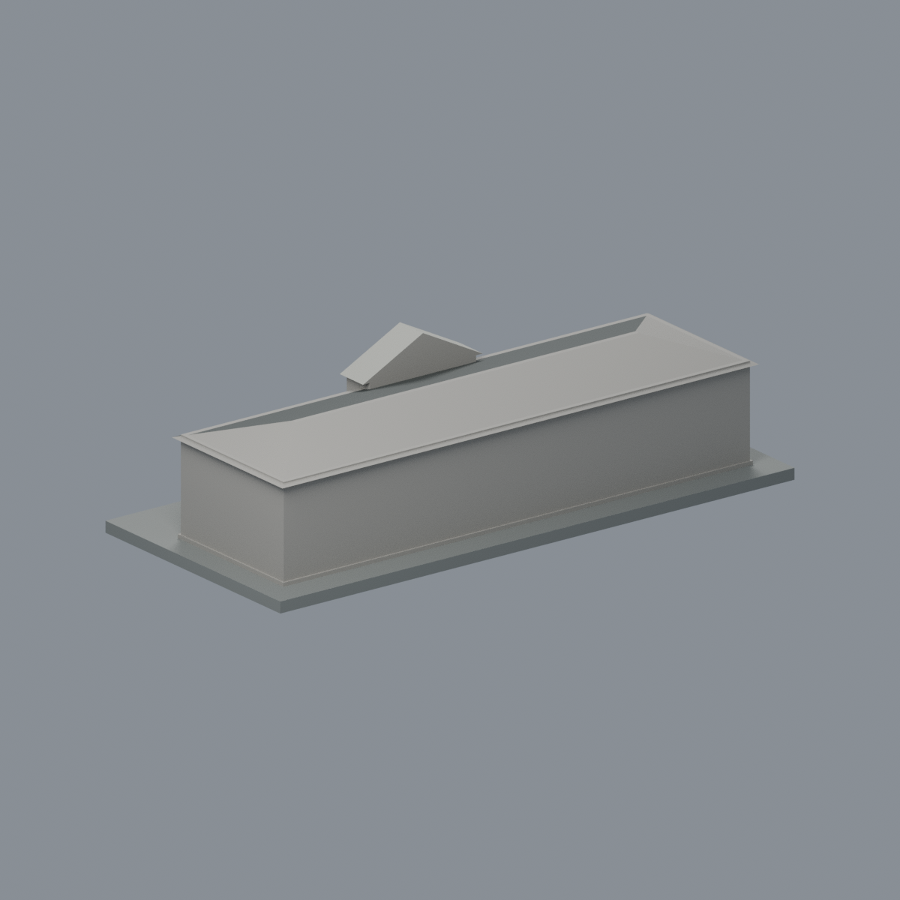
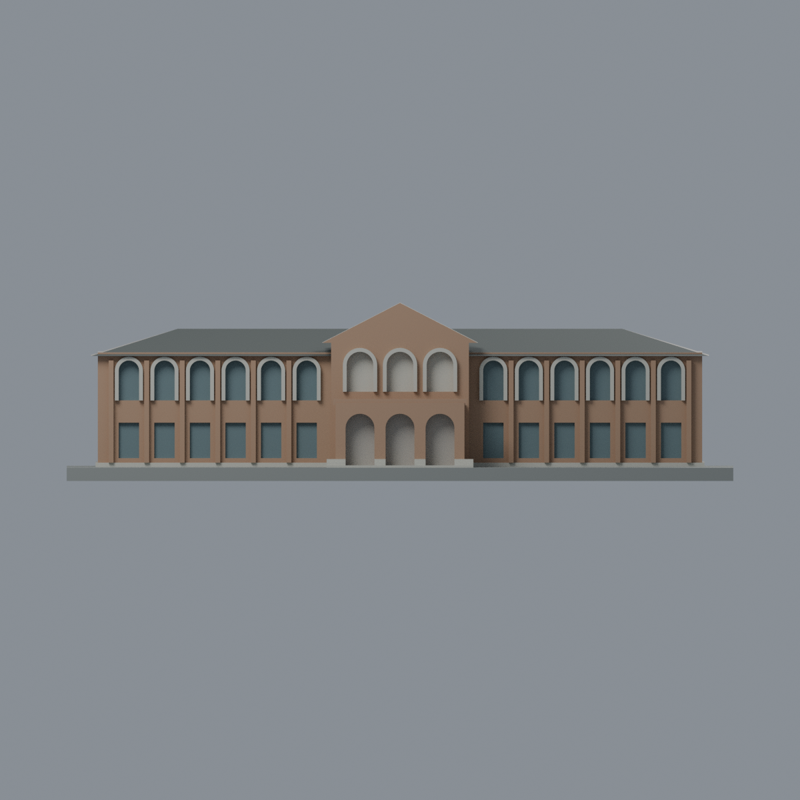
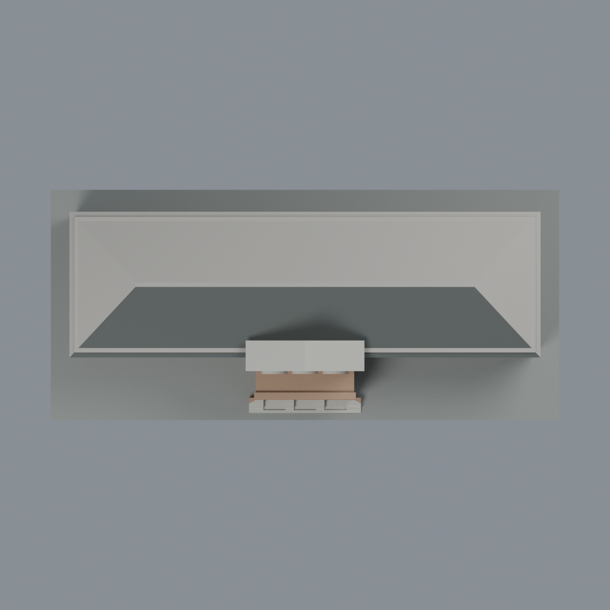

# 臺大文學院：六材質外觀版

沿用原 **5,394 三角面／2,699 頂點**，不改原 STL 位元、座標、面序或幾何；這是既有模型外觀改版，不增加模型包數。

| 正面 | 背面保持中性 |
|---|---|
|  |  |
|  |  |

[表面色 3MF](liberal-appearance.3mf) · [可編輯 Blender](scene.blend) · [材質色表](palette.json) · [逐面指派與依據](face-materials.json) · [原 STL](../model.stl)

## 來源與配色邊界

親自查看臺大學生心理輔導中心[位置資訊頁](https://csw.ntu.edu.tw/cp_n_194260.html)的[文學院官方正面照片](https://csw.ntu.edu.tw/001/Upload/1497/ckfile/923aef6e-eb5e-4067-b598-5255e263bbf6.jpg)。內嵌 EXIF DateTimeOriginal 是 **2022-03-11 10:42:43**，時區與拍攝日未獨立確認；網頁更新日不當照片拍攝日。不宣稱 2026 現況，不散布照片位元。

- 正面暖棕磚牆、既有淺壁柱、中央山牆與三拱門廊外面；色值未校正，不是建材標準色。照片遮樹處僅對原簡化重複面作有界材質延伸，不增加窗數或裝飾。
- 既有上層拱窗浮雕環與前基腳為淡灰石色。兩翼原凹窗背面灰藍，不畫照片中的細窗格或反射。
- **中央上層三拱是開放廊面，不是玻璃窗**；原封閉代理背面採淡灰中性內表面色，沒有新增穿透結構。下層三拱門廊深部仍中性，不把陰影塗黑。
- 只將照片可見主屋頂前坡設炭灰，中央原山牆厚度的上緣為灰色代理；不額外做簷線、瓦片、石雕、圓飾、欄杆或文字。
- 未見側牆、後牆、後屋面、屋頂頂平台中性；展示底板不當現場草坪或鋪面。原幾何比例及簡化不變。

[原幾何與來源界線](../README.md) · [來源與 EXIF 覆核](qa/source-review.json)

## 重建與核驗

安裝 [依賴](source/requirements.txt)，Blender 使用 4.3.2。由本資料夾上層提供原 model.stl：

1. `python appearance/source/build_appearance.py`
2. `python appearance/source/verify_exchange.py`
3. `blender -b -t 3 --python-exit-code 1 -P appearance/source/render_appearance.py`
4. `blender -b -t 3 --python-exit-code 1 -P appearance/source/verify_scene.py`

[獨立重建 ZIP](rebuild-source.zip)含原 STL、四支程式及依賴，不含第三方照片；不取代原建模腳本。[逐檔 SHA256](SHA256SUMS)

[交換／拓撲 QA](qa/exchange-validation.json)核對原座標與面序、全部面材質、單連通、有向水密邊、頂點 link 單環、正體積與零退化／重複面；lib3mf 嚴格讀取零警告，實際編輯單材質再存讀，其他材質及面指派不變。SDK 六位小數量化誤差另列。

[Blender 存讀與編輯](qa/scene-validation.json) · [渲染記錄](qa/render-manifest.json) · [獨立重建](qa/rebuild-validation.json)

## 製造限制照舊

尺寸仍為 150 × 68 × 40 mm；原 STL、建模程式、場景及歷史 QA 保留。原層檢與薄特徵檢查本次未重跑，不能由材質 QA 代替。

3MF 是同一網格的表面色，不是六個封閉分色實體、切片專案、噴頭映射或 G-code。切片 GUI、多材料路徑與實體列印未測；拱形門廊、浮雕窗框、屋簷及薄邊仍須評估材料、支撐及拆除風險，沒有保證可印或免支撐。
