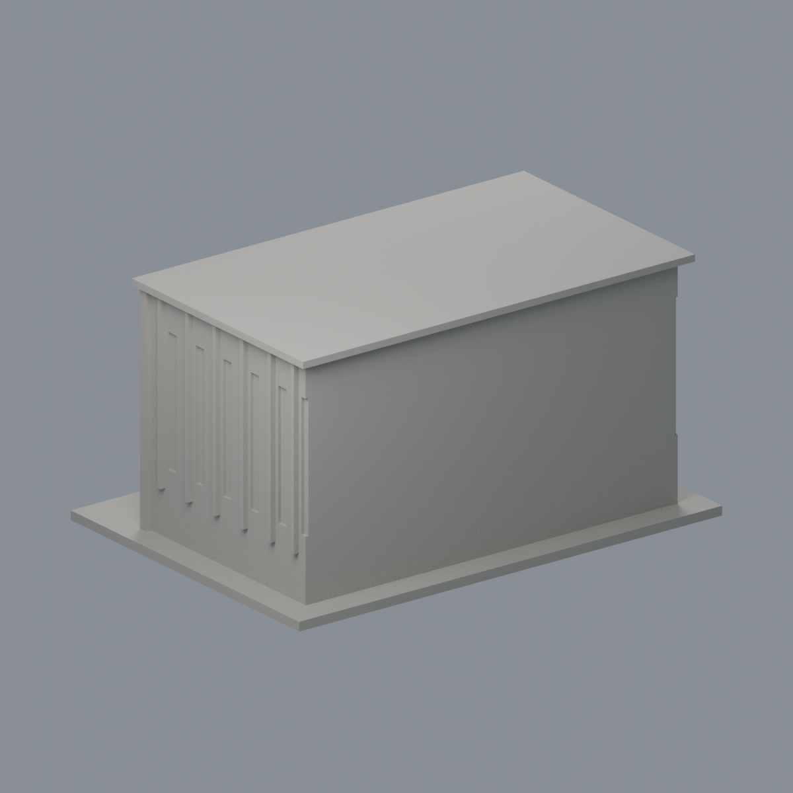
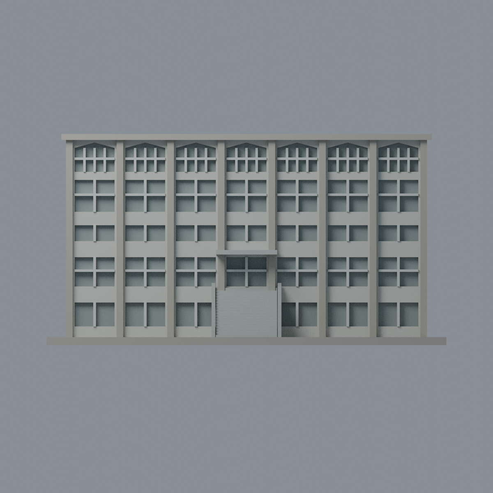
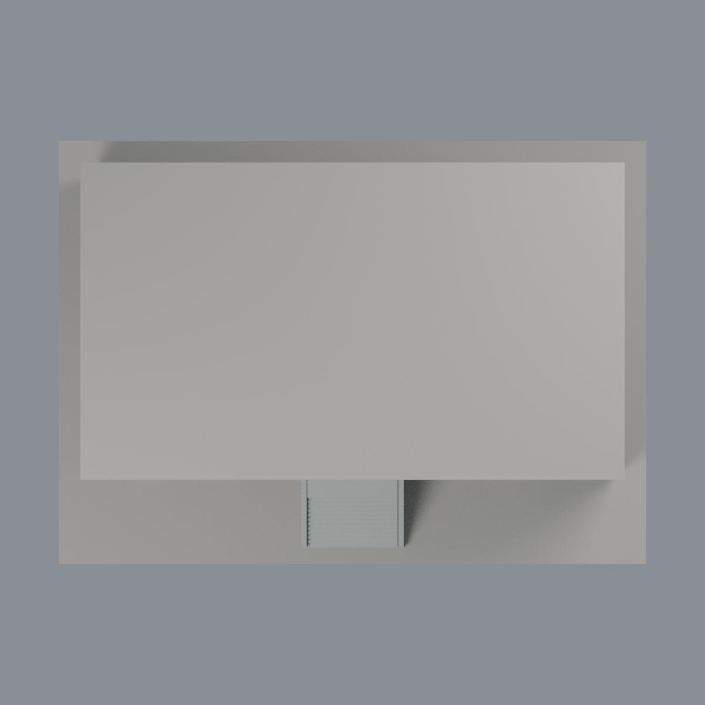

# 臺大圖書資訊學系館：六材質外觀版

沿用原 **4,358 三角面／2,177 頂點**，不改原 STL 位元、座標、面序或幾何；這是既有模型外觀改版，不增加模型包數。

| 正面 | 背面保持中性 |
|---|---|
|  |  |
|  |  |

[表面色 3MF](ntulis-appearance.3mf) · [可編輯 Blender](scene.blend) · [材質色表](palette.json) · [逐面指派與依據](face-materials.json) · [原 STL](../model.stl)

## 來源與配色邊界

親自核對臺大官方[斜照 5770](https://homepage.ntu.edu.tw/~cpo/2010photo/M/M9/IMG_5770.JPG)、[正面 5771](https://homepage.ntu.edu.tw/~cpo/2010photo/M/M9/IMG_5771.JPG)與[側面近照 5773](https://homepage.ntu.edu.tw/~cpo/2010photo/M/M9/IMG_5773.JPG)，以此為配色基準，另以[圖資系網站外觀照](https://www.lis.ntu.edu.tw/wp-content/uploads/2014/09/NTULISb.jpg)輔助辨識。2010 三照 EXIF DateTimeOriginal 分別為 2010-10-09 14:26:01／14:26:55／14:28:08；2011 為修改日期。系網照片路徑 2014/09 是上傳路徑，EXIF 原始時間為 2003-10-01 00:00:04、修改欄為 2014-09-04；均僅 metadata，時鐘與時區未獨立核實，**不稱此照於 2014 拍攝**。原歷史 README 的 2014 系網來源脈絡保留，這裡明確區分日期。[來源覆核與雜湊](qa/source-review.json)，不代表 2026 現況，原照不入包。

- 正面灰暖直柱、較淺灰實窗裙、銀白原窗框；只對各層及上部淺尖拱窗的離散凹背採灰玻璃，不把窗間實牆連成玻璃幕牆。
- 外階梯及原厚側牆採冷灰，保留原樓梯、入口和原粗窗形的簡化誤差；照片細欄杆、空調、樹木與壁字均不補造。
- 左端只染原凸細肋淺灰，側面照片被樹遮擋且原長凹槽粗化，側牆與凹背保留中性，**不將整條槽當玻璃**。右端、背面與主屋頂中性。
- 小入口棚同一灰色構件的頂面為有界材料延伸，非俯視照片證實；不把局部陰影烘焙成黑牆。
- 原 STL、原場景、建模腳本與歷史 QA 不變，配色不增模型數，不宣稱實體列印成功。

[原幾何與歷史來源限制](../README.zh-TW.md)

## 重建與核驗

安裝 [依賴](source/requirements.txt)，Blender 使用 4.3.2。由本資料夾上層提供原 model.stl：

1. `python appearance/source/build_appearance.py`
2. `python appearance/source/verify_exchange.py`
3. `blender -b -t 3 --python-exit-code 1 -P appearance/source/render_appearance.py`
4. `blender -b -t 3 --python-exit-code 1 -P appearance/source/verify_scene.py`

[獨立重建 ZIP](rebuild-source.zip)含原 STL、四支程式及依賴，不含第三方照片；不取代原建模腳本。[逐檔 SHA256](SHA256SUMS)

[交換／拓撲 QA](qa/exchange-validation.json)核對原座標與面序、全部面材質、單連通、有向水密邊、頂點 link 單環、正體積與零退化／重複面；lib3mf 嚴格讀取零警告，實際編輯單材質再存讀，其他材質及面指派不變。SDK 六位小數量化誤差另列。

[Blender 存讀與編輯](qa/scene-validation.json) · [渲染記錄](qa/render-manifest.json) · [獨立重建](qa/rebuild-validation.json)

## 製造限制照舊

尺寸仍為 150 × 108 × 79.2 mm；原 STL、建模程式、場景及歷史 QA 保留。原層檢與薄特徵檢查本次未重跑，不能由材質 QA 代替。

3MF 是同一網格的表面色，不是各材質各自封閉的分色實體、切片專案、噴頭映射或 G-code。切片 GUI、多材料路徑與實體列印未測；柱頭、屋簷、窗框及薄邊仍須評估材料、支撐及拆除風險，沒有保證可印或免支撐。
