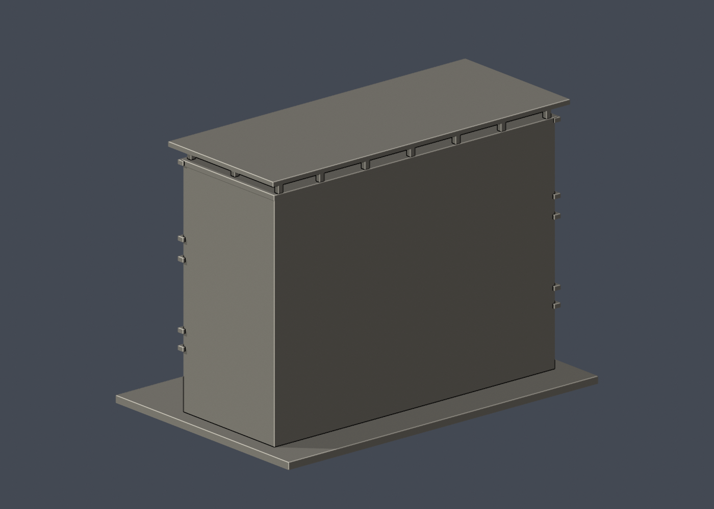
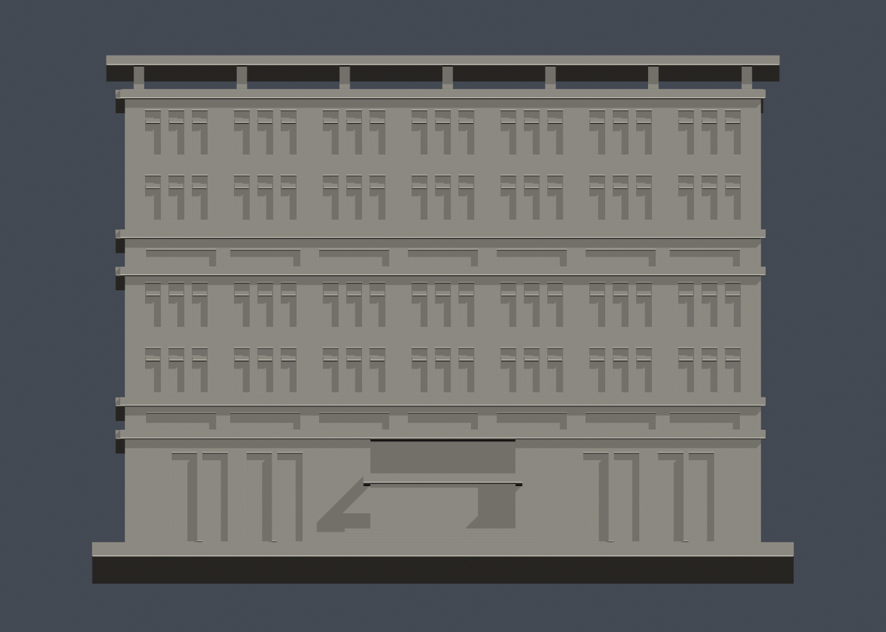

# 國立臺灣大學 霖澤館（主棟）

官方索引代碼 E51。公開外觀近似模型，非測繪或BIM。

## 模型預覽

| 模型預覽 | 模型預覽 | 模型預覽 |
| :---: | :---: | :---: |
| 正面  | 背面  | 正立面  |

## 範圍與比例
只作2009落成主棟的2010官方外觀近似；與萬才館分棟。低講堂、跨棟橋及園景不納入，不能當完整法律院區。前面和左側依官方照片核對，未見背面/另一端留白。深度、窗距與屋頂頂棚柱距目測；入口只表達外觀凹入，不重建室內。後來入口無障礙改造未依新照片核對，因此不是2026完整現況版本。

保留辨識特徵：灰色下部、上層兩組各兩列高窗、中段與下部水平狹窗帶、分組細長窗、中央大入口、抬高屋頂平棚及開放矩形空隙。屋頂細柱和窗框加厚；文字、植栽與細欄杆省略。

尺寸 [150.0, 99.0, 109.0] mm，含底座最長150 mm。各館獨立比例，不是可拼接的共同尺度校園沙盤。尺寸、厚度、窗距均為照片目測和列印簡化，不是原建物實測。

## 列印
- 底座向下，毫米單位。參考起點：0.4 mm噴嘴、0.16–0.2 mm層高、3道外牆、15–20%填充。須依自己的切片器調整。
- 入口梁、窗上緣與抬高頂棚需要局部支撐，尤其頂棚柱間約20mm跨距；頂棚支柱2.2mm。5個薄篩警示層是方柱尖角被opening削圓，柱仍保留，詳見thin-warning-notes.json。
- 新增細浮雕名義最小約0.9 mm；這不是全模型最小壁厚的測量結果。零碎設備、文字招牌、樹木、電線及細緻裝飾沒有加入。
- 門窗背牆與實心量體避免隱藏內殼；實際填充由切片器決定。
- 未實際列印；未用PrusaSlicer、Cura等生成工具路徑。不宣稱無支撐或無風險可印。

## 驗證與檔案
- model.stl、model.obj；scene.blend是由實際STL匯入的可編修網格。
- build_model.py為獨立參數來源；Python3.12，依requirements.txt裝依賴後執行python build_model.py。
- Blender4.3.2：blender -b -t 2 -P render_preview.py。previews/front.png、rear.png、elevation.png均直接渲染交付STL。
- python validate_model.py：原始法向、水密、流形邊／頂點、單一連通表面、無分離封閉內殼、正體積、150mm、獨立重建SHA256及已儲存Blender/STL三角幾何一致性。結果validation.json。
- python check_layers.py：每0.2mm水平截面幾何檢查，共 545 層，所抽樣截面全部閉合。首層採z=0.071mm避免重合平面退化，非實際列印首層設定。
- layer-check.json另記向下超45度面積指標與各層輪廓；它不是切片器、最小壁厚測試或實體試印。閉合截面不保證擠出連續、橋接、支撐可拆、床面附著或局部細節可印。
- SHA256SUMS可核對檔案；更改參數後需重建、重繪、重驗證。

## 公開來源
查閱及圖像像素檢視：2026-10-13。來源照片未隨檔重新散布。
- [官方校訊：霖澤教學館與萬才研究館為兩棟](https://sec.ntu.edu.tw/epaper/article.asp?num=833&sn=6294)
- [法律院官方2009遷院及館舍記錄](https://www.law.ntu.edu.tw/media/k2/attachments/NTU_newsletter-2010_No.7-1-14.pdf)
- [實際檢視2010官方外觀 E51-IMG_6026.JPG](https://homepage.ntu.edu.tw/~cpo/2010photo/E/E51/IMG_6026.JPG)
- [實際檢視2010官方外觀 E51-IMG_6028.JPG](https://homepage.ntu.edu.tw/~cpo/2010photo/E/E51/IMG_6028.JPG)
- [實際檢視2010官方外觀 E51-IMG_6029.JPG](https://homepage.ntu.edu.tw/~cpo/2010photo/E/E51/IMG_6029.JPG)
- [臺大官方建物索引，檢索標題2026-08-17](https://cpo.ntu.edu.tw/map/C_01_list.pdf)

照片版權屬原權利人；沒有轉授原建築設計或照片權利。不同拍攝日期不等於已核實目前全部外觀。

## 新增有效輪廓及薄篩
- python check_valid_sections.py：0.2mm間距、z=0.071mm起，全部個別輪廓及組合多邊形均須closed/valid，沒有polygon repair。結果valid-sections.json。
- python thin_canonical_v2.py：1mm間距有效截面作0.8mm參考opening；這是輔助特徵指標，不是全面壁厚、切片器或實體試印。
- 薄篩109層，最大面積損失2.8544%，超過1%指標層5個。
- 警示精確位於z=102.071–106.071mm抬高屋頂空隙。截面共16個2.2×2.2mm方柱，面積77.44mm²；0.8mm opening只削圓角，所有柱核心仍保留，2.854%不是細柱消失。thin-warning-notes.json包含逐柱包圍尺寸，未發現柱窄於0.8mm參考。屋頂仍有實際橋接/支撐問題，不能把此結果當免支撐保證。
