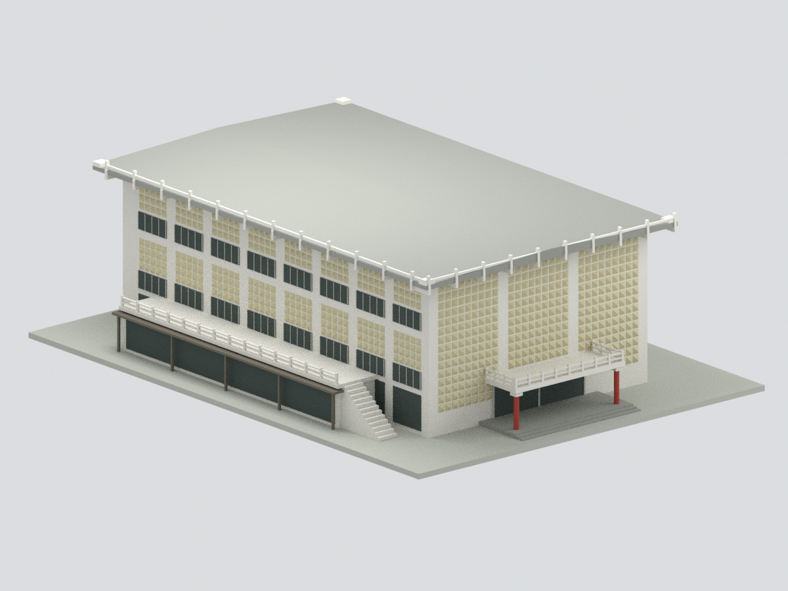
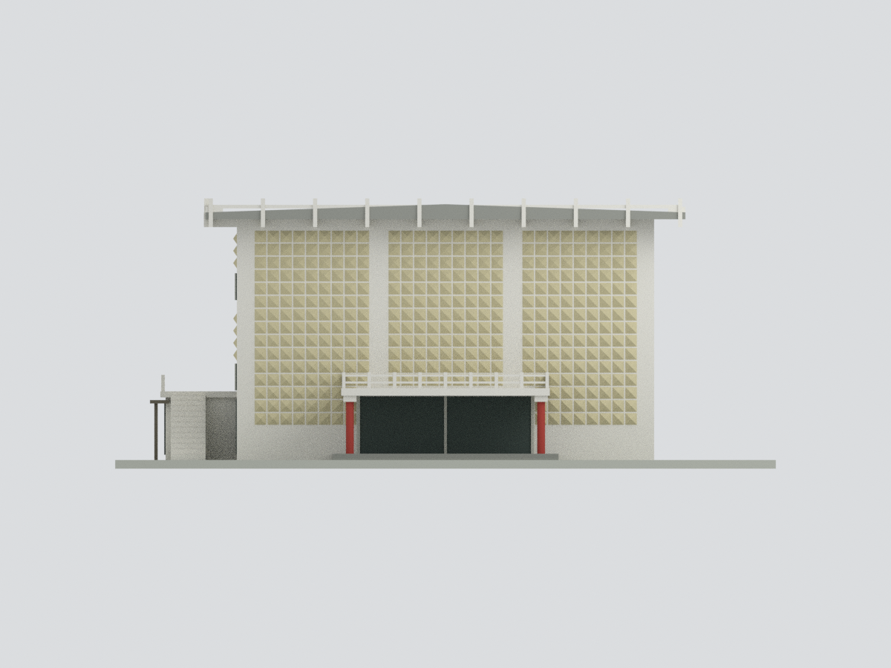
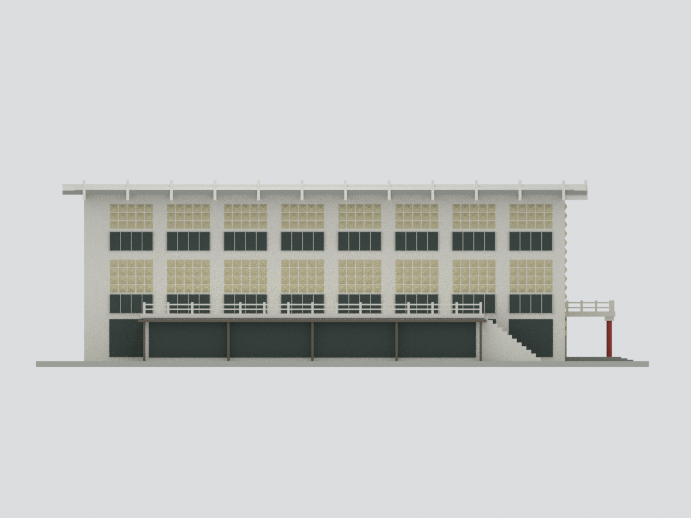
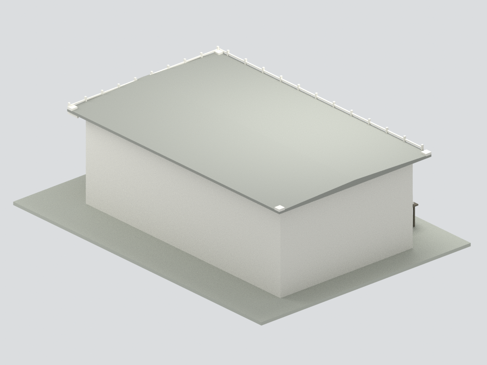
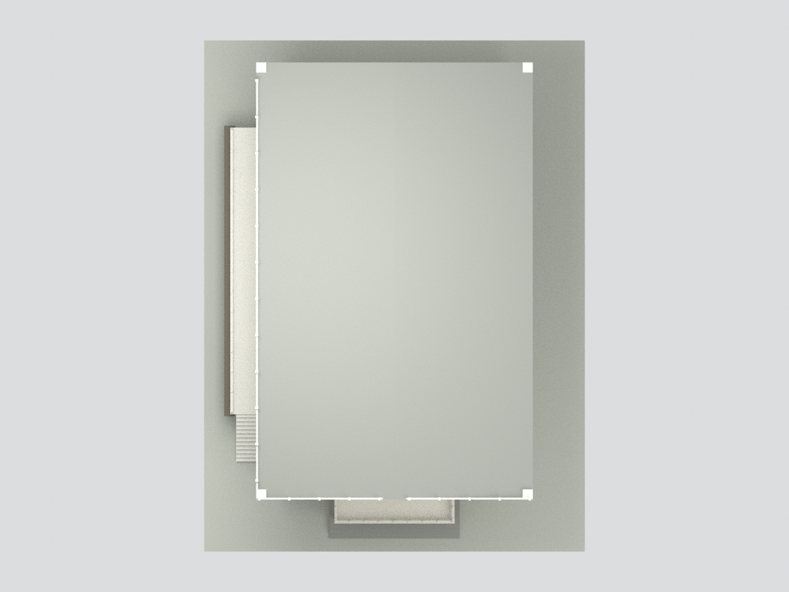
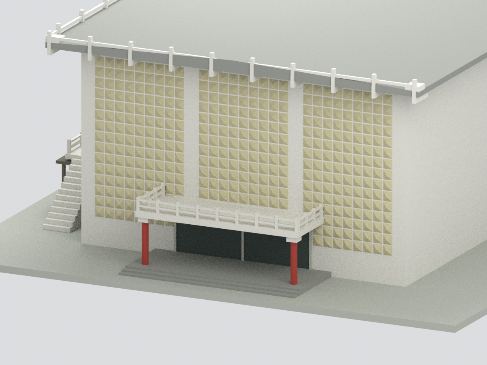

# 臺大鹿鳴堂主館 — 歷史外觀近似

## 模型預覽

以下為本模型實際網格的六視圖渲染，不是來源照片；歷史範圍與近似限制請見下文。

| 前側 | 正立面 | 側面 |
| --- | --- | --- |
|  |  |  |
| 背側 | 俯視 | 入口細節 |
|  |  |  |

原創程序化多色展示模型，**不是全館群完整重建、不是 2026 現況、不是實測模型**。
來源是臺大 2001 校園規劃報告第 60 頁的規劃足跡關係，與不同年代的實際外觀照片。可辨認的主館長方量體、淺雙坡屋頂與寬挑簷、三組折面壁飾、紅柱門廊、側露台及外梯均以照片為準；沒有把規劃案室內改造、曲線動線或新增附屬當作已落成。

## 檔案與狀態
- model.stl：毫米、單一連通封閉實體。
- model.3mf：8 色面材質，實際多色支援取決於切片器；不代表各色分件可直接組裝。
- scene.blend：一個可見聯集網格；隱藏集合保留每項原創構件，可編輯；勿將所有重疊構件一起列印。
- previews/：6 張以實際網格生成的 Blender 渲染，非來源照片。
- build_model.py / render_model.py / validate_model.py / verify_scene.py：可離線重建；依賴與完整命令見 REBUILD.md。
- QA.json / BLEND-QA.json / independent-review.json：格式、幾何及獨立來源視覺審核各自列項。
- **外觀展示近似：非實測、非2026現況或試印合格宣告。**

## 必讀限制
1. 2001 圖沒有可讀精確尺寸。名義主館寬 24、長 40、高 14 單位均是照片比例估計；4 mm/名義公尺僅建模規約，不是可信建築比例尺。
2. 主館背面開口、對側細部未取得足夠照片，以平實牆面中性化；後方附屬的輪廓和高度未鎖定，**不包含後方附屬館群**。範圍不是整基地。
3. 照片年代不同（可辨識 2012、2021，以及檔名 08.23 但本包未獨立核定其拍攝日）；不宣稱任一精確時點的完整外觀。建物始建 1967 依校方文字；此模型不是 1967 原貌。
4. 錐面數量、窗格、欄杆雕花、簷角上翹、屋面坡度與臺階尺寸簡化；後側簷細節不猜造。網罩、燈具、文字商標、植被、空調、室內、細雨遮不建。側露台下層採封閉支撐簡化，不代表原結構。
5. 色彩是未校準照片估計；不模擬真玻璃、風化或材質細紋。底板為原創展示支撐，不是地形。
6. **未實體試印**。網格閉合不等於可免支撐列印；簷口、門廊與欄杆需要切片檢查、支撐及最小線寬評估。微細錐面/窗框可能低於某些噴嘴能力；縮放、顏色指定、分件與支撐由印製者確認。沒有負責結構安全或施工用途。

詳細來源與證據分級見 SOURCES.md；重建後必須重跑 QA、視覺檢查與雜湊，不沿用舊審核宣稱。

## 模型下載

[STL](model.stl) · [8色3MF](model.3mf) · [Blender場景](scene.blend) · [來源與限制](SOURCES.md) · [重建](REBUILD.md) · [返回校區](../../README.md)
