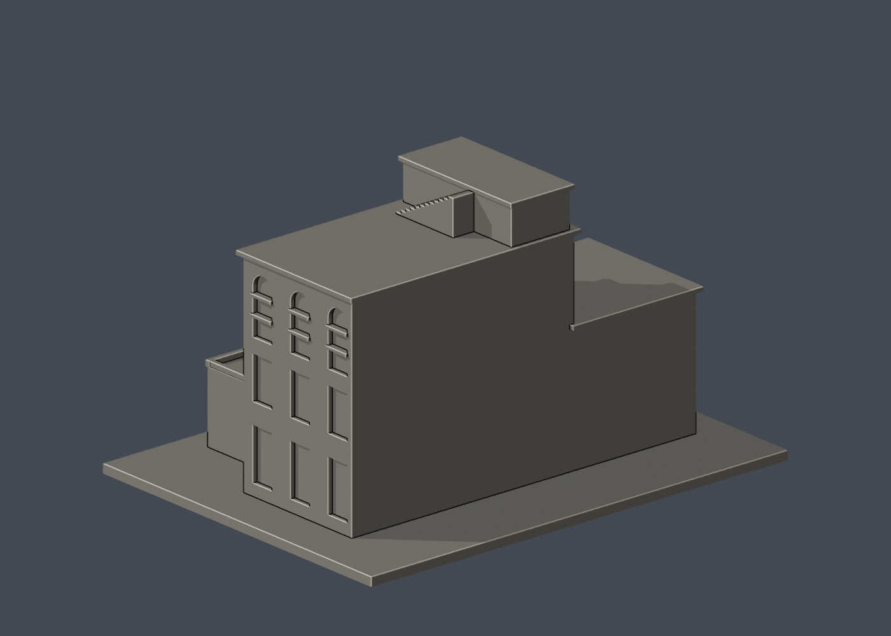

# 國立臺灣大學 氣象館A館

[返回校區圖鑑](../../README.md) · [返回臺大總圖鑑](../../../README.md)

## 實際 STL 正面與背面

| 模型預覽 | 模型預覽 | 模型預覽 |
| :---: | :---: | :---: |
| 正面  | 背面  |  |

[下載 STL](model.stl) · [Blender 場景](scene.blend) · [參數化來源](build_model.py) · [驗證結果](validation.json)

[新增34件列印幾何補查與細節警示](../../../qa/printability-20261013/README.zh-TW.md)

官方索引代碼 S44。公開外觀近似模型，非測繪或BIM。

## 範圍與比例
以2013洪致文公開高角度多向外觀照片為主，官方館舍與校史資料核對身份。只作A館階梯退縮外部量體，與第九批1975 B館分棟。低翼、屋頂梯與階梯塔相對尺寸目測；背面和未見窗留白。屋頂設備、管線、附屬連通橋及B/C館均省略，不宣稱2026設備現況。

保留辨識特徵：逐層退縮的低翼與高主體、長拱窗配下層直窗、帶圓孔的較高梯間、平屋面與低女兒牆、外露屋頂實心台階。沒有把屋頂外階梯改成光滑斜坡。

尺寸 [150.0, 114.5, 87.80000305175781] mm，含底座最長150 mm。各館獨立比例，不是可拼接的共同尺度校園沙盤。尺寸、厚度、窗距均為照片目測和列印簡化，不是原建物實測。

## 列印
- 底座向下，毫米單位。參考起點：0.4 mm噴嘴、0.16–0.2 mm層高、3道外牆、15–20%填充。須依自己的切片器調整。
- 低雨棚、拱窗橫框及屋頂台階邊緣可能需要支撐；屋頂平台為可見外部凹凸，不形成封閉空腔。
- 新增細浮雕名義最小約0.9 mm；這不是全模型最小壁厚的測量結果。零碎設備、文字招牌、樹木、電線及細緻裝飾沒有加入。
- 門窗背牆與實心量體避免隱藏內殼；實際填充由切片器決定。
- 未實際列印；未用PrusaSlicer、Cura等生成工具路徑。不宣稱無支撐或無風險可印。

## 驗證與檔案
- model.stl、model.obj；scene.blend是由實際STL匯入的可編修網格。
- build_model.py為獨立參數來源；Python3.12，依requirements.txt裝依賴後執行python build_model.py。
- Blender4.3.2：blender -b -t 2 -P render_preview.py。previews/front.png、rear.png、elevation.png均直接渲染交付STL。
- python validate_model.py：原始法向、水密、流形邊／頂點、單一連通表面、無分離封閉內殼、正體積、150mm、獨立重建SHA256及已儲存Blender/STL三角幾何一致性。結果validation.json。
- python check_layers.py：每0.2mm水平截面幾何檢查，共 439 層，所抽樣截面全部閉合。首層採z=0.071mm避免重合平面退化，非實際列印首層設定。
- layer-check.json另記向下超45度面積指標與各層輪廓；它不是切片器、最小壁厚測試或實體試印。閉合截面不保證擠出連續、橋接、支撐可拆、床面附著或局部細節可印。
- SHA256SUMS可核對檔案；更改參數後需重建、重繪、重驗證。

## 公開來源
查閱及圖像像素檢視：2026-10-13。來源照片未隨檔重新散布。
- [大氣系官方2025概述：A館為日治舊館，B/C分開](https://www.as.ntu.edu.tw/images/Daily%20Update/C05B_114_202508.pdf)
- [臺大校史館：氣象學教室身份及歷史](https://historygallery.ntu.edu.tw/2018建築史網站/)
- [原攝影者洪致文2013-10-05由鄰館拍攝公開多向外觀](https://cwhung.blogspot.com/2013/10/blog-post.html)
- [實際檢視2013退縮正面及圓孔梯間](https://blogger.googleusercontent.com/img/b/R29vZ2xl/AVvXsEiPgSGB6Fs2CcOlbx8l9lFthfEaiwiDa6sG5NIi1l6mlUTepAUFaW8ryZeN9fJSM5M160_w4crtegeHIej5lVUjlAFlWD1tuOIw8EuMpHbJm-3OOSqEMwxxC6ww6GMj3BkW7K_sJIeXWg/s1600/1378208_505854842833256_1730926211_n.jpg)
- [實際檢視2013屋頂梯與右側長窗](https://blogger.googleusercontent.com/img/b/R29vZ2xl/AVvXsEjTf9inidkYrSbNK7RJ00FP7xejS72UHQHTMH5T3A_IrRCuxlhSMqQpX094WIRBbx6serQy7N96ec99vdyGNXr1Lzse-3g4YBSh6lMeEDvng6i3IT-REX6DH5gWDrNLiC0FhEt8RNcvLQ/s1600/1385599_508692062549534_1820339733_n.jpg)
- [實際檢視2013高角度整體量體](https://blogger.googleusercontent.com/img/b/R29vZ2xl/AVvXsEhLQIw66ehW02MBpFLGaNJkbF9_KGitgogb1oLJfWqftKe25Ik_6KsvKB9ibQczleCt4aiO-8Um-WCUO450georSLAEeY5o8cOS2LGdO9D85eZvfuLIxyTXQMsvfxKuA3fO2xBCS2GM4Q/s1600/65049_631022153615044_82957223_n.jpg)
- [臺大官方建物索引，檢索標題2026-08-17](https://cpo.ntu.edu.tw/map/C_01_list.pdf)

照片版權屬原權利人；沒有轉授原建築設計或照片權利。不同拍攝日期不等於已核實目前全部外觀。
