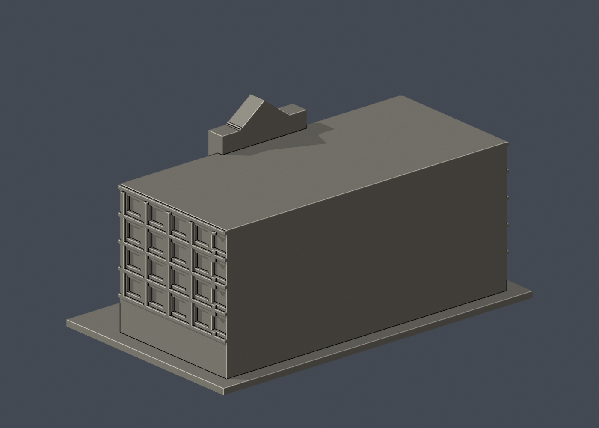

# 國立臺灣大學 國家發展所大樓

官方索引代碼 E10。公開外觀近似模型，非測繪或BIM。

## 模型預覽

| 模型預覽 | 模型預覽 | 模型預覽 |
| :---: | :---: | :---: |
| 正面  | 背面  | 正立面  |

## 範圍與比例
依2010官方正面及兩側斜角照片。樹遮小窗與磚紋省略；側面窗格節奏及進深近似，背面及屋頂設備無充分證據而留白。不宣稱2026全部外觀現況。

保留辨識特徵：中央階梯山牆與菱形凹飾、灰色入口塔、底層大半圓拱、中央階梯窗帶、底層圓窗及兩側結構格柵。

尺寸 [150.0, 90.0, 78.30000305175781] mm，含底座最長150 mm。各館獨立比例，不是可拼接的共同尺度校園沙盤。尺寸、厚度、窗距均為照片目測和列印簡化，不是原建物實測。

## 列印
- 底座向下，毫米單位。參考起點：0.4 mm噴嘴、0.16–0.2 mm層高、3道外牆、15–20%填充。須依自己的切片器調整。
- 入口拱、窗框與結構格柵上緣可能需要支撐，凹窗保留實心背牆；菱形頂飾及高處階梯邊應慢速列印。
- 新增細浮雕名義最小約0.81 mm（模型高度調整後）；這不是全模型最小壁厚的測量結果。零碎設備、文字招牌、樹木、電線及細緻裝飾沒有加入。
- 門窗背牆與實心量體避免隱藏內殼；實際填充由切片器決定。
- 未實際列印；未用PrusaSlicer、Cura等生成工具路徑。不宣稱無支撐或無風險可印。

## 驗證與檔案
- model.stl、model.obj；scene.blend是由實際STL匯入的可編修網格。
- build_model.py為獨立參數來源；Python3.12，依requirements.txt裝依賴後執行python build_model.py。
- Blender4.3.2：blender -b -t 2 -P render_preview.py。previews/front.png、rear.png、elevation.png均直接渲染交付STL。
- python validate_model.py：原始法向、水密、流形邊／頂點、單一連通表面、無分離封閉內殼、正體積、150mm、獨立重建SHA256及已儲存Blender/STL三角幾何一致性。結果validation.json。
- python check_layers.py：每0.2mm水平截面幾何檢查，共 392 層，所抽樣截面全部閉合。首層採z=0.071mm避免重合平面退化，非實際列印首層設定。
- layer-check.json另記向下超45度面積指標與各層輪廓；它不是切片器、最小壁厚測試或實體試印。閉合截面不保證擠出連續、橋接、支撐可拆、床面附著或局部細節可印。
- SHA256SUMS可核對檔案；更改參數後需重建、重繪、重驗證。

## 公開來源
查閱及圖像像素檢視：2026-10-13。來源照片未隨檔重新散布。
- [臺大學輔中心官方：國發所大樓與位置身份](https://csw.ntu.edu.tw/cp_n_188377.html)
- [臺大校友雙月刊：國發所搬回校總區沿革](https://ntualumnibm.ntu.edu.tw/bm.bimonthly.article/detail/sn/9010)
- [實際檢視2010官方外觀 6020](https://homepage.ntu.edu.tw/~cpo/2010photo/E/E10/IMG_6020.JPG)
- [實際檢視2010官方外觀 6021](https://homepage.ntu.edu.tw/~cpo/2010photo/E/E10/IMG_6021.JPG)
- [實際檢視2010官方外觀 6022](https://homepage.ntu.edu.tw/~cpo/2010photo/E/E10/IMG_6022.JPG)
- [臺大官方建物索引，檢索標題2026-08-17](https://cpo.ntu.edu.tw/map/C_01_list.pdf)

照片版權屬原權利人；沒有轉授原建築設計或照片權利。不同拍攝日期不等於已核實目前全部外觀。
