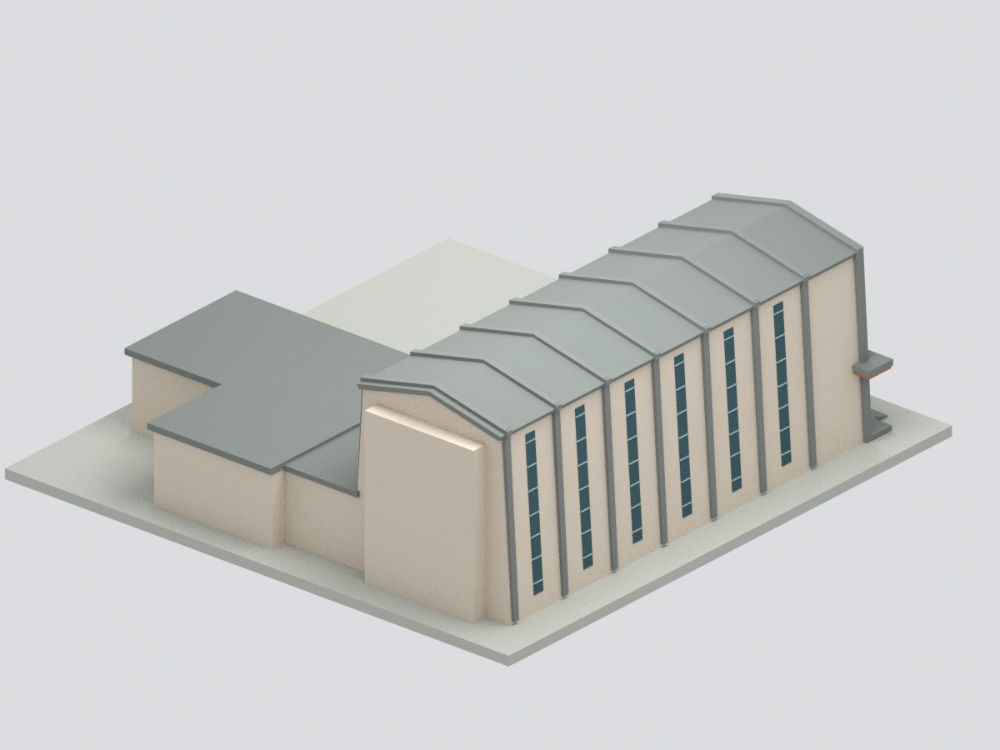

# 國立臺灣大學雅頌坊｜全外觀近似模型

## 模型預覽

| 模型預覽 | 模型預覽 | 模型預覽 |
| :---: | :---: | :---: |
|  |  |  |

**外觀展示近似：非實測、非2026現況或試印合格宣告。**

範圍包含長向低坡雙坡主廳、前廳、側服務翼、垂直辦公翼、第一後台及後方淺凸部，不是只做入口。主廳雙坡、灰色斜柱框架、6道長側窄窗、前方高彩窗、橫向雨庇及珊瑚色飾帶依官方圖像建構。內部房間不開放展示，玻璃用不透明色面表示。

## 證據與比例
- 臺大藝文中心2016場地平面：觀眾席深12.9m、寬7.95m；舞台深6.4m；入口1.77×2.89m；內部天花最高約8.6m。
- 附翼輪廓及前廳深度按該圖比例判讀；外牆厚、屋高分配、附翼高度、窗格、色值與柱框厚度是近似，不是圖上直接尺寸。
- 主廳約8.55×23m外包絡；高約9.72m（估值），每名義公尺6mm展示尺度，**不作精確測繪比例保證**。連底座最大尺寸以build-summary.json為準。
- 官方全棟立體線圖佐證主廳低坡雙坡及平頂附翼。官方2009年4月刊及未標拍攝日期官網外觀交叉比對；另2025年建築師親訪照只作二手比對，不視為官方承諾。

## 未知與簡化
完整後牆、屋頂俯照、附翼後開口、機電設備、壁磚分格及地景未充分確認：後側採保守素面，不虛構密集窗格；不建樹木、人車或鄰棟。前方階梯簡化；無障礙坡道/欄杆及後台門細節省略，非無障礙或消防圖。彩玻璃採近似色格，非逐片復刻。

## 檔案與驗證
model.stl：單一閉合實體；model.3mf：相同幾何及11色基礎材質；scene.blend：相同可見網格＋隱藏可編輯分件；previews/：6張實際網格渲染；build_model.py/render_model.py及requirements.txt/REBUILD.md可重建。

QA.json檢查拓樸及跨格式一致，BLEND-QA.json驗證場景一致，visual-review.json為獨立來源/外觀審核。通過不等於可直接列印；細框約0.27～0.48mm，可能小於噴嘴需求，未驗支撐/切片/材質映射，**未實體試印**。縮放需重新評估最小厚度。

只公開自製幾何、腳本、文件與渲染；來源照片/PDF留私人參考區，未嵌入BLEND或包入ZIP。上傳待核時不重複發布、不假造commit。

## 實際模型預覽與下載

[STL](model.stl) · [11色3MF](model.3mf) · [Blender場景](scene.blend) · [來源與限制](SOURCES.md) · [重建](REBUILD.md) · [返回校區](../../README.md)
