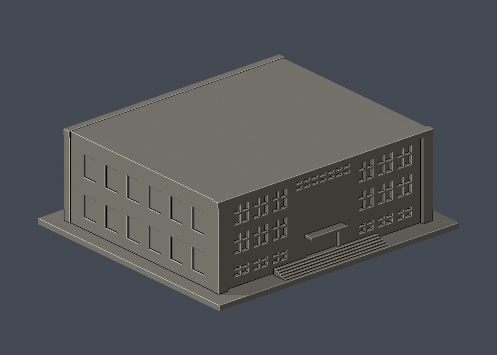

# 國立臺灣大學 舊體育館

[返回校區圖鑑](../../README.md) · [返回臺大總圖鑑](../../../README.md)

## 實際 STL 正面與背面

| 模型預覽 | 模型預覽 | 模型預覽 |
| :---: | :---: | :---: |
| 正面  | 背面  |  |

[下載 STL](model.stl) · [Blender 場景](scene.blend) · [參數化來源](build_model.py) · [驗證結果](validation.json)

[新增34件列印幾何補查與細節警示](../../../qa/printability-20261013/README.zh-TW.md)

官方索引代碼 N14。公開外觀近似模型，非測繪或BIM。

## 範圍與比例
2010年官方前方與斜角照片，加上體育室後舞台照片的外觀近似。前後立面皆有實景依據；進深、屋面平整化及側窗數量為簡化估計，不宣稱現況實測。

保留辨識特徵：大矩形框架、中央高玻璃面、兩翼六組細孔屏牆、底層入口與後舞台中央實牆、兩側窗帶。屏牆孔數大幅減少並放大為有背牆凹孔。

尺寸 [150.0, 134.0, 51.0] mm，含底座最長150 mm。各館獨立比例，不是可拼接的共同尺度校園沙盤。尺寸、厚度、窗距均為照片目測和列印簡化，不是原建物實測。

## 列印
- 底座向下，毫米單位。參考起點：0.4 mm噴嘴、0.16–0.2 mm層高、3道外牆、15–20%填充。須依自己的切片器調整。
- 入口雨棚、後門雨棚和凹窗上緣需視切片結果局部支撐；細孔並非穿透館內。
- 新增細浮雕名義最小約0.9 mm；這不是全模型最小壁厚的測量結果。零碎設備、文字招牌、樹木、電線及細緻裝飾沒有加入。
- 門窗背牆與實心量體避免隱藏內殼；實際填充由切片器決定。
- 未實際列印；未用PrusaSlicer、Cura等生成工具路徑。不宣稱無支撐或無風險可印。

## 驗證與檔案
- model.stl、model.obj；scene.blend是由實際STL匯入的可編修網格。
- build_model.py為獨立參數來源；Python3.12，依requirements.txt裝依賴後執行python build_model.py。
- Blender4.3.2：blender -b -t 2 -P render_preview.py。previews/front.png、rear.png、elevation.png均直接渲染交付STL。
- python validate_model.py：原始法向、水密、流形邊／頂點、單一連通表面、無分離封閉內殼、正體積、150mm、獨立重建SHA256及已儲存Blender/STL三角幾何一致性。結果validation.json。
- python check_layers.py：每0.2mm水平截面幾何檢查，共 255 層，所抽樣截面全部閉合。首層採z=0.071mm避免重合平面退化，非實際列印首層設定。
- layer-check.json另記向下超45度面積指標與各層輪廓；它不是切片器、最小壁厚測試或實體試印。閉合截面不保證擠出連續、橋接、支撐可拆、床面附著或局部細節可印。
- SHA256SUMS可核對檔案；更改參數後需重建、重繪、重驗證。

## 公開來源
查閱及圖像像素檢視：2026-10-13。來源照片未隨檔重新散布。
- [臺大官方2010照片索引](https://homepage.ntu.edu.tw/~cpo/about_campus_archeitectureimage.html)
- [前方實景 5716](https://homepage.ntu.edu.tw/~cpo/2010photo/N/N14/IMG_5716.JPG)
- [前方實景 5717](https://homepage.ntu.edu.tw/~cpo/2010photo/N/N14/IMG_5717.JPG)
- [臺大體育室後舞台](https://rent.pe.ntu.edu.tw/venues/?K=82)
- [後方實景](https://rent.pe.ntu.edu.tw/udf/1666689036012958500.jpg)
- [臺大官方建物索引，檢索標題2026-08-17](https://cpo.ntu.edu.tw/map/C_01_list.pdf)

照片版權屬原權利人；沒有轉授原建築設計或照片權利。不同拍攝日期不等於已核實目前全部外觀。
