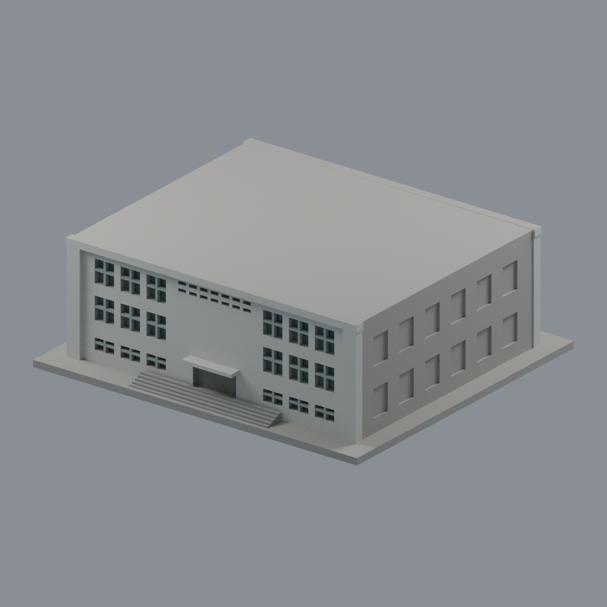
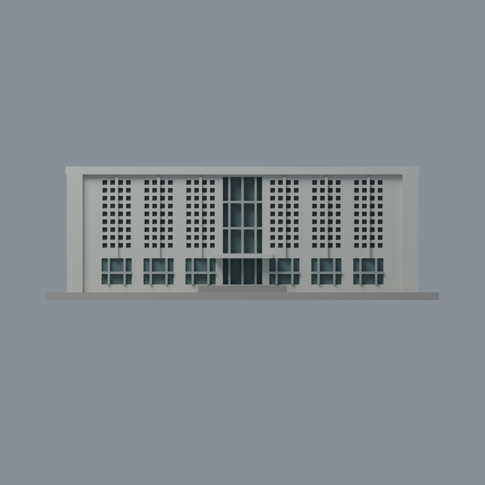
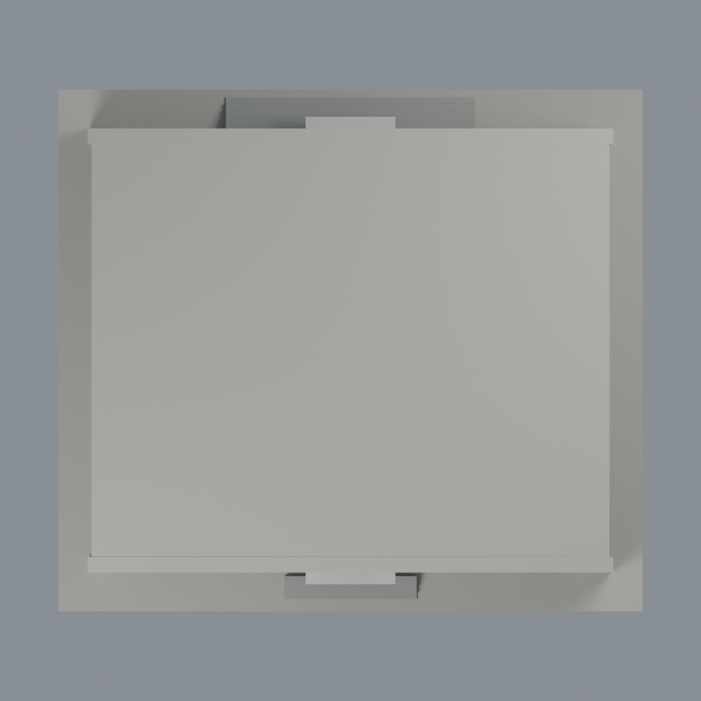

# 臺大舊體育館：七材質外觀版

沿用原 **7,036 三角面／3,324 頂點**，不改原 STL 位元、座標、面序或幾何；這是既有模型外觀改版，不增加模型包數。

| 模型預覽 | 模型預覽 | 模型預覽 |
| :---: | :---: | :---: |
| 正面  | 來源支持的後舞台  |  |
|  |  |  |

[表面色 3MF](ntuoldgym-appearance.3mf) · [可編輯 Blender](scene.blend) · [材質色表](palette.json) · [逐面指派與依據](face-materials.json) · [原 STL](../model.stl)

## 來源與配色邊界

親自核對臺大官方[舊體育館正面照](https://homepage.ntu.edu.tw/~cpo/2010photo/N/N14/IMG_5716.JPG)及體育室[後舞台頁](https://rent.pe.ntu.edu.tw/venues/?K=82)的[完整背面照](https://rent.pe.ntu.edu.tw/udf/1666689036012958500.jpg)。正面 EXIF DateTime 為 2011-01-11 16:03:55、背面為 2022-10-19 14:01:32；**僅檔案中繼資料，未獨立證實為拍攝日**，也不由網址的 2010 或檔名時間推斷拍攝日。正面只有 400 × 300 像素，用於整體材料與正面辨識，不還原細字。跨期照片不是 2026 全棟現況證明。[來源覆核](qa/source-review.json)，原照不入包。

- 有來源前／後白灰牆、端框及遮罩屏面；原小凹格背用深中性表示開口深度，**不是玻璃**，也沒有穿透改模。
- 中央直玻璃帶、前下層與背面離散窗背採灰綠玻璃代理，原窗梃淺灰，保留原粗窗格而非逐片復刻。
- 後舞台中央關閉捲門為灰橄欖金屬，不塗玻璃；後上部小通風格為深中性，不誤作窗片。
- 前後既有小雨棚白灰，階梯灰石；不增加捲門細紋、文字、汙漬、植栽、水塔、空調或室內設備。
- 樹木遮住／未清楚對應的兩側窗面與屋頂、底座維持中性；不延伸前後材質去猜測側牆。
- 原 STL 位元、幾何、建模腳本、場景及歷史 QA 不變；配色不新增模型數，沒有物理試印成功宣稱。

[原幾何與歷史來源限制](../README.zh-TW.md)

## 重建與核驗

安裝 [依賴](source/requirements.txt)，Blender 使用 4.3.2。由本資料夾上層提供原 model.stl：

1. `python appearance/source/build_appearance.py`
2. `python appearance/source/verify_exchange.py`
3. `blender -b -t 3 --python-exit-code 1 -P appearance/source/render_appearance.py`
4. `blender -b -t 3 --python-exit-code 1 -P appearance/source/verify_scene.py`

[獨立重建 ZIP](rebuild-source.zip)含原 STL、四支程式及依賴，不含第三方照片；不取代原建模腳本。[逐檔 SHA256](SHA256SUMS)

[交換／拓撲 QA](qa/exchange-validation.json)核對原座標與面序、全部面材質、單連通、有向水密邊、頂點 link 單環、正體積與零退化／重複面；lib3mf 嚴格讀取零警告，實際編輯單材質再存讀，其他材質及面指派不變。SDK 六位小數量化誤差另列。

[Blender 存讀與編輯](qa/scene-validation.json) · [渲染記錄](qa/render-manifest.json) · [獨立重建](qa/rebuild-validation.json)

## 製造限制照舊

尺寸仍為 150 × 134 × 51 mm；原 STL、建模程式、場景及歷史 QA 保留。原層檢與薄特徵檢查本次未重跑，不能由材質 QA 代替。

3MF 是同一網格的表面色，不是各材質各自封閉的分色實體、切片專案、噴頭映射或 G-code。切片 GUI、多材料路徑與實體列印未測；柱頭、屋簷、窗框及薄邊仍須評估材料、支撐及拆除風險，沒有保證可印或免支撐。
