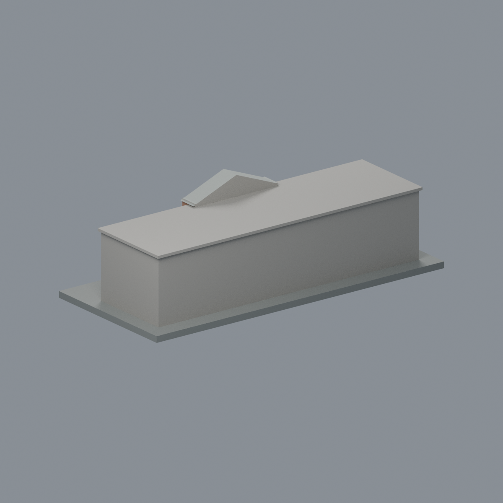
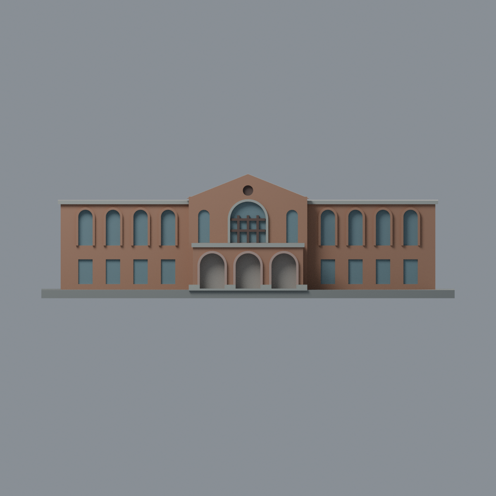
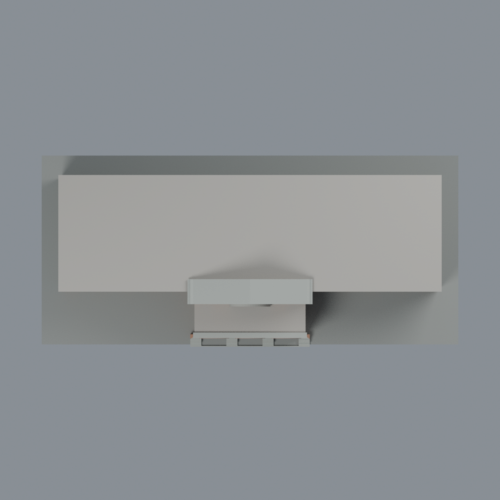

# 臺大舊總圖書館：七材質外觀版

沿用原 **4,426 三角面／2,215 頂點**，不改原 STL 位元、座標、面序或幾何；這是既有模型外觀改版，不增加模型包數。

| 模型預覽 | 模型預覽 | 模型預覽 |
| :---: | :---: | :---: |
| 正面  | 背面保持中性  |  |
|  |  |  |

[表面色 3MF](oldlib-appearance.3mf) · [可編輯 Blender](scene.blend) · [材質色表](palette.json) · [逐面指派與依據](face-materials.json) · [原 STL](../model.stl)

## 來源與配色邊界

親自查看臺大訪客中心官方[舊總圖書館正面照片](https://visitorcenter.ntu.edu.tw/001/Upload/photoedittemp/f7838b68-5869-46b3-b7fc-0dea87d996c3.jpg)。內嵌 EXIF DateTimeOriginal 為 **2021-07-19 17:33:31**，Photoshop 修改時間另為 2021-07-22；時區與拍攝日未獨立確認，不以修改日當拍攝日，不宣稱 2026 現況。照片不隨模型散布。

- 正面紅棕磚牆、中央山牆和既有兩翼拱窗浮雕仍是磚色，**兩翼上層拱圈不是灰石色**。照片中樹遮重複面只作原簡化範圍內的材質延伸，不增窗數。
- 中央高拱窗既有浮雕環、前簷帶、門廊頂緣為灰石色；兩旁窄拱窗只處理原凹緣，沒有新增不存在的石框。
- 下層三拱既有浮雕環為粉砂岩色，保留原簡化截面，不添加雕紋、細柱頭或穿透欄杆。原深門廊封閉代理背面中性，不把陰影塗黑或捏造室內。
- 中央原直橫窗梃深棕、原凹窗背面灰藍；圓通風孔背面深棕，不添加百葉。玻璃是不透明色代理，不畫反射樹影。
- 未見平屋頂、後牆和側面保持中性。中央山牆原厚度上緣灰色是現存幾何的簡化簷緣代理，不是新增屋面。展示底板不當現地石鋪面。
- 沿用前段歷史量體，不擴充後方館舍、文字、爬藤或設備；色值未校正，不是材料標準色。

[原幾何與來源界線](../README.md) · [來源與 EXIF 覆核](qa/source-review.json)

## 重建與核驗

安裝 [依賴](source/requirements.txt)，Blender 使用 4.3.2。由本資料夾上層提供原 model.stl：

1. `python appearance/source/build_appearance.py`
2. `python appearance/source/verify_exchange.py`
3. `blender -b -t 3 --python-exit-code 1 -P appearance/source/render_appearance.py`
4. `blender -b -t 3 --python-exit-code 1 -P appearance/source/verify_scene.py`

[獨立重建 ZIP](rebuild-source.zip)含原 STL、四支程式及依賴，不含第三方照片；不取代原建模腳本。[逐檔 SHA256](SHA256SUMS)

[交換／拓撲 QA](qa/exchange-validation.json)核對原座標與面序、全部面材質、單連通、有向水密邊、頂點 link 單環、正體積與零退化／重複面；lib3mf 嚴格讀取零警告，實際編輯單材質再存讀，其他材質及面指派不變。SDK 六位小數量化誤差另列。

[Blender 存讀與編輯](qa/scene-validation.json) · [渲染記錄](qa/render-manifest.json) · [獨立重建](qa/rebuild-validation.json)

## 製造限制照舊

尺寸仍為 150 × 68.85 × 45 mm；原 STL、建模程式、場景及歷史 QA 保留。原層檢與薄特徵檢查本次未重跑，不能由材質 QA 代替。

3MF 是同一網格的表面色，不是七個封閉分色實體、切片專案、噴頭映射或 G-code。切片 GUI、多材料路徑與實體列印未測；拱形門廊、原窗梃、浮雕窗框及薄邊仍須評估材料、支撐及拆除風險，沒有保證可印或免支撐。
