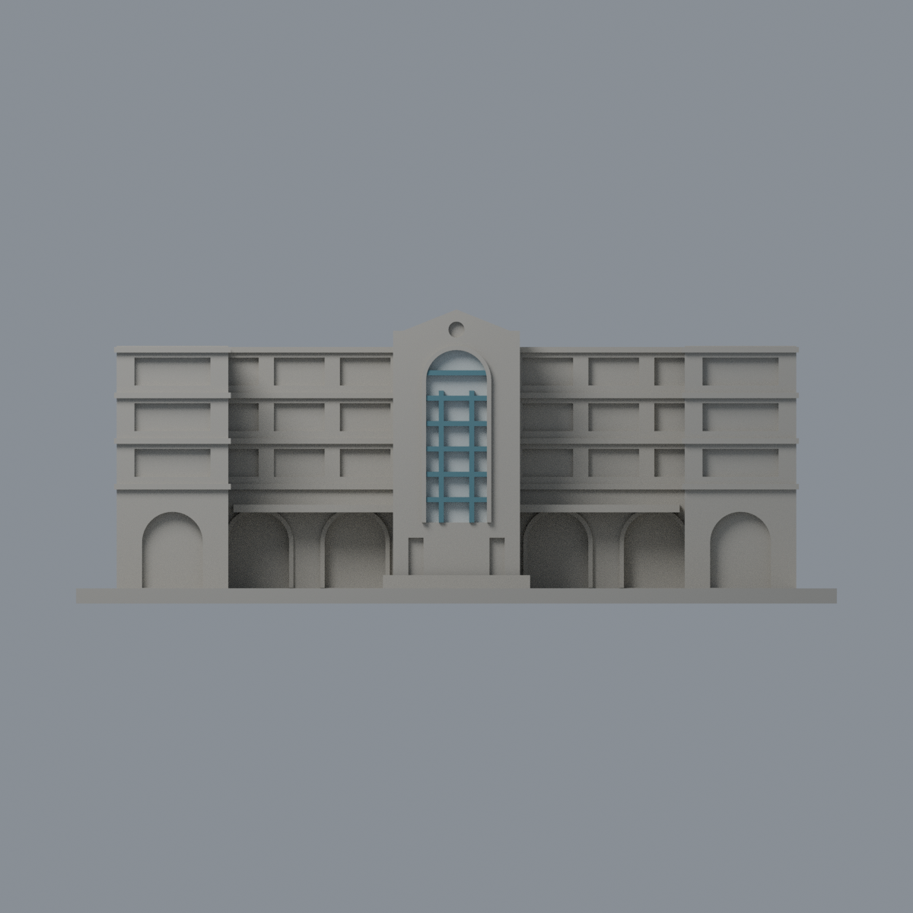
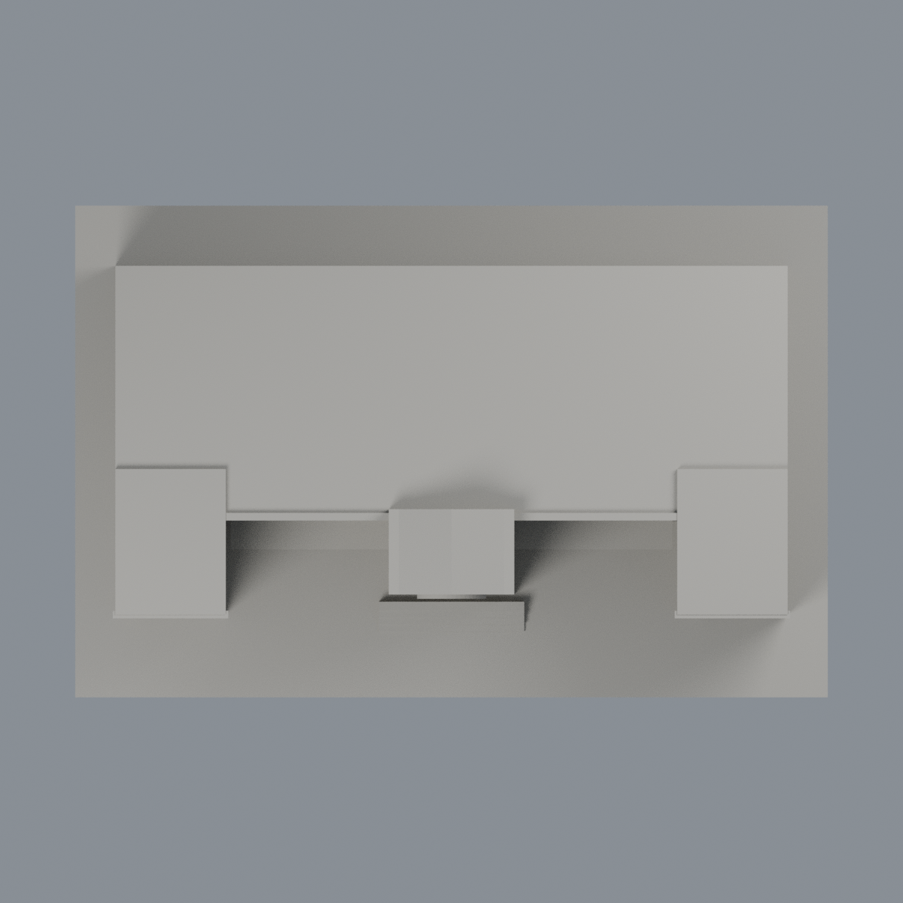

# 臺大普通教學館中央高拱窗限定配色：三材質外觀版

沿用原 **3,424 三角面／1,682 頂點**，不改原 STL 位元、座標、面序或幾何；這是既有模型外觀改版，不增加模型包數。

| 模型預覽 | 模型預覽 | 模型預覽 |
| :---: | :---: | :---: |
| 正面  | 背面保持中性  |  |
|  |  |  |

[表面色 3MF](ntuputong-appearance.3mf) · [可編輯 Blender](scene.blend) · [材質色表](palette.json) · [逐面指派與依據](face-materials.json) · [原 STL](../model.stl)

## 來源與配色邊界

親看臺大校園規劃單位[建築影像目錄](https://homepage.ntu.edu.tw/~cpo/about_campus_archeitectureimage.html)所列普通教學館四張完整照片 IMG_5910、5912、5915、5922，核對原單色預覽與生成器。本次檢查的是實際照片，不斷言目前頁面出版日。[精確 URL、SHA 與日期](qa/source-review.json)。nested Original 均 2010-10-16，root Modified 為 2011-01-11；不能把修改日、路徑或本次檢查日當成拍攝日。日期未獨立鑑定，不宣稱 2026 現況。來源原圖私用，不入包。

- 只做中央高拱窗：25 個原凹背面採淡反射灰玻璃代理，避免把照片亮白反射區整片染飽和青色；兩支細直框及六支細橫框共 304 個原面採低飽和藍灰色。玻璃背與前方框格是原獨立幾何，不新增分面或貼圖。
- 原較寬 arch_trim 是簡化建築外緣，照片緊接灰石／外牆，不足證明全圈是青藍金屬，故保持中性，不和已確認細框混色。
- 主牆紅磚與灰水平帶跨原未分割大面，全部中性；兩翼的深槽是開放走廊，底部拱口是通道與混合牆背，均非整片玻璃。小圓孔無充分玻璃證據也中性。
- 原厚實簷棚未分實景綠透光片與金色框，不硬染；屋頂、未知背牆、台階和地面中性。中性不是實景灰色還原，本版僅中央窗框材料研究，不假裝完整立面復原。
- 逐面使用完整原三頂點範圍及原盒表面定位，保留 STL 位元、座標／面序與歷史 QA。不新增磚縫、欄杆、標字、樹或設備，未做實體列印測試。

[原幾何與歷史來源限制](../README.md)

## 重建與核驗

安裝 [依賴](source/requirements.txt)，Blender 使用 4.3.2。由本資料夾上層提供原 model.stl：

1. `python appearance/source/build_appearance.py`
2. `python appearance/source/verify_exchange.py`
3. `blender -b -t 3 --python-exit-code 1 -P appearance/source/render_appearance.py`
4. `blender -b -t 3 --python-exit-code 1 -P appearance/source/verify_scene.py`

[獨立重建 ZIP](rebuild-source.zip)含原 STL、四支程式及依賴，不含第三方照片；不取代原建模腳本。[逐檔 SHA256](SHA256SUMS)

[交換／拓撲 QA](qa/exchange-validation.json)核對原座標與面序、全部面材質、單連通、有向水密邊、頂點 link 單環、正體積與零退化／重複面；lib3mf 嚴格讀取零警告，實際編輯單材質再存讀，其他材質及面指派不變。SDK 六位小數量化誤差另列。

[Blender 存讀與編輯](qa/scene-validation.json) · [渲染記錄](qa/render-manifest.json) · [獨立重建](qa/rebuild-validation.json)

## 製造限制照舊

尺寸仍為 150 × 98 × 58 mm；原 STL、建模程式、場景及歷史 QA 保留。原層檢與薄特徵檢查本次未重跑，不能由材質 QA 代替。

3MF 是同一網格的表面色，不是各材質各自封閉的分色實體、切片專案、噴頭映射或 G-code。切片 GUI、多材料路徑與實體列印未測；柱頭、屋簷、窗框及薄邊仍須評估材料、支撐及拆除風險，沒有保證可印或免支撐。
