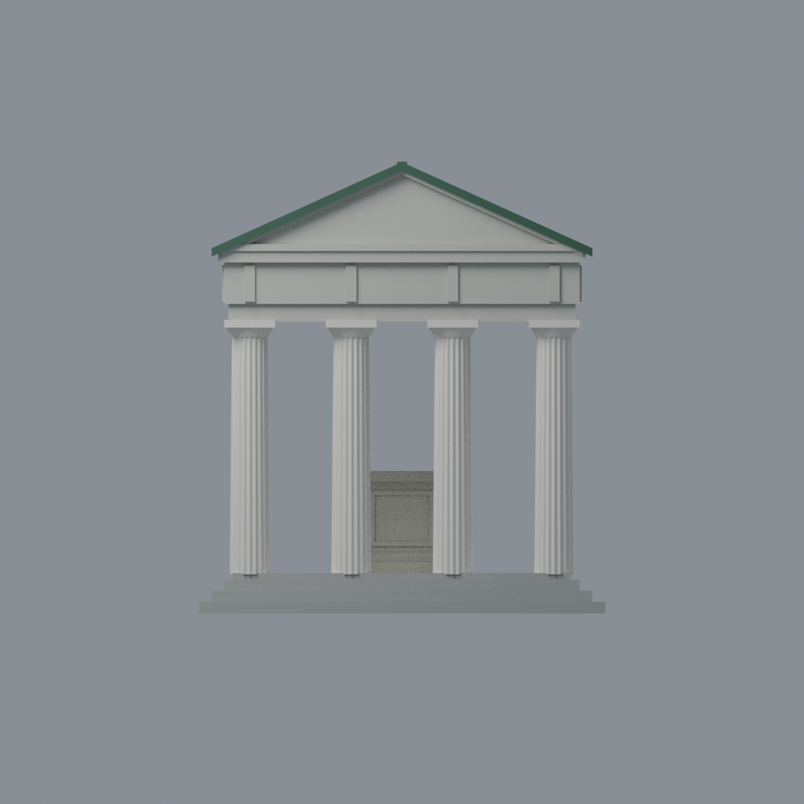
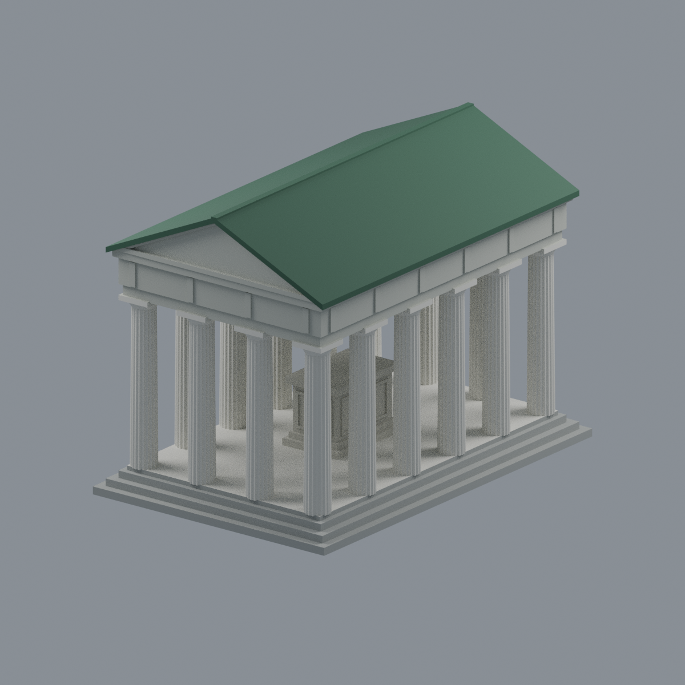
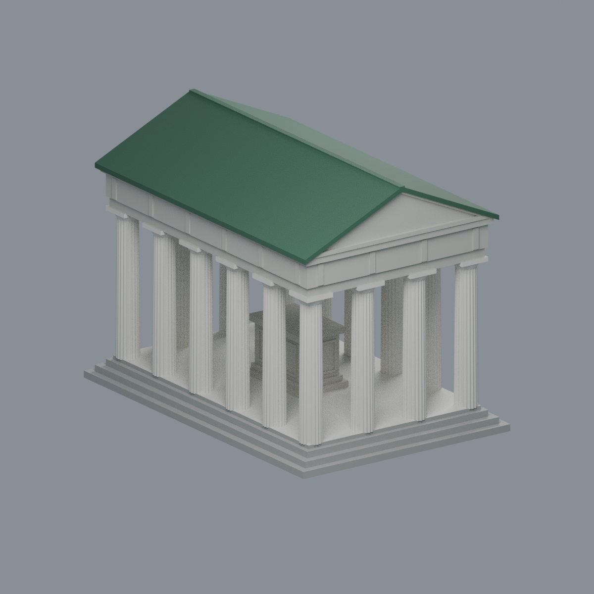

# 國立臺灣大學｜傅園斯年堂

**2009–2011 公開照片歷史完整外觀近似**，非2026現況測繪。短4長6、角柱共用共16柱的矩形柱廊；雙坡綠屋頂、前後三角山牆、三階平台與中央矩形紀念墓座。


| 檔案 | 用途 |
|---|---|
| [model.stl](model.stl) | 單體幾何，無色彩 |
| [model.3mf](model.3mf) | 5材質逐面色彩，可編輯；非多色列印機映射 |
| [scene.blend](scene.blend) | 相同三角網格、材質、相機燈光，可直接編輯 |
| [build_model.py](build_model.py) | 可重建幾何與3MF |
| [SOURCES.md](SOURCES.md) | 來源、年代、觀察與省略 |
| [QA.md](QA.md) | 原始拓樸、截面、薄特徵及支撐限制 |

## 預覽
| 正面 | 背斜 |
|---|---|
|  |  |
| 頂面 | 左前斜 |
|  |  |

## 比例與限制
模型約96×144×106.8mm，未取得實測尺寸，沒有保證比例尺。後立面局部遮擋；精細盾紋雕花、文字、瓦片數與園區方尖碑／水池皆省略。不是傅鐘模型，也不是整座傅園。

**未實體試印，不是免支撐模型。** 雖然原始網格拓樸通過，屋簷橫切仍有薄片警告，白天花與楣梁存在大跨度懸空；須在切片器評估方向、支撐、縮放或分件，不保證FFF可印或強度。

## 重建與核對
```sh
python build_model.py
python qa_model.py
python check_features.py
blender -b --threads 4 --python-exit-code 1 --python render_model.py
blender -b --threads 4 --python-exit-code 1 --python verify_scene.py
blender -b --threads 4 --python-exit-code 1 --python verify_render.py
# verify_exchange.py 需 lib3mf SDK；BUILD_PYTHON 指向具建模依賴的 Python。
python verify_package.py
```
重建依賴列於requirements.txt。5張1200px圖片由實際交付3MF三角面、CPU Cycles固定種子渲染，不使用參考照片貼圖或AI外觀替代。

授權見[LICENSE](LICENSE)，不涵蓋外部來源照片。
