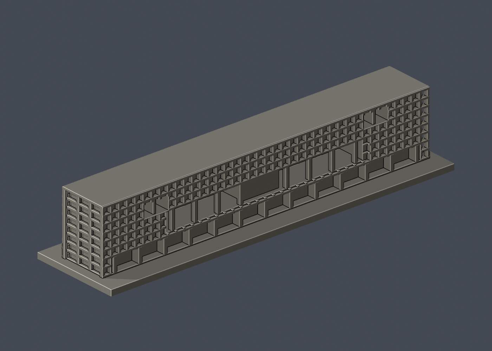

# 國立臺灣大學 社會科學院主棟

## 模型預覽

| 模型預覽 | 模型預覽 | 模型預覽 |
| :---: | :---: | :---: |
| 正面  | 背面  |  |

[返回校區圖鑑](../../README.md) · [返回臺大總圖鑑](../../../README.md)

## 實際 STL 正面與背面

[下載 STL](model.stl) · [Blender 場景](scene.blend) · [參數化來源](build_model.py) · [驗證結果](validation.json)

本件新增closed/valid與薄篩結果見本資料夾valid-sections.json、thin-feature-check.json。

範圍：校總區E11主棟，包括介宙館、頤賢館所在的長條主樓及中央外部穿堂。低層辜振甫紀念圖書館閱覽廳不在本件，不能稱整個社科院完成。依2013官方落成數據及2017/2018攝影者公開外觀，非2026現況測繪。

## 比例與簡化
官方主棟東西長168m、南北寬22.3m、高31.2m；本體採142×18.85×26.37mm，約1:1183。底座及加粗外格網另加，成品最長150mm，整體150×38×29mm。不能與其他模型共同比例拼接。

八層長條量體、中央大開口與外立柱、兩側錯層大開口有多角度照片支持。前後外格網和短端格柵簡化為粗框及淺槽；40格為視覺近似，沒有逐扇窗精測。無屋頂機電或室內配置推造。未知細節省略。中央會議量體只表達穿堂可見外部形狀。

## 列印
底座朝下，建議先以0.4mm噴嘴和0.2mm層高預覽。附牆外直框1mm、橫板0.8mm、主要開口立柱1.4×1.6mm，為列印加粗。大開口約8mm高、相鄰柱跨距約8.6mm，頂部與屋緣需要支撐/橋接評估；深穿堂須確認支撐可移除。不保證免支撐。

原STL法向、單一連通封閉表面、邊與頂點流形、正體積、150mm、確定性重建及Blender對應均驗證。145個0.2mm截面closed/valid；1mm抽樣0.8mm參考opening薄篩沒有超1%警示，最大約0.9896%仍不等於所有細節皆可印。這些是幾何檢查，未使用真正切片器或實體試印。

## 公開證據
- [臺大2013落成校訊，主棟尺寸/分段命名](https://sec.ntu.edu.tw/epaper/article.asp?num=1136&sn=11622)
- [社會科學院官方介紹](https://coss.ntu.edu.tw/intro.html)
- [Ikue Yamada建築攝影頁，2017/2018參訪](https://architecture-tour.com/world/taiwan/national-taiwan-university-college-of-social-sciences/)，實看image1/7/11/14主立面、image40短端、image41反側。
- [主立面照片](https://architecture-tour.com/image/world-taiwan-national-taiwan-university-college-of-social-sciences_image11.jpg)；[短端](https://architecture-tour.com/image/world-taiwan-national-taiwan-university-college-of-social-sciences_image40.jpg)；[反側](https://architecture-tour.com/image/world-taiwan-national-taiwan-university-college-of-social-sciences_image41.jpg)
- [2026-08-17官方索引](https://cpo.ntu.edu.tw/map/C_01_list.pdf)，E11為複合體索引，一筆不等於本件已覆蓋全區。

來源照片不重新散布，previews只有實際STL渲染。低閱覽廳雖有屋頂公開照，88單元完整排布仍欠充分資料，另列缺口。

## 重建
使用requirements.txt所列依賴執行python build_model.py，Blender 4.3.2+執行blender -b -P render_preview.py。python validate_model.py驗證原STL/重建/場景。check_valid_sections.py與thin_canonical_v2.py接受model.stl及輸出資料夾兩個參數。source-model-comparison.json載來源與模型對照。
