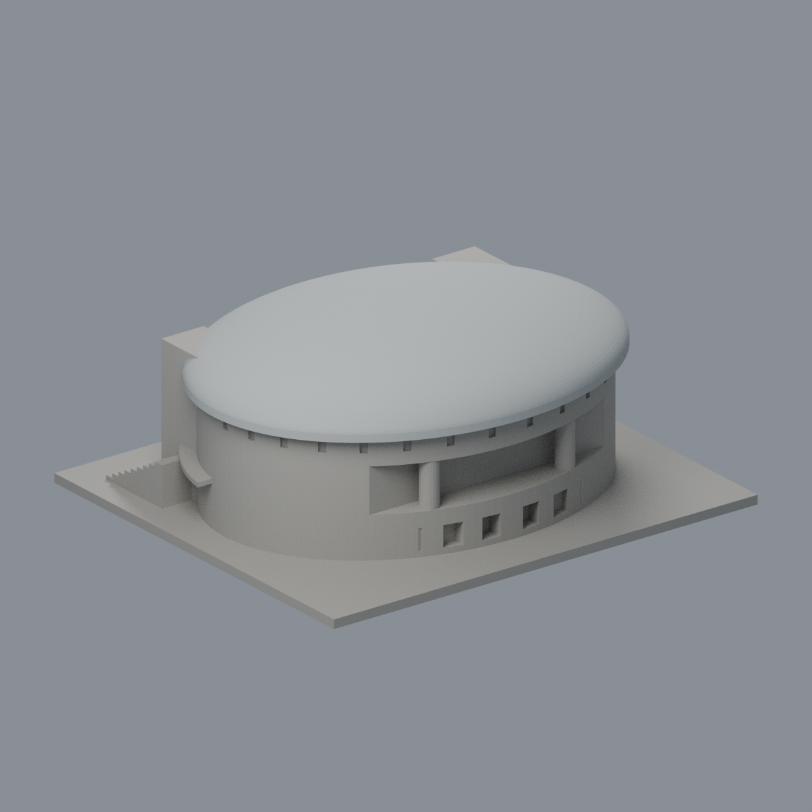
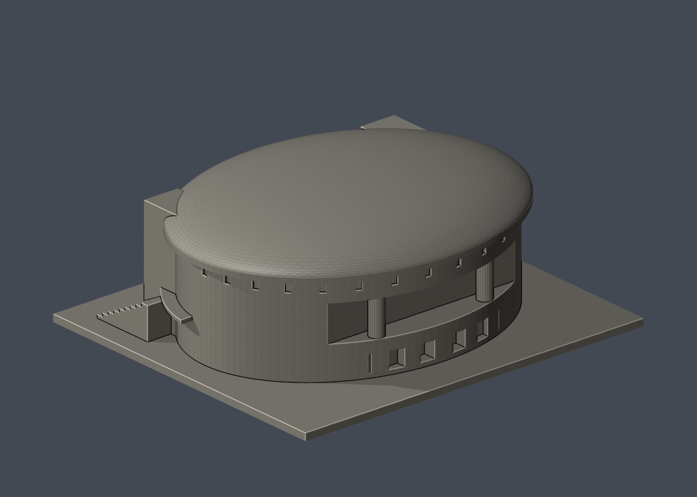

# 國立臺灣大學 綜合體育館

## 模型預覽

| 模型預覽 | 模型預覽 | 模型預覽 |
| :---: | :---: | :---: |
| 正面與來源支持區域  | 來源支持金屬屋蓋／後牆中性  |  |

## 4 材質外觀版（2026-10-21）

[來源界線與四視角](appearance/README.md) · [表面色 3MF](appearance/ntusports-appearance.3mf) · [可編輯場景](appearance/scene.blend)

依官方前後照片，只處理原金屬屋蓋與兩入口塔玻璃／金屬橫條；以原凸包支撐平面定位 Boolean 截面，粉褐牆帶、圓窗格柵、底層入口和後圓柱混面中性，不新增屋頂桁架。 原 STL 與歷史 QA 不變；這是外觀改善，不是新增幾何。[原單色正面](previews/front.png)／[原單色背面](previews/rear.png)

| 模型預覽 | 模型預覽 | 模型預覽 |
| :---: | :---: | :---: |
| 原單色正面  | 原單色背面  |  |

官方索引代碼 N5。公開外觀近似模型，非測繪或BIM。

## 範圍與比例
公開前方及運動場側外觀近似；橢圓平面、深度、圓頂弧度為目測估計。未逐根復原屋頂鋼桁架，未重建室內球場。

保留辨識特徵：橢圓量體、低圓頂、雙排圓窗、兩座遮陽側塔、入口弧形雨棚、兩側外梯，以及運動場側退縮開口與柱體。

尺寸 [150.0, 132.0, 56.0] mm，含底座最長150 mm。各館獨立比例，不是可拼接的共同尺度校園沙盤。尺寸、厚度、窗距均為照片目測和列印簡化，不是原建物實測。

## 列印
- 底座向下，毫米單位。參考起點：0.4 mm噴嘴、0.16–0.2 mm層高、3道外牆、15–20%填充。須依自己的切片器調整。
- 圓頂外緣、入口雨棚、背面退縮區頂緣均有懸垂，建議局部支撐；圓窗是有背牆淺凹。
- 新增細浮雕名義最小約0.9 mm；這不是全模型最小壁厚的測量結果。零碎設備、文字招牌、樹木、電線及細緻裝飾沒有加入。
- 門窗背牆與實心量體避免隱藏內殼；實際填充由切片器決定。
- 未實際列印；未用PrusaSlicer、Cura等生成工具路徑。不宣稱無支撐或無風險可印。

## 驗證與檔案
- model.stl、model.obj；scene.blend是由實際STL匯入的可編修網格。
- build_model.py為獨立參數來源；Python3.12，依requirements.txt裝依賴後執行python build_model.py。
- Blender4.3.2：blender -b -t 2 -P render_preview.py。previews/front.png、rear.png、elevation.png均直接渲染交付STL。
- python validate_model.py：原始法向、水密、流形邊／頂點、單一連通表面、無分離封閉內殼、正體積、150mm、獨立重建SHA256及已儲存Blender/STL三角幾何一致性。結果validation.json。
- python check_layers.py：每0.2mm水平截面幾何檢查，共 280 層，所抽樣截面全部閉合。首層採z=0.071mm避免重合平面退化，非實際列印首層設定。
- layer-check.json另記向下超45度面積指標與各層輪廓；它不是切片器、最小壁厚測試或實體試印。閉合截面不保證擠出連續、橋接、支撐可拆、床面附著或局部細節可印。
- SHA256SUMS可核對檔案；更改參數後需重建、重繪、重驗證。

## 公開來源
查閱及圖像像素檢視：2026-10-13。來源照片未隨檔重新散布。
- [臺大體育室：館前廣場及前方照片](https://rent.pe.ntu.edu.tw/venues/?K=92)
- [實際檢視前方斜角照片](https://rent.pe.ntu.edu.tw/udf/1649339932082075800.jpg)
- [臺大訪客中心：綜合體育館](https://visitorcenter.ntu.edu.tw/News_Content_n_74842_s_81632.html)
- [實際檢視運動場側照片](https://visitorcenter.ntu.edu.tw/001/Upload/photoedittemp/c759fce3-236a-466a-be13-ff46c0ad0321.jpg)
- [臺大官方建物索引，檢索標題2026-08-17](https://cpo.ntu.edu.tw/map/C_01_list.pdf)

照片版權屬原權利人；沒有轉授原建築設計或照片權利。不同拍攝日期不等於已核實目前全部外觀。
