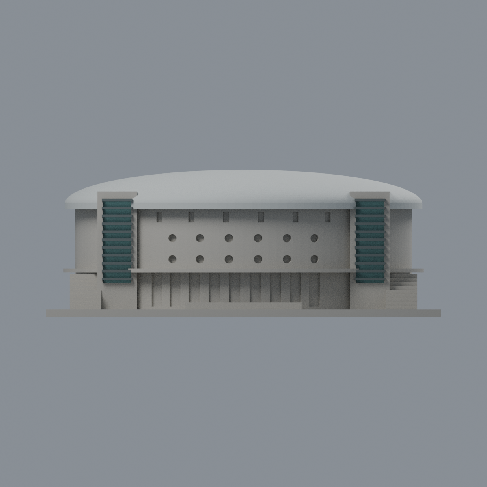
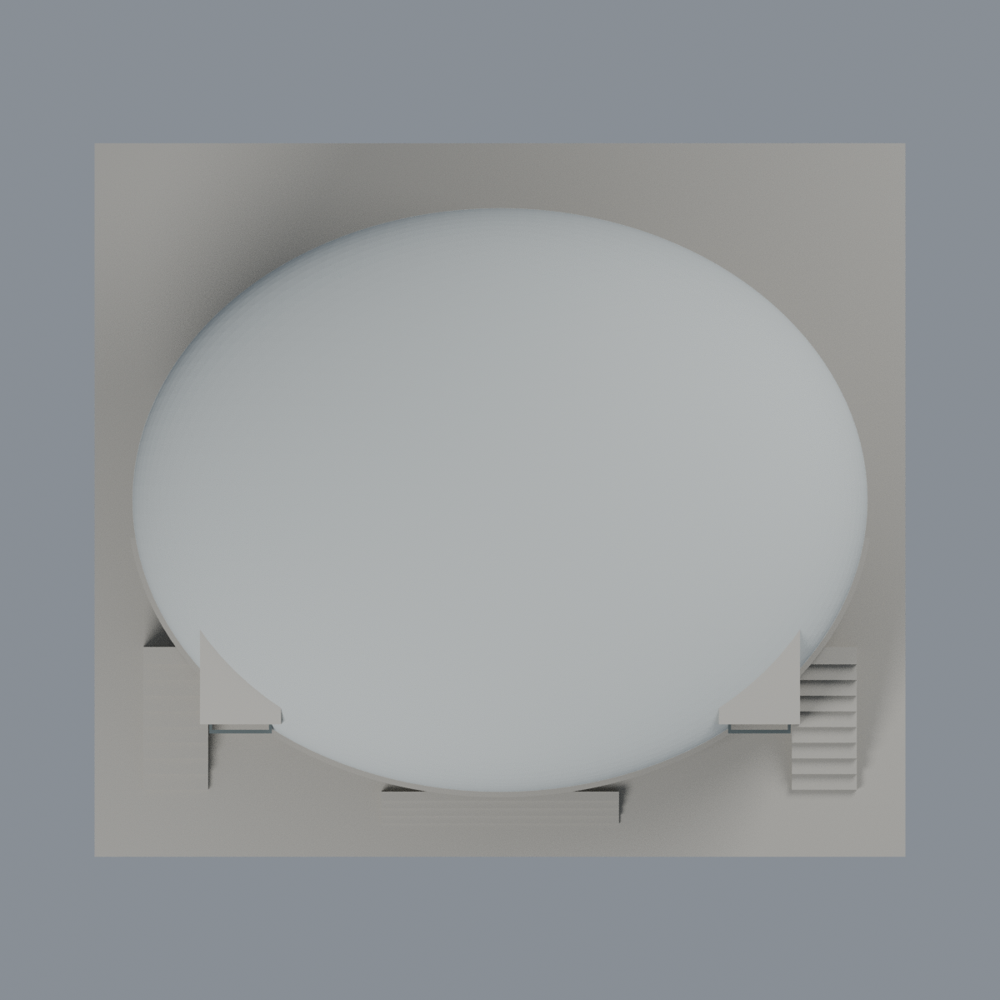

# 臺大綜合體育館屋蓋與入口塔限定配色：四材質外觀版

沿用原 **9,236 三角面／4,572 頂點**，不改原 STL 位元、座標、面序或幾何；這是既有模型外觀改版，不增加模型包數。

| 正面 | 來源支持金屬屋蓋／後牆中性 |
|---|---|
|  |  |
|  |  |

[表面色 3MF](ntusports-appearance.3mf) · [可編輯 Blender](scene.blend) · [材質色表](palette.json) · [逐面指派與依據](face-materials.json) · [原 STL](../model.stl)

## 來源與配色邊界

親看臺大[體育室場館正面照](https://rent.pe.ntu.edu.tw/venues/?K=92)與[遊客中心後側照](https://visitorcenter.ntu.edu.tw/News_Content_n_74842_s_81632.html)，核對原預覽、生成器與 STL。[精確 URL、SHA 與日期檢查](qa/source-review.json)。正面照片 EXIF 是空白冒號佔位，不是有效日期，拍攝時間未知；後照 nested Original／Modified 均 2012-03-15 14:41:02。日期屬未獨立鑑定的檔案中繼資料，不推斷網址數字為攝影日期，也不宣稱 2026 現況。完整原照片私用，不入包。

- 原大屋蓋、外凸金屬簷圈及底面以銀灰代理；不烘焙天空藍或簷底深影。保留原簡化橢球外形，不補來源可見而原網格缺少的白桁架／屋面縫。
- 屋蓋原面逐一驗證位於原 sphere(1,128) 經縮放／平移的凸包支撐平面，三頂點均在凸包內。4,152 面包含 Boolean 截出的交界三角，避免只測解析橢球等式而漏色。簷圈以原橢圓柱凸包同法驗證 831 面；其中 1 面又與左塔金屬條底面重合，材料歸屬未決，保留中性，最終銀灰 4,982 面。容差 0.0001 mm，未改原面。
- 兩前入口塔背板各 2 原面採低飽和藍綠玻璃代理；11 條原外凸橫條／塔按原盒表面採深灰金屬。上述重合面中性後，金屬條合計 400 面，不把它們染成玻璃或擴張到石牆。
- 主牆實景粉牆與褐帶／基腳未在原網格分界，整面中性。圓窗有未刻出的格柵／窗框，不全塗藍；底層入口凹背混窗裙與玻璃、後側兩圓柱混銀帶與玻璃、低窗與上部小天窗也保守中性。
- 中性不是實景灰色還原。限定屋蓋與入口塔材料研究，不宣稱全立面還原；不補字樣、柵架、草地或設備。原 STL 位元、三角座標／面序和歷史 QA 全保留，未做實體列印測試。

[原幾何與歷史來源限制](../README.md)

## 重建與核驗

安裝 [依賴](source/requirements.txt)，Blender 使用 4.3.2。由本資料夾上層提供原 model.stl：

1. `python appearance/source/build_appearance.py`
2. `python appearance/source/verify_exchange.py`
3. `blender -b -t 3 --python-exit-code 1 -P appearance/source/render_appearance.py`
4. `blender -b -t 3 --python-exit-code 1 -P appearance/source/verify_scene.py`

[獨立重建 ZIP](rebuild-source.zip)含原 STL、四支程式及依賴，不含第三方照片；不取代原建模腳本。[逐檔 SHA256](SHA256SUMS)

[交換／拓撲 QA](qa/exchange-validation.json)核對原座標與面序、全部面材質、單連通、有向水密邊、頂點 link 單環、正體積與零退化／重複面；lib3mf 嚴格讀取零警告，實際編輯單材質再存讀，其他材質及面指派不變。SDK 六位小數量化誤差另列。

[Blender 存讀與編輯](qa/scene-validation.json) · [渲染記錄](qa/render-manifest.json) · [獨立重建](qa/rebuild-validation.json)

## 製造限制照舊

尺寸仍為 150 × 132 × 56 mm；原 STL、建模程式、場景及歷史 QA 保留。原層檢與薄特徵檢查本次未重跑，不能由材質 QA 代替。

3MF 是同一網格的表面色，不是各材質各自封閉的分色實體、切片專案、噴頭映射或 G-code。切片 GUI、多材料路徑與實體列印未測；柱頭、屋簷、窗框及薄邊仍須評估材料、支撐及拆除風險，沒有保證可印或免支撐。
