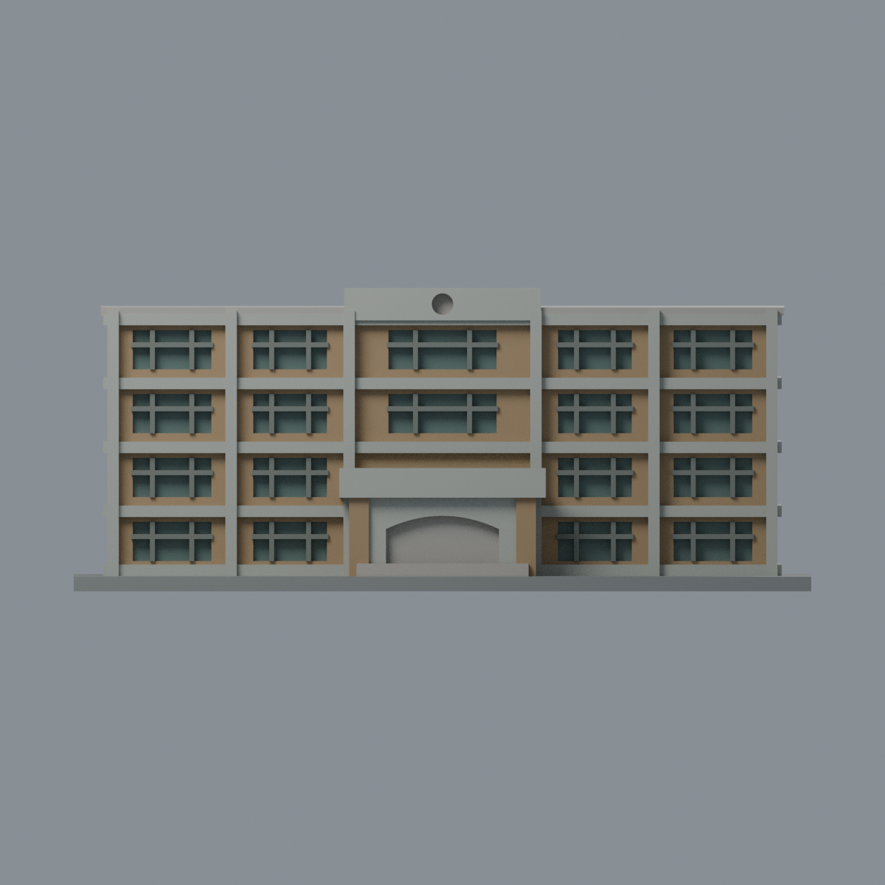
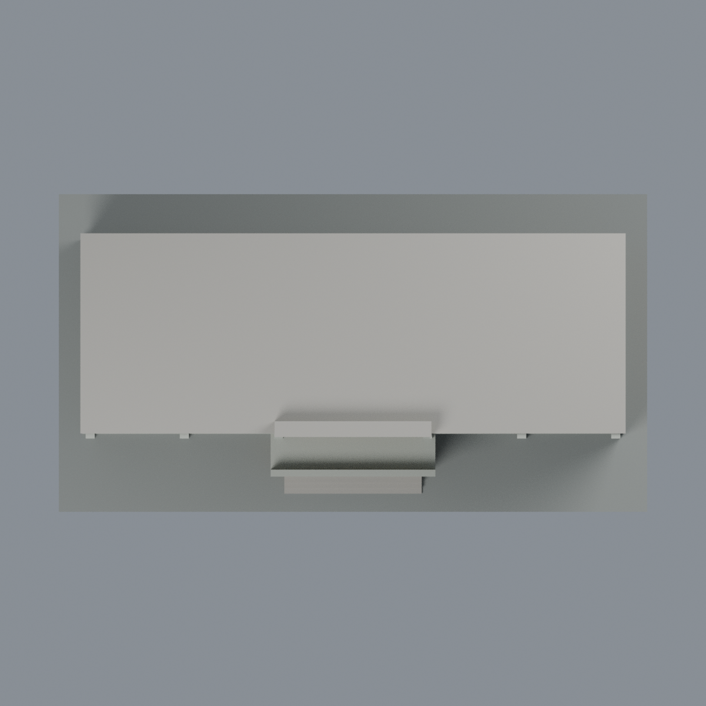

# 臺大知武館：六材質外觀版

沿用原 **3,982 三角面／1,813 頂點**，不改原 STL 位元、座標、面序或幾何；這是既有模型外觀改版，不增加模型包數。

| 模型預覽 | 模型預覽 | 模型預覽 |
| :---: | :---: | :---: |
| 正面  | 背面保持中性  |  |
|  |  |  |

[表面色 3MF](tomatake-appearance.3mf) · [可編輯 Blender](scene.blend) · [材質色表](palette.json) · [逐面指派與依據](face-materials.json) · [原 STL](../model.stl)

## 來源與配色邊界

親自查看臺大官方影像庫的 [IMG_5969 正面](https://homepage.ntu.edu.tw/~cpo/2010photo/E/E22/IMG_5969.JPG) 與 [IMG_5975 右斜面](https://homepage.ntu.edu.tw/~cpo/2010photo/E/E22/IMG_5975.JPG)。這是 2010 年典藏目錄的歷史照片；檔內 EXIF 記錄見來源 QA，拍攝日期未獨立核實，不宣稱 2026 現況。來源照片不隨包散布。

- 本件為知武館，不是旁邊舊農機館。正面與照片右端（模型 x 正側）的原牆面赭棕磚色；已有水平帶、正面連續柱帶為淺灰色。未觀察的左端保持中性，不把右端色彩直接鏡像。
- 原窗凹背低彩度灰綠玻璃，既有窗梃深灰色。保留原厚化與簡化窗列，不加空調、百葉、反光圖案或門牌。
- 只將原入口外凸兩柱的可分離面設為磚色，連體拱形額面、頂板與前實心女兒牆灰色；連體拱腹兩側未細分磚／石界線，不另畫對角色斑。入口原淺凹背保持中性，不假裝補出照片玻璃門；灰色曲面範圍只依原面域，非精確實景砌體分界。
- 原中央頂冠立面灰色；小圓凹口中性，不添鐘面或標誌。屋頂平面、背面及左側原條帶均保持中性。展示底板與原階梯不當作現場鋪面材質證據。
- 照片有雨痕與陰影，本版不把它們畫成黑色材料。色值未經色卡校準；原尺寸、幾何和歷史 QA 均不改，並非測繪或完整現況模型。

[原幾何與來源界線](../README.md) · [本次來源覆核](qa/source-review.json)

## 重建與核驗

安裝 [依賴](source/requirements.txt)，Blender 使用 4.3.2。由本資料夾上層提供原 model.stl：

1. `python appearance/source/build_appearance.py`
2. `python appearance/source/verify_exchange.py`
3. `blender -b -t 3 --python-exit-code 1 -P appearance/source/render_appearance.py`
4. `blender -b -t 3 --python-exit-code 1 -P appearance/source/verify_scene.py`

[獨立重建 ZIP](rebuild-source.zip)含原 STL、四支程式及依賴，不含第三方照片；不取代原建模腳本。[逐檔 SHA256](SHA256SUMS)

[交換／拓撲 QA](qa/exchange-validation.json)核對原座標與面序、全部面材質、單連通、有向水密邊、頂點 link 單環、正體積與零退化／重複面；lib3mf 嚴格讀取零警告，實際編輯單材質再存讀，其他材質及面指派不變。SDK 六位小數量化誤差另列。

[Blender 存讀與編輯](qa/scene-validation.json) · [渲染記錄](qa/render-manifest.json) · [獨立重建](qa/rebuild-validation.json)

## 製造限制照舊

尺寸仍為 150 × 81 × 61.5 mm；原 STL、建模程式、場景及歷史 QA 保留。原層檢與薄特徵檢查本次未重跑，不能由材質 QA 代替。

3MF 是同一網格的表面色，不是六個封閉分色實體、切片專案、噴頭映射或 G-code。切片 GUI、多材料路徑與實體列印未測；柱頭、屋簷、窗框及薄邊仍須評估材料、支撐及拆除風險，沒有保證可印或免支撐。
