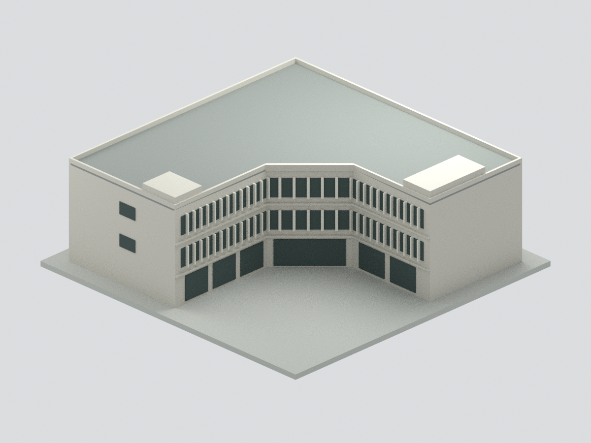
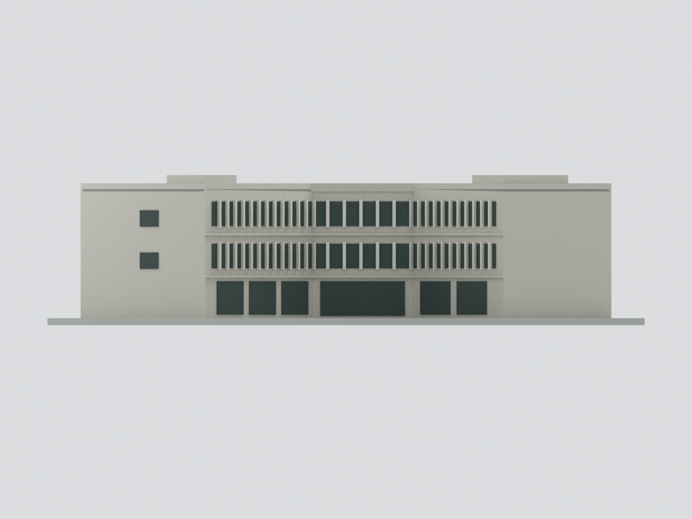
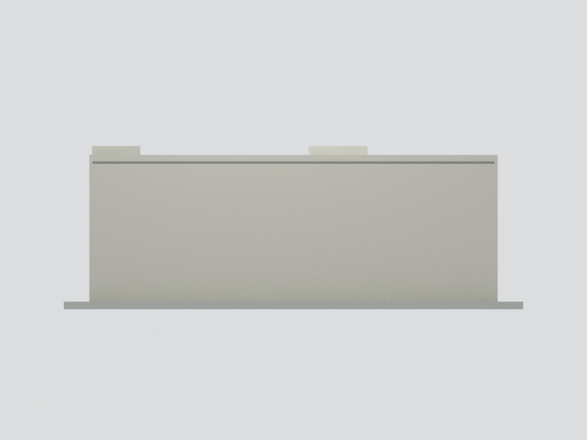
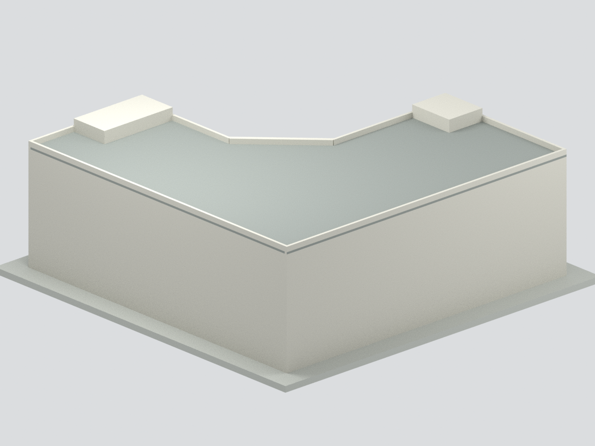
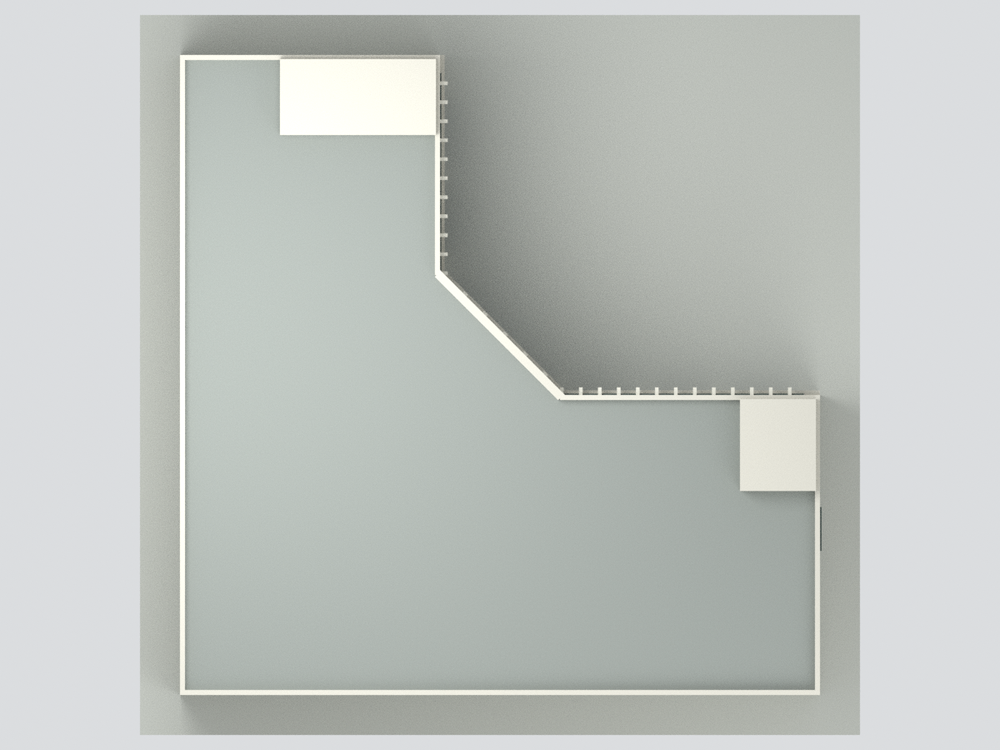
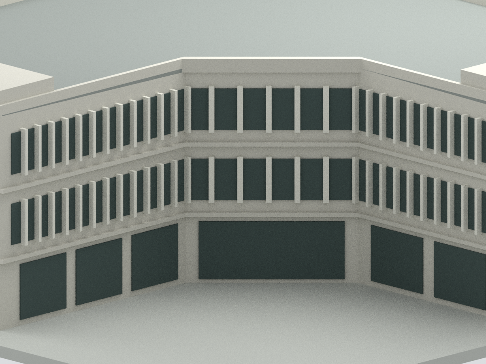

# 臺大小福樓：1981–1986 年歷史外觀簡化模型

## 模型預覽

以下為本模型實際網格的六視圖渲染，不是來源照片；歷史範圍與近似限制請見下文。

| 前側 | 正立面 | 側面 |
| --- | --- | --- |
|  |  |  |
| 背側 | 俯視 | 入口細節 |
|  |  |  |

**外觀展示近似：非實測、非2026現況或試印合格宣告。**

以臺大官方校友刊刊載之 1981 年竣工平面和加梯前老照片建立。保留三層 L 形主量體、內凹斜角、庭院面上下不同的開口節奏、豎肋、平屋頂、端部較高體量。主樓約 32 × 32 × 12.2 名義公尺，全部尺寸為平面比例及照片推估，**沒有可靠可讀尺寸標註**；輸出採每名義公尺 5 mm，連展示底座 180 × 180 × 64 mm，不應解讀為校準的 1:200 測量模型。

## 年代與未知
- 1981 原始平面搭配初期照片；1987 鋼梯、2012 RC 梯／電梯、近年植被、店招均不建入。
- 後方兩外立面的窗門缺乏可辨證據，留作未細化實體表面；**不是確認原樓為盲牆**。
- 樓梯間上突體量位置由平面推測、高度估計。屋頂設備未知而省略。
- 窗數、顏色、肋間距、樓層高度與入口均屬近似；玻璃使用實色面，沒有室內、地下室、結構工程或真實地形。
- 底座是模型支撐，不是實際廣場；1981 平面邊界可能含樓板／簷投影，不能視作逐層精準實牆。

## 檔案
`model.stl` 單色；`model.3mf` 五種基礎材質索引；`scene.blend` 可編輯隱藏原始部件與可見合併體；`previews/` 六張實際渲染。列印請用合併模型，不要把重疊的隱藏構件一起列印。細肋與懸挑仍須依噴嘴、材料與方向試印；幾何封閉不保證可直接列印。

證據見 SOURCES.md、parameters-evidence.json；重建見 REBUILD.md；完整性見 QA.json、BLEND-QA.json、manifest.json。參考照片和掃描圖不在交付封包內。

## 模型下載

[STL](model.stl) · [5色3MF](model.3mf) · [Blender場景](scene.blend) · [來源與限制](SOURCES.md) · [重建](REBUILD.md) · [返回校區](../../README.md)
