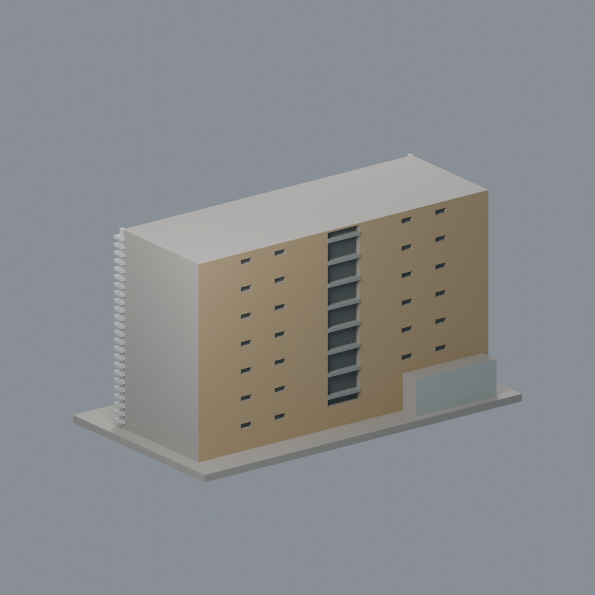
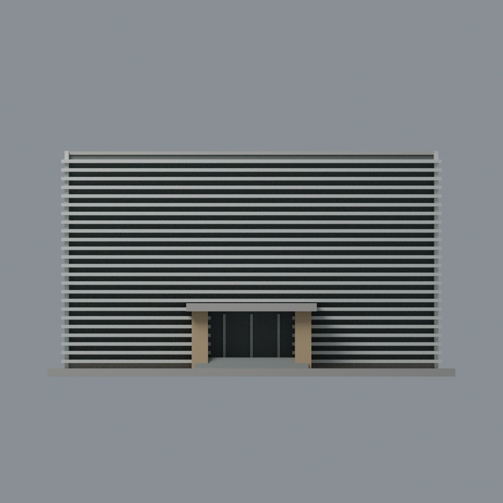
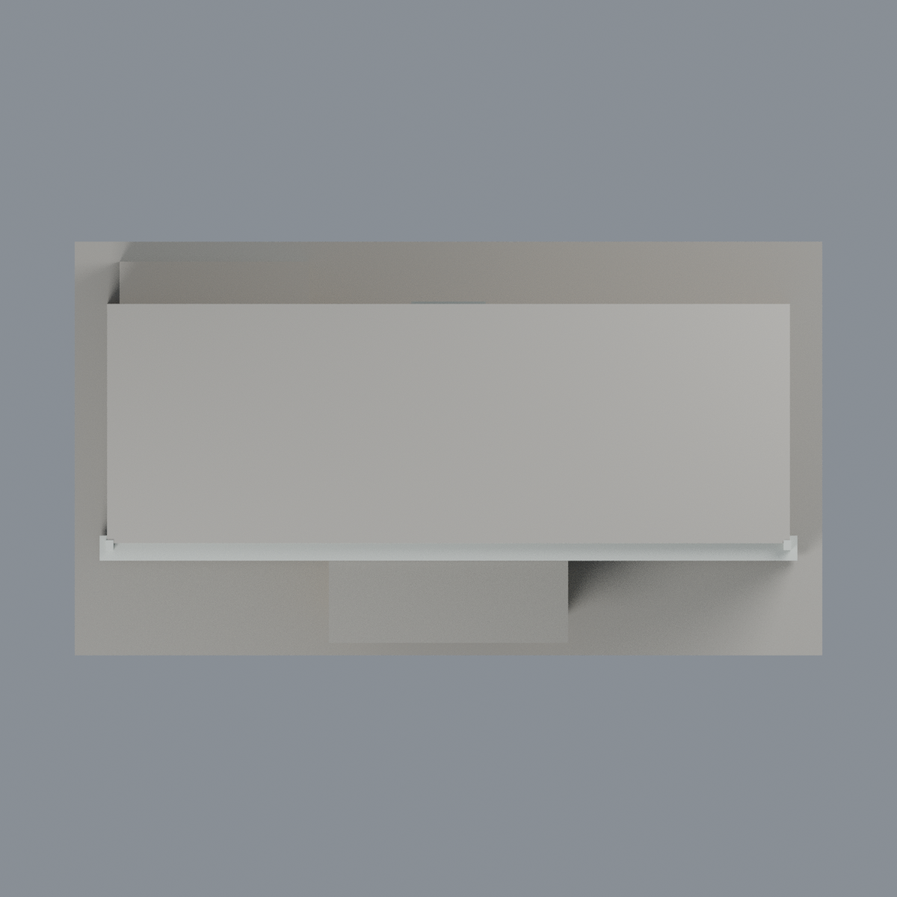

# 臺大嚴慶齡工業研究中心：七材質外觀版

沿用原 **3,410 三角面／1,707 頂點**，不改原 STL 位元、座標、面序或幾何；這是既有模型外觀改版，不增加模型包數。

| 正面 | 來源支持後塔與樓梯 |
|---|---|
|  |  |
|  |  |

[表面色 3MF](ntuyen-appearance.3mf) · [可編輯 Blender](scene.blend) · [材質色表](palette.json) · [逐面指派與依據](face-materials.json) · [原 STL](../model.stl)

## 來源與配色邊界

親自核對臺大官方 2010 照片 [5982 前左](https://homepage.ntu.edu.tw/~cpo/2010photo/E/E63/IMG_5982.JPG)、[5983 後面](https://homepage.ntu.edu.tw/~cpo/2010photo/E/E63/IMG_5983.JPG)、[5984 前右](https://homepage.ntu.edu.tw/~cpo/2010photo/E/E63/IMG_5984.JPG)。EXIF DateTimeOriginal 均記 2010-10-16，精確時間存於[來源覆核](qa/source-review.json)，時區與時鐘未獨立核實，不以修改日或歷史照片宣稱 2026 現況。原照研究私用，不入包。

- 正面既有密集水平遮陽片銀白，各片底面及上緣僅同構件材料延伸。**片間深凹是包含窗／實牆／遮蔽的中性陰影代理，不能當成整面藍玻璃帷幕**。
- 來源明見的門廊兩粗柱與後側雙塔實牆暖赭色，後側離散小窗低彩度深灰；中央樓梯深凹不是玻璃，原平台灰混凝土。
- 門棚邊實景有細白／赭色條帶但原盒狀面未分色界，整棚中性，未冒充精確還原；入口深背也只作暗中性代理，原窄框銀色，不聲稱完整帷幕。
- 後附屬低屋僅來源可見後面淺灰金屬代理，不加波紋或設備；未見屋頂、窄側面及其他未知面中性。台階灰色，無分面地坪不塗草綠。不加白色字牌或虛構文字。
- 保持原 STL 位元、面序、腳本、場景與歷史 QA，不新增切面、棟數或實體列印成功宣稱。

[原幾何與歷史來源限制](../README.zh-TW.md)

## 重建與核驗

安裝 [依賴](source/requirements.txt)，Blender 使用 4.3.2。由本資料夾上層提供原 model.stl：

1. `python appearance/source/build_appearance.py`
2. `python appearance/source/verify_exchange.py`
3. `blender -b -t 3 --python-exit-code 1 -P appearance/source/render_appearance.py`
4. `blender -b -t 3 --python-exit-code 1 -P appearance/source/verify_scene.py`

[獨立重建 ZIP](rebuild-source.zip)含原 STL、四支程式及依賴，不含第三方照片；不取代原建模腳本。[逐檔 SHA256](SHA256SUMS)

[交換／拓撲 QA](qa/exchange-validation.json)核對原座標與面序、全部面材質、單連通、有向水密邊、頂點 link 單環、正體積與零退化／重複面；lib3mf 嚴格讀取零警告，實際編輯單材質再存讀，其他材質及面指派不變。SDK 六位小數量化誤差另列。

[Blender 存讀與編輯](qa/scene-validation.json) · [渲染記錄](qa/render-manifest.json) · [獨立重建](qa/rebuild-validation.json)

## 製造限制照舊

尺寸仍為 150 × 83 × 83 mm；原 STL、建模程式、場景及歷史 QA 保留。原層檢與薄特徵檢查本次未重跑，不能由材質 QA 代替。

3MF 是同一網格的表面色，不是各材質各自封閉的分色實體、切片專案、噴頭映射或 G-code。切片 GUI、多材料路徑與實體列印未測；柱頭、屋簷、窗框及薄邊仍須評估材料、支撐及拆除風險，沒有保證可印或免支撐。
