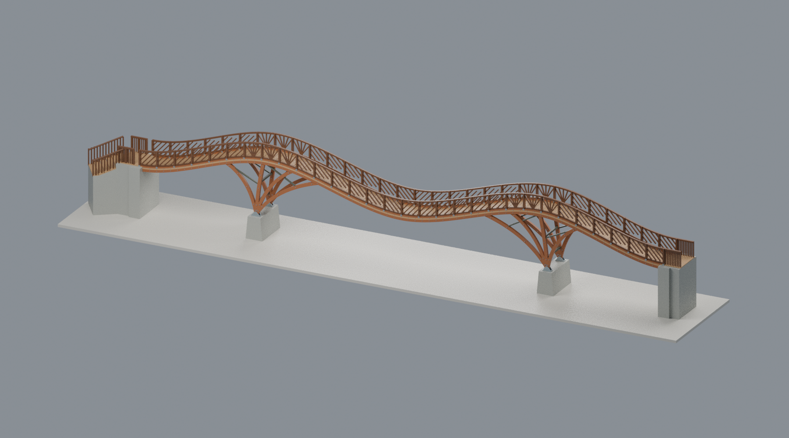

# 國立臺灣大學｜溪頭實驗林（校外基地）

**溪頭自然教育園區／臺大實驗林校外場域，不是臺北校總區；本分類不改寫教育部手冊的官方校區名錄。**

目前 **2件**，各為明示範圍的完整外觀近似，非2026現況調查或整座園區完成。

- **樹之歌木屋**：2019報導竣工，42㎡單棟；不含鄰接服務中心／大學樓或神木步道。照片日期未知，上傳路徑2022不能當拍攝日。尺寸推估、後編織／支腳簡化、平滑屋面，內拱天花與斜井內段省略。
- **銀杏橋**：2017竣工完整橋梁，主橋36m＝8＋20＋8m、雙墩四扇每扇四主肋、雙峰中央下凹橋面，含兩岸橋台與左岸轉折階梯；不是2014尖角40m方案。名義1:120僅主橋長寬，曲率、高度、截面、階數及細欄數推估；施工／啟用日期與作品頁／講義年代不當逐張拍攝日。

兩件均未實印、不保證免支撐；銀杏橋狹長細欄、橋底空間與懸挑尤其需要支撐及線寬試印評估。

| 建築模型 | 建築模型 | 建築模型 |
| :---: | :---: | :---: |
|  [樹之歌（2019完整外觀近似）](buildings/ntu-xitou-tree-song/README.md) |  **[銀杏橋（2017竣工外觀近似）](buildings/ntu-xitou-ginkgo-bridge-2017/README.md)** |  |

[回臺大主圖鑑](../README.md) · [來源與範圍](buildings/ntu-xitou-tree-song/SOURCES.md)
