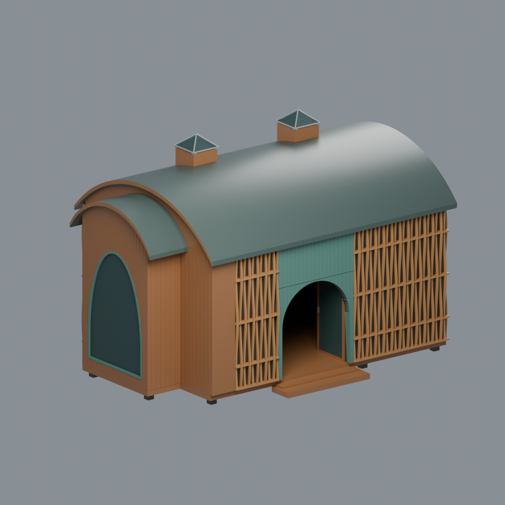

# 臺灣大學溪頭實驗林｜樹之歌木屋（2019）

**42㎡單棟展示木屋的完整外觀近似；臺大校外溪頭實驗林，不是臺北校總區，也不是溪頭全園區。** 依2019報導竣工資料、設計者提供的照片與圖紙，以及實際承包商照片重建。所有尺寸均為比例推估，沒有現場測繪；個別照片日期未知，不宣稱2026現況。



## 已保留的完整外部構成

- 矩形主屋＋單一短端凸窗盒，架高木地板、小入口踏階與簡化可見支腳；沒有另加巨大景觀底座。
- **一個連續淺弧桶頂**，凸窗另有較窄、較低的短弧頂及木質弧形封邊。室內兩個不同高度的拱頂不是兩個外部屋頂。
- 兩個偏後的方形高採光井，井內保留空氣，頂端有四坡玻璃帽與金屬斜邊。
- 長正面偏左的綠色面板、半圓拱洞；**兩扇矩形木框玻璃門位於拱洞後，向內開約90°**。不是四分之一圓門葉，也不是省掉門的永久開洞。
- 突出短端的高窄拱形固定玻璃窗、綠色內框、下窗臺及兩側退縮肩牆；不是第二個入口。
- 不開窗的後長牆和另一短端；正面與盲短端有彎曲直木條交錯橫檔的淺浮雕，後面圖案保守延伸。木條後有不透明牆，不是整棟穿孔格柵。
- 入口後是真正中空房間，保留簡化中央隔牆及前方通道，不是立即撞上實心填塊。

## 比例、狀態與簡化

顯示尺寸約 **170.10×117.50×114.13mm**，主平面144×100mm，凸窗約20×52mm。來源的42㎡只用作尺度級別參考，**不是精確1:100或可施工尺寸**。主平面長寬、凸窗比例依圖紙推估；沒有將圖片像素當成實測公尺。

採完成後綠色入口的2019報導狀態。施工照未漆綠、關閉玻璃門及膠帶，與完工照內開門是階段差別；本模型沒有混用施工膠帶、鷹架或自然木色入口。2022/12是圖片網址的上傳路徑，不能當成拍攝或竣工日期；29個來源JPEG均無EXIF拍攝日期。

木條數、彎曲幅度、板縫、後牆表面排列、支腳與門角度均簡化／推估。**瓦片紋理以平滑深綠灰屋面簡化**，不做微小瓦片凸起；室內不同高度的雙拱天花、斜採光管內段、燈具、展品、家具、空調與隱藏基礎省略。屋頂保留單一外殼，中空井用簡單垂直井段，不冒稱完整室內或結構施工BIM。

玻璃為有厚度的實體面。Blend／3MF以材質Alpha提示玻璃，**STL沒有顏色或透明度**；玻璃位置不能當作可穿越的幾何空氣。所有部件融合為一個表面連通網格，不是門可動、屋頂可拆的裝配套件；仍可編輯頂點、逐面材質或改生成參數。

鄰接服務中心、大學樓、神木、步道階梯、招牌、人物、樹木及地形都不屬於本棟，未混入。

## 列印風險

**未實印，不保證免支撐。** 架高地板、屋簷、拱洞、內開門、採光帽與薄木條存在懸挑、橋接或支撐拆除風險。全局0.2mm切層與局部0.8mm核心檢查的失敗項照實保留，不能因整棟水密就宣稱免支撐或所有細節可印。縮小會加劇薄件風險；請依設備、耗材、擺向自行切片與實印測試。[完整QA](QA.md)。

## 交付內容

| 檔案 | 用途 |
|---|---|
| `model.stl` | 毫米、單閉合連通網格，無色無透明度 |
| `model.3mf` | 相同三角、7種逐面材質；strict讀取與真實材質edit-save-reopen |
| `scene.blend` | 可編輯幾何／材質、前相機與燈光；無原圖貼圖或內嵌腳本 |
| `build_model.py`、`render_model.py` | 原始參數建模、實際交付mesh五視圖 |
| `mesh.json`、`palette.json` | 精確幾何／材質映射 |
| `qa_model.py`、`check_features.py`、`verify_*.py` | 原始拓樸、全局切層、局部薄件、空區與格式驗證 |
| `rebuild.py` | 隔離重建核心4檔＋5PNG並比較bytes |
| `QA.md`、`qa/`、`qa-*.json` | 數值證據、獨立來源終審、所有警告 |
| `SOURCES.md`、`sources.json` | 來源作者、日期、用途與私有原圖hash，不含原圖 |
| `SHA256SUMS` | 全包檔案SHA256 |

## 五個真實最終網格視圖

[入口／凸窗斜視](previews/front.png) · [盲後牆／盲短端](previews/rear.png) · [入口正立面](previews/elevation.png) · [俯視](previews/top.png) · [凸窗端斜視](previews/left_oblique.png)

全部由同一交付網格渲染，非原照片拼貼、AI概念圖或實印成品照片。

## 重建與驗證

Python3.12、Blender4.3.2驗證，依賴見`requirements.txt`，Blender需另裝。從模型目錄執行：

```bash
python build_model.py
python qa_model.py
python check_features.py
python verify_exchange.py
blender -b -t 8 --python-exit-code 1 --python render_model.py
blender -b -t 8 --python-exit-code 1 --python verify_scene.py
blender -b -t 8 --python-exit-code 1 --python verify_render.py
python rebuild.py --output ../independent-new --threads 8
python verify_package.py
```

`rebuild.py`要求新目錄；同環境CPU Cycles seed0、96 samples、無降噪，核心4檔及5PNG bytes一致。僅去除PNG文字／日期metadata，不改像素。Blend幾何材質另驗，不宣稱跨路徑Blend本體bytes一致；不同軟硬體版本也不保證圖像bytes相同。修改模型後需更新release、重跑QA及來源審查，不沿用舊hash。

[來源](SOURCES.md) · [QA](QA.md) · [原創產生物授權](LICENSE)。本包不含第三方原始照片、圖紙或裁圖。
