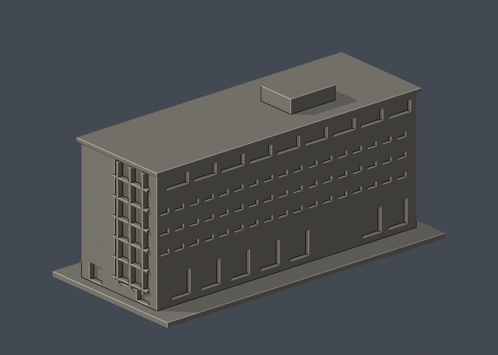

# 國立臺灣大學 碧禎館

## 模型預覽

| 模型預覽 | 模型預覽 | 模型預覽 |
| :---: | :---: | :---: |
| 正面  | 背面  |  |

[返回校區圖鑑](../../README.md) · [返回臺大總圖鑑](../../../README.md)

## 實際 STL 正面與背面

[下載 STL](model.stl) · [Blender 場景](scene.blend) · [參數化來源](build_model.py) · [驗證結果](validation.json)

[新增34件列印幾何補查與細節警示](../../../qa/printability-20261013/README.zh-TW.md)

校區：竹北校區。公開外觀近似模型，非測繪或BIM。

## 範圍與比例
以2015官方校務報告PDF第45–46頁（頁面印刷43–44頁）的四張公開外觀為主，其中一張明載2011攝影日期。保留主要獨立館體；地形高差、外部坡道擋土牆及旁側工務所木屋不包含。長寬高與各面開口位置為目測近似，不宣稱2026設備現況。

保留辨識特徵：長條平頂量體、頂層退縮窗帶、三排小橫窗、偏心垂直玻璃帶與短陽台、短邊實牆雙片與中央窄玻璃帶、另一端較寬玻璃面、單一鐘面和屋頂簡化突出物。鐘面沒有文字或細指針；高架底層以淺凹表示。

尺寸 [150.0, 73.0, 71.25] mm，含底座最長150 mm。各館獨立比例，不是可拼接的共同尺度校園沙盤。尺寸、厚度、窗距均為照片目測和列印簡化，不是原建物實測。

## 列印
- 底座向下，毫米單位。參考起點：0.4 mm噴嘴、0.16–0.2 mm層高、3道外牆、15–20%填充。須依自己的切片器調整。
- 頂層凹帶、短陽台、屋簷與窗框可能需局部支撐。所有開口實心背牆，不包含設備或內部空間。
- 新增細浮雕名義最小約0.9 mm；這不是全模型最小壁厚的測量結果。零碎設備、文字招牌、樹木、電線及細緻裝飾沒有加入。
- 門窗背牆與實心量體避免隱藏內殼；實際填充由切片器決定。
- 未實際列印；未用PrusaSlicer、Cura等生成工具路徑。不宣稱無支撐或無風險可印。

## 驗證與檔案
- model.stl、model.obj；scene.blend是由實際STL匯入的可編修網格。
- build_model.py為獨立參數來源；Python3.12，依requirements.txt裝依賴後執行python build_model.py。
- Blender4.3.2：blender -b -t 2 -P render_preview.py。previews/front.png、rear.png、elevation.png均直接渲染交付STL。
- python validate_model.py：原始法向、水密、流形邊／頂點、單一連通表面、無分離封閉內殼、正體積、150mm、獨立重建SHA256及已儲存Blender/STL三角幾何一致性。結果validation.json。
- python check_layers.py：每0.2mm水平截面幾何檢查，共 356 層，所抽樣截面全部閉合。首層採z=0.071mm避免重合平面退化，非實際列印首層設定。
- layer-check.json另記向下超45度面積指標與各層輪廓；它不是切片器、最小壁厚測試或實體試印。閉合截面不保證擠出連續、橋接、支撐可拆、床面附著或局部細節可印。
- SHA256SUMS可核對檔案；更改參數後需重建、重繪、重驗證。

## 公開來源
查閱及圖像像素檢視：2026-10-13。來源照片未隨檔重新散布。
- [臺大官方2015校務會議報告，第45–46頁四張外觀](https://sec.ntu.edu.tw/001/Upload/relfile/9804/25967/103-2-1report.pdf)
- [臺大官方竹北分部與碧禎館介紹](https://sec.ntu.edu.tw/epaper/article.asp?num=988&sn=9123)
- [臺大研究中心：2026碧禎館活動證實館舍仍使用（不作幾何來源）](https://rtrc.ntu.edu.tw/news/260416.html)
- 此館不使用臺北校區索引代碼，身份由竹北校區官方報導確認。

照片版權屬原權利人；沒有轉授原建築設計或照片權利。不同拍攝日期不等於已核實目前全部外觀。
