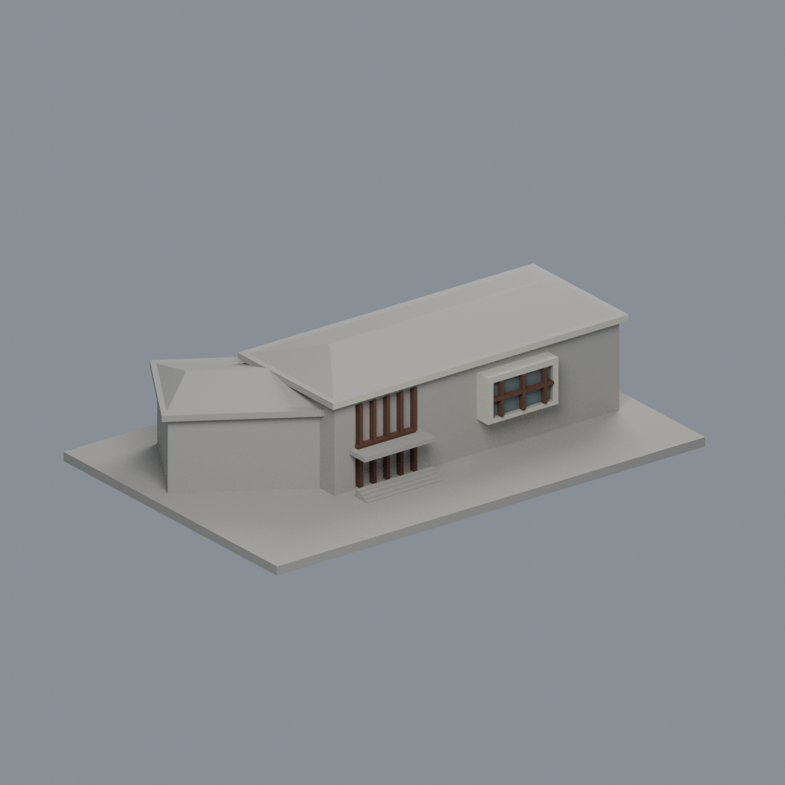
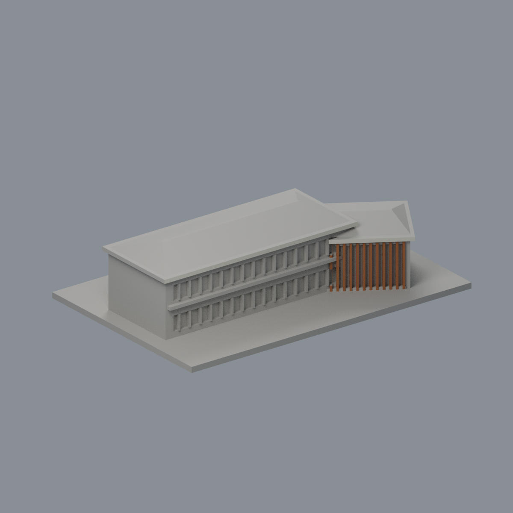

# 國立臺灣大學 鋤禾館（雲林分部農業育成推廣中心）

## 模型預覽

| 模型預覽 | 模型預覽 | 模型預覽 |
| :---: | :---: | :---: |
| 正面與來源支持區域  | 來源支持後側木屏／混合牆中性  |  |

## 5 材質外觀版（2026-10-21）

[來源界線與四視角](appearance/README.md) · [表面色 3MF](appearance/ntuchuhe-appearance.3mf) · [可編輯場景](appearance/scene.blend)

依 2019／2022／2023 官方照片，僅原斜翼木屏、入口與凸窗木框、奶白簷框及獨立凸窗背；主牆木灰混面、入口格柵玻璃混面、後百葉與未知屋坡均中性，不假造綠布棚。 原 STL 與歷史 QA 不變；這是外觀改善，不是新增幾何。原單色正面（歷史檔案留存，不作本頁預覽）／原單色背面（歷史檔案留存，不作本頁預覽）

官方索引代碼 雲林校區；無臺北索引代碼。公開外觀近似模型，非測繪或BIM。

## 範圍與比例
依2021校務報告所載公開空拍、2019背向斜角與2023官方入口照片，近似兩翼主館。兩翼交角32度、相對長度、進深及斜屋頂高度為目測參數，並非工程角度。未觀測端面與小屋頂設備留白；農場、廣場、造景及其他建物未納入。

保留辨識特徵：雙翼斜接、兩座低斜屋頂、寬平簷口、正面突出玻璃窗盒、入口高窗與低雨棚、另一側雙層長窗、低翼密集木格柵。木格柵改成實心背牆浮雕。

尺寸 [150.0, 99.68354797363281, 38.44936752319336] mm，含底座最長150 mm。各館獨立比例，不是可拼接的共同尺度校園沙盤。尺寸、厚度、窗距均為照片目測和列印簡化，不是原建物實測。

## 列印
- 底座向下，毫米單位。參考起點：0.4 mm噴嘴、0.16–0.2 mm層高、3道外牆、15–20%填充。須依自己的切片器調整。
- 寬簷口、突出窗盒與入口雨棚具有懸垂，建議局部支撐；密集格柵需在切片預覽逐根核對，不保證免支撐。
- 新增細浮雕名義最小約0.9 mm；這不是全模型最小壁厚的測量結果。零碎設備、文字招牌、樹木、電線及細緻裝飾沒有加入。
- 門窗背牆與實心量體避免隱藏內殼；實際填充由切片器決定。
- 未實際列印；未用PrusaSlicer、Cura等生成工具路徑。不宣稱無支撐或無風險可印。

## 驗證與檔案
- model.stl、model.obj；scene.blend是由實際STL匯入的可編修網格。
- build_model.py為獨立參數來源；Python3.12，依requirements.txt裝依賴後執行python build_model.py。
- Blender4.3.2：blender -b -t 2 -P render_preview.py。previews/front.png、rear.png、elevation.png均直接渲染交付STL。
- python validate_model.py：原始法向、水密、流形邊／頂點、單一連通表面、無分離封閉內殼、正體積、150mm、獨立重建SHA256及已儲存Blender/STL三角幾何一致性。結果validation.json。
- python check_layers.py：每0.2mm水平截面幾何檢查，共 192 層，所抽樣截面全部閉合。首層採z=0.071mm避免重合平面退化，非實際列印首層設定。
- layer-check.json另記向下超45度面積指標與各層輪廓；它不是切片器、最小壁厚測試或實體試印。閉合截面不保證擠出連續、橋接、支撐可拆、床面附著或局部細節可印。
- SHA256SUMS可核對檔案；更改參數後需重建、重繪、重驗證。

## 公開來源
查閱及圖像像素檢視：2026-10-13。來源照片未隨檔重新散布。
- [臺大官方2018啟用消息，確認鋤禾館身份](https://www.ntu.edu.tw/spotlight/2018/1491_20180806.html)
- [實驗林管理處官方中心介紹](https://www.exfo.ntu.edu.tw/page.php?id=203)
- [實際檢視2023官方正面](https://www.exfo.ntu.edu.tw/uploadfiles/images/20230406_141010_3467.jpg)
- [實際檢視2023官方入口](https://www.exfo.ntu.edu.tw/uploadfiles/images/20230406_152354_4570.jpg)
- [實際檢視反向斜角，照片標記2019-10-29](https://www.exfo.ntu.edu.tw/uploadfiles/images/20230406_142209_2771.jpg)
- [官方公開校務報告第10頁右上外部空拍，僅取建物外觀](https://sec.ntu.edu.tw/001/Upload/18/ckfile/f60930bc-9968-4849-978d-68f23cfa4091.pdf)
- 鋤禾館位於雲林分部，不屬臺北校區建物索引；身份由上列官方分部與中心資料核對。

照片版權屬原權利人；沒有轉授原建築設計或照片權利。不同拍攝日期不等於已核實目前全部外觀。
