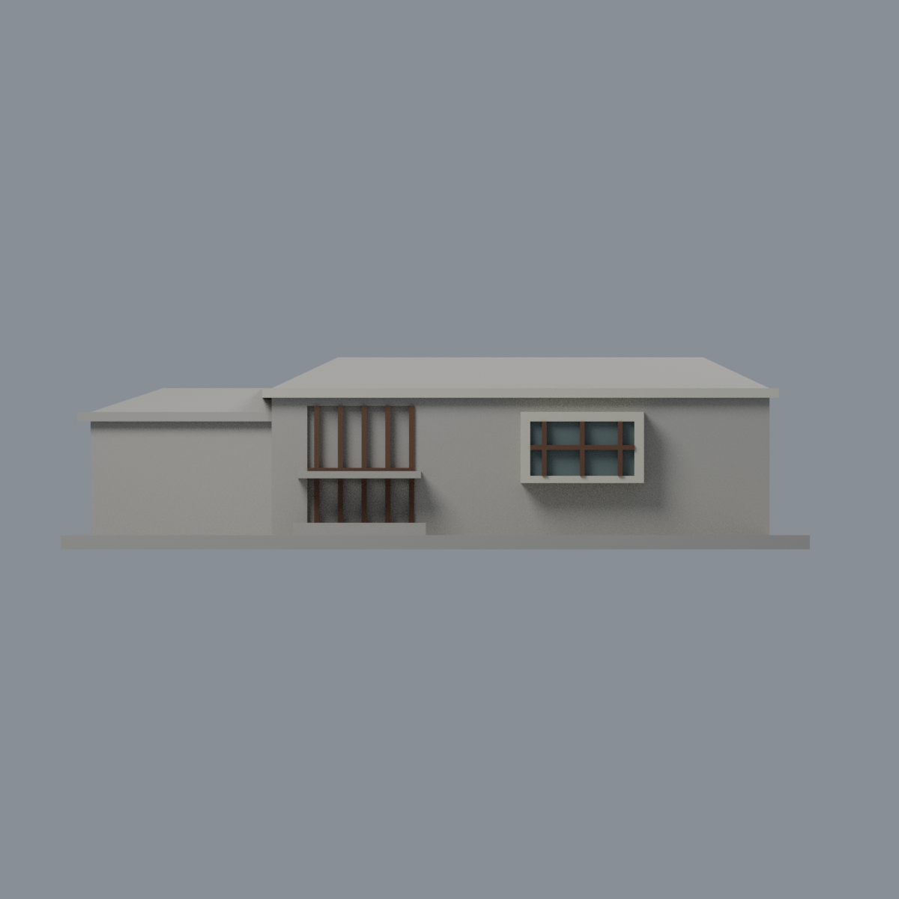
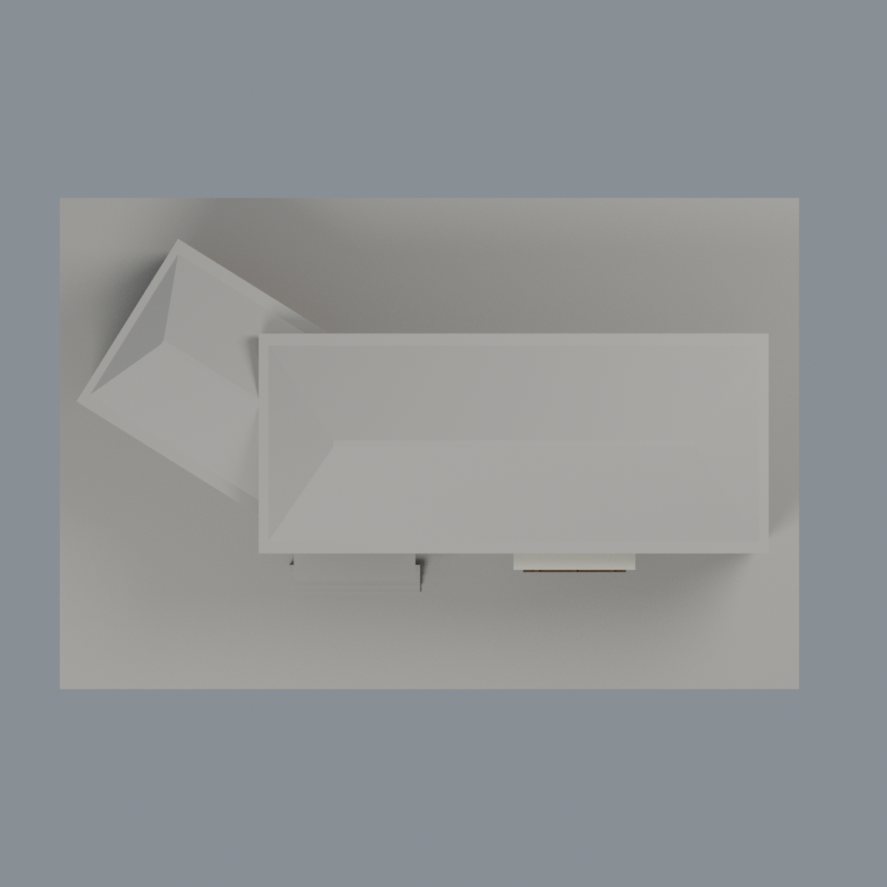

# 臺大雲林鋤禾館木屏與框簷限定配色：五材質外觀版

沿用原 **2,212 三角面／1,002 頂點**，不改原 STL 位元、座標、面序或幾何；這是既有模型外觀改版，不增加模型包數。

| 模型預覽 | 模型預覽 | 模型預覽 |
| :---: | :---: | :---: |
| 正面  | 來源支持草坪側木屏／混合牆中性  |  |
|  |  |  |

[表面色 3MF](ntuchuhe-appearance.3mf) · [可編輯 Blender](scene.blend) · [材質色表](palette.json) · [逐面指派與依據](face-materials.json) · [原 STL](../model.stl)

## 來源與配色邊界

親看臺大[農業育成推廣中心官方頁](https://www.exfo.ntu.edu.tw/page.php?id=203)的完整正面、入口近照與草坪側反向照片，核對原單色預覽和生成器。[精確 URL、SHA 與檔案日期](qa/source-review.json)。相機 Original 分別為 2022-05-19、2023-01-31、2019-10-29，不能將三個檔名共同的 20230406 當拍攝日；背照像素日期也標 2019/10/29。這些屬未獨立鑑定的日期證據，不宣稱 2026 現況。來源照片研究私用，不散布。

- 斜翼草坪側原木屏採暖棕，前入口五支直框與橫框、凸窗三支直框與橫框採較深棕。原生成器列 17 支斜翼木屏，只有 12 支在 union 後仍外露，另 5 支埋入主量體，不補造消失的構件。
- 原獨立主翼前／後簷帶垂直面、斜翼草坪側簷面及前凸窗外框採奶白；不延伸到未見屋坡或整面主牆。凸窗背有兩個獨立完整玻璃代理原面，前方木框為另外幾何，因此可採低飽和灰綠，不將木框吞成玻璃。
- 主牆實景左側灰、右側木色跨越原未分割面，整體中性；不以 x 閾值畫出不存在的斜切邊。入口凹背混實格柵、門和玻璃，原後窗長帶亦混百葉、窗裙與玻璃，全部中性。
- 綠色布遮棚不在原幾何，既有厚實入口棚不能冒充綠布；保留中性。屋坡僅有有限遠景，仍中性，不推估整屋黑色。斜翼未知側牆、地坪、植栽同樣中性，不加館名或招牌。
- 分類先逆縮放 150/158，斜翼再逆移位及旋轉 32 度，只選原 box 表面完整三角。只做色面定位，輸出保留原 STL 位元、全部座標／面序與歷史 QA；中性不是實景灰色重建。未進行實體列印測試。

[原幾何與歷史來源限制](../README.md)

## 重建與核驗

安裝 [依賴](source/requirements.txt)，Blender 使用 4.3.2。由本資料夾上層提供原 model.stl：

1. `python appearance/source/build_appearance.py`
2. `python appearance/source/verify_exchange.py`
3. `blender -b -t 3 --python-exit-code 1 -P appearance/source/render_appearance.py`
4. `blender -b -t 3 --python-exit-code 1 -P appearance/source/verify_scene.py`

[獨立重建 ZIP](rebuild-source.zip)含原 STL、四支程式及依賴，不含第三方照片；不取代原建模腳本。[逐檔 SHA256](SHA256SUMS)

[交換／拓撲 QA](qa/exchange-validation.json)核對原座標與面序、全部面材質、單連通、有向水密邊、頂點 link 單環、正體積與零退化／重複面；lib3mf 嚴格讀取零警告，實際編輯單材質再存讀，其他材質及面指派不變。SDK 六位小數量化誤差另列。

[Blender 存讀與編輯](qa/scene-validation.json) · [渲染記錄](qa/render-manifest.json) · [獨立重建](qa/rebuild-validation.json)

## 製造限制照舊

尺寸仍為 150 × 99.6835 × 38.4494 mm；原 STL、建模程式、場景及歷史 QA 保留。原層檢與薄特徵檢查本次未重跑，不能由材質 QA 代替。

3MF 是同一網格的表面色，不是各材質各自封閉的分色實體、切片專案、噴頭映射或 G-code。切片 GUI、多材料路徑與實體列印未測；柱頭、屋簷、窗框及薄邊仍須評估材料、支撐及拆除風險，沒有保證可印或免支撐。
