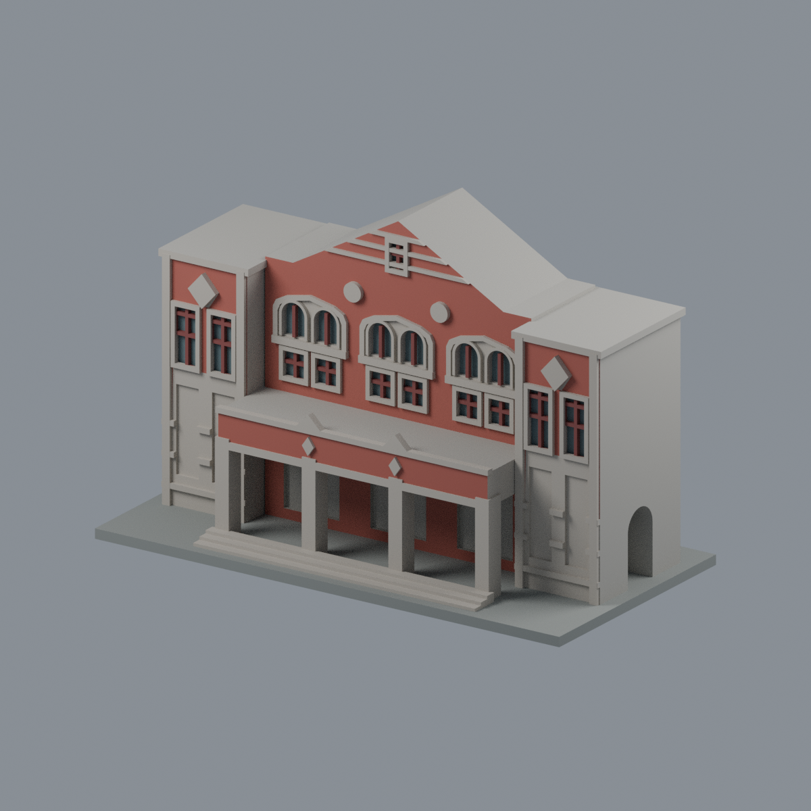

# 國立臺灣師範大學 · 和平校區I 公開外觀模型

首批3件不同建築的**局部外觀段**。不是3棟完整模型，也不是全校完成。每件含底座最長150mm，獨立比例、自建網格。

| 行政大樓 | 禮堂 | 文薈廳 |
|---|---|---|
|  [行政大樓中央入口段](buildings/ntnu-administration-central-entry-segment/) |  [禮堂前棟入口段](buildings/ntnu-auditorium-front-block-segment/) |  [文薈廳圓窗山牆與蝙蝠廊段](buildings/ntnu-wenhui-gable-corridor-segment/) |

以上預覽皆由交付STL直接渲染。每件資料夾有 STL、可編輯 scene.blend、參數腳本、來源、數位QA及SHA。

校區核對：[官方校圖](https://www.ga.ntnu.edu.tw/ntnu_map/)，4張圖面均印2026-09-23；和平I、和平II、公館、林口及3處校外教學大樓仍有後續工作。地圖中的運動場、廣場等不直接算建築；相連群棟需另核實體棟界。

數位QA不等於真切片或實體試印。原照片與PDF僅私下核對，不包含於公開資料。

[六材質外觀與來源界線](buildings/ntnu-administration-central-entry-segment/appearance/README.md)

| 模型預覽 | 模型預覽 | 模型預覽 |
| :---: | :---: | :---: |
|  |  |  |
