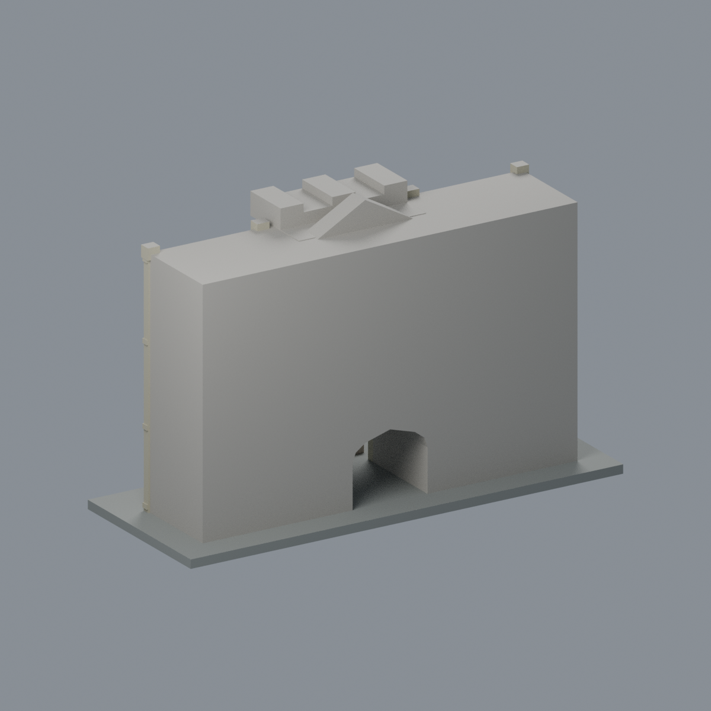
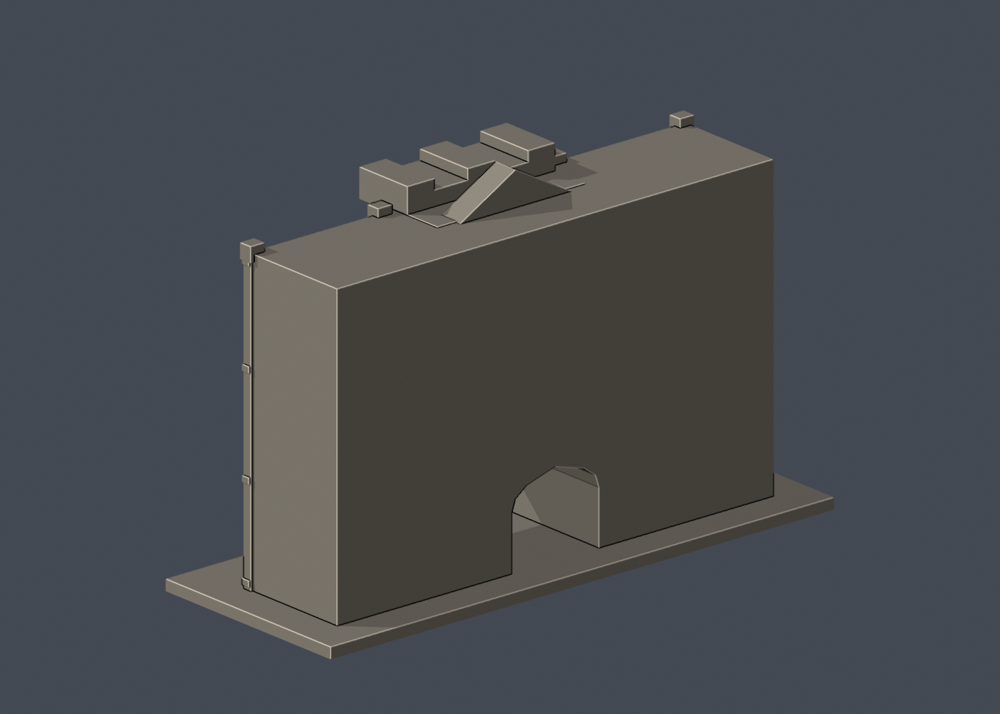
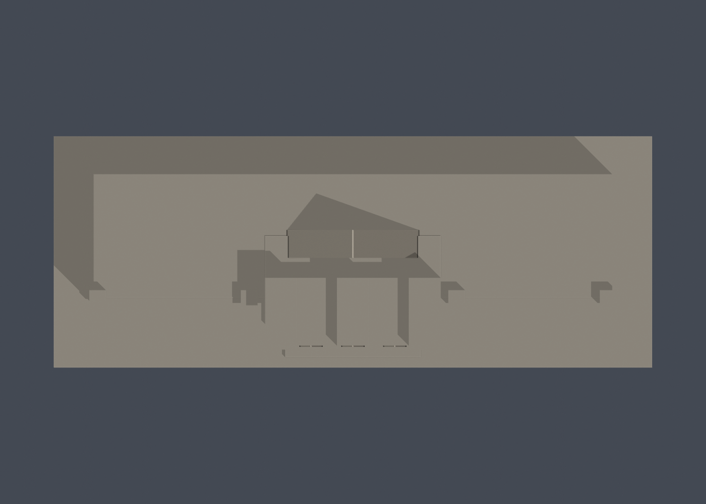
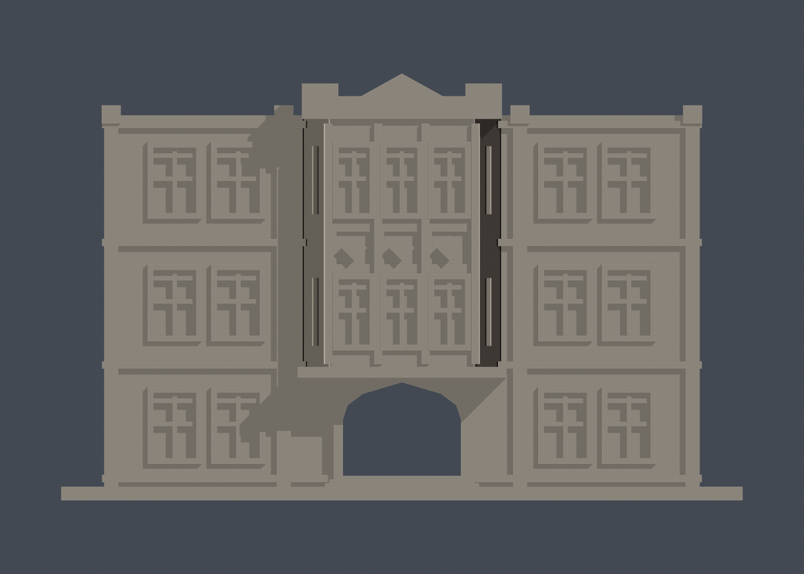

# 行政大樓中央入口段

## 模型預覽

| 模型預覽 | 模型預覽 | 模型預覽 |
| :---: | :---: | :---: |
| 正面原幾何配色  | 背面與未見面保持中性  |  |

國立臺灣師範大學 · 和平校區I · 校圖 H101  
這是依公開外觀照片自建的局部近似模型，**不是完整單棟、測繪模型或2026現況複製品**。未使用第三方3D mesh。

## 最新六材質外觀版（2026-10-20）

[來源界線與四視角](appearance/README.md) · [表面色 3MF](appearance/ntnuadmin-appearance.3mf) · [可編輯場景](appearance/scene.blend)

依官方導覽照片登錄原中央入口段紅棕磚牆、灰褐凸窗與拱緣、淡窗框與低彩度窗凹背；原菱形裝飾是石色，不是玻璃。照片拍攝日期未知；不增添交錯石塊、設備或文字，背面、裁切端與頂面中性。原STL與歷史QA不變，不是新增幾何。[原單色正面](previews/front.png)／[原單色背面](previews/rear.png)

| 模型預覽 | 模型預覽 | 模型預覽 |
| :---: | :---: | :---: |
| 原單色正面  | 原單色背面  |  |

[俯視](previews/top.png) · [正立面](previews/elevation.png)

| 模型預覽 | 模型預覽 | 模型預覽 |
| :---: | :---: | :---: |
| 俯視  | 正立面  |  |

## 下載與重建

- [可列印網格 model.stl](model.stl)
- [可編輯 Blender 網格 scene.blend](scene.blend)
- [參數化來源 build_model.py](build_model.py) · [requirements.txt](requirements.txt)
- [STL 渲染腳本](render_preview.py)
- 含底座外框：**150 × 58 × 94 mm**；每件獨立比例，不是各館等比校園。STL 無內建單位，匯入請指定毫米。
- Python 3.12 安裝 requirements.txt 後執行 build_model.py；接著用 Blender 4.3.2+ 執行 render_preview.py。scene.blend 是實際交付 STL 匯入的可編輯網格，參數調整請改 Python 來源重建。

## 保留特徵

- 中央三層立面與兩邊各一組相鄰雙窗段
- 二、三樓凸出多面窗座、分層窗臺及正面三分窗
- 底層穿透式深拱入口、上方城垛狀女兒牆與小山牆

## 證據範圍與簡化

- 不是完整行政大樓：兩翼及完整進深未納入。
- 模型背面與兩側端頭是選段截斷面，不是實際後立面。
- 照片年代不詳；依已檢視的官方舊導覽與2022出版實拍簡化。1957增建第三樓的歷史由官方另頁核對。
- 細密葉飾以牆背支撐的菱形浮雕代替；窗櫺有加粗，不逐一複製所有玻璃小格。

- 別名：臺北高等學校本館、一進、Administration Building I。
- [2026-09-23官方校圖](https://www.ga.ntnu.edu.tw/ntnu_map/)只核名稱、位置與棟界，不能用校圖符號當實拍外觀。
- 逐條來源、年代、支持特徵見 [sources.json](sources.json)。來源原照／PDF不隨此公開模型包重新散布。

## 列印與QA限制

- 底座朝下，建議先以 0.4 mm 噴嘴、0.2 mm 層高在自己的切片軟體預覽；這只是參考，不是已驗證設定。
- 入口、廊道與橫梁有挑空，請檢視懸垂與支撐可拆性；窗框、圓窗、女兒牆等細件需注意速度、材料、比例及脆弱處。
- 原STL硬檢：[validate_model.py](validate_model.py)／[validation.json](validation.json)，不使用 repair 修掉原始失敗證據。
- 0.2 mm逐層有效輪廓：[check_contour_validity.py](check_contour_validity.py)／[contour-validity-check.json](contour-validity-check.json)。固定起點 z=0.071 mm 避免共面退化，檢查 degree 2、單圈及組合多邊形有效，不吞 invalid。
- thin-v2：[check_thin_features.py](check_thin_features.py)／[thin-feature-check.json](thin-feature-check.json)，0.8 mm參考寬度形態 opening，採 canonical shared-edge interpolation，1 mm取樣間距。這不是全面最小壁厚量測。
- **數位幾何QA不是Cura／Prusa真切片、實際工具路徑或實體試印，不能宣稱保證可印或免支撐。**
- 拱門補充驗證：[射線檢查腳本](check_entry_opening.py)／[entry-opening-check.json](entry-opening-check.json)，五條前後穿透測試線均無遮擋；這不是全部空間的量測。
- 檔案校驗：[SHA256SUMS](SHA256SUMS)。

研究截至 2026-10-13。這件只涵蓋已標示局部，學校其餘建物仍待續接。
