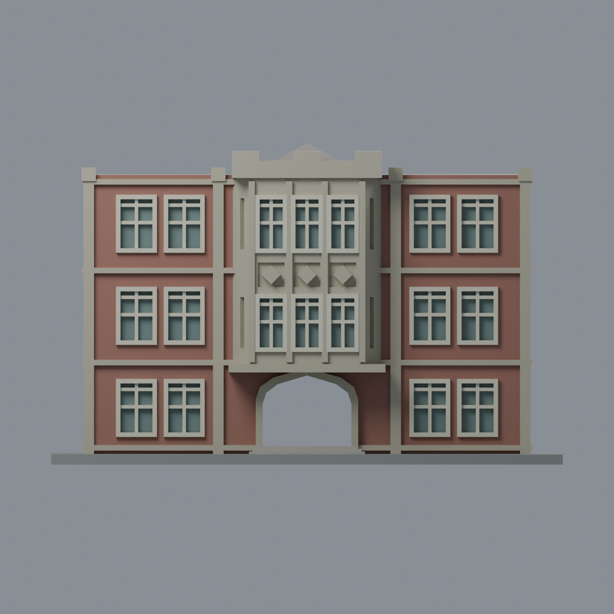
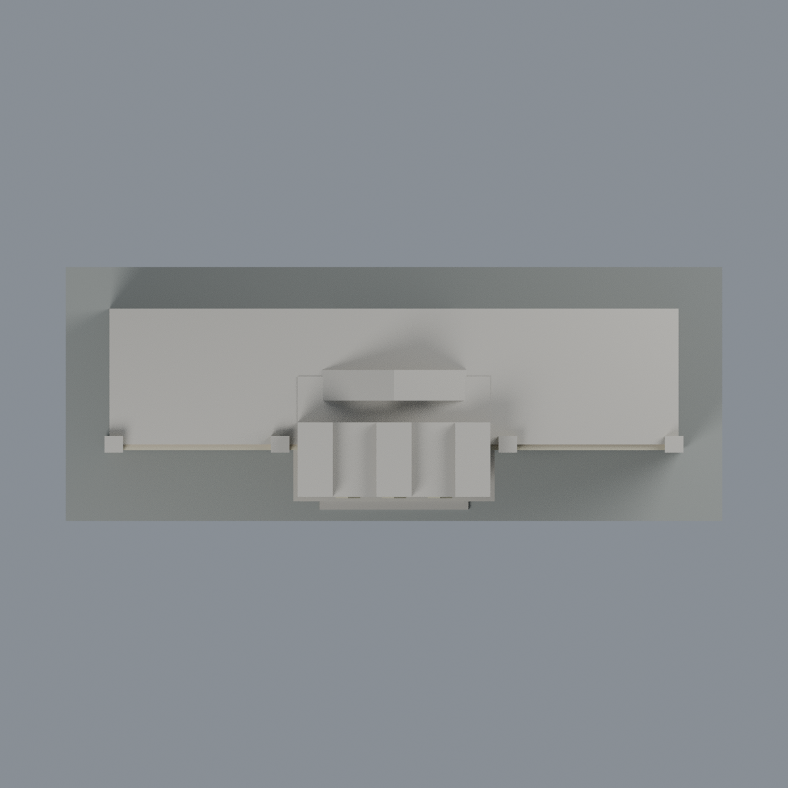

# 師大行政大樓中央入口段：六材質外觀版

沿用原 **5,292 三角面／2,466 頂點**，不改原 STL 位元、座標、面序或幾何；這是既有模型外觀改版，不增加模型包數。

| 模型預覽 | 模型預覽 | 模型預覽 |
| :---: | :---: | :---: |
| 正面  | 背面保持中性  |  |
|  |  |  |

[表面色 3MF](ntnuadmin-appearance.3mf) · [可編輯 Blender](scene.blend) · [材質色表](palette.json) · [逐面指派與依據](face-materials.json) · [原 STL](../model.stl)

## 來源與配色邊界

親自查看師大 [校園導覽行政大樓頁](https://pr.ntnu.edu.tw/reception/index.php?parent_id=560) 所附 [官方正面照片](https://pr.ntnu.edu.tw/archive/image/010.jpg)。照片未帶可用拍攝時間；導覽頁更新日 2011-06-07 不是拍攝日期，**不宣稱 2026 現況**。照片不隨包散布。

- 範圍僅原「中央入口＋兩側成對窗段」，不是整棟行政大樓。正面原牆平面紅棕磚色；既有立柱與層間帶灰褐石材代理。照片交錯磚石塊未在原網格逐塊分離，因此不捏造交錯白石紋。
- 中央凸窗正面與斜側面、既有菱形／簡化四瓣花裝飾、窗間石條、拱門飾緣灰褐色；菱形裝飾不是玻璃。原都鐸拱仍為穿透開口，不補成黑色門板。
- 只將可分離的原窗外框、中梃與橫梃設為淡奶白；正面窗凹背低彩度玻璃。斜側小窗凹背未可靠單獨登錄，保留石色近似，不宣稱完整玻璃面已復原。
- 中央頂冠只配可見前側立面石色；屋頂水平面、後方低山牆、背面及裁切短端保持中性。原簡化窗框及立面比例不更動，不增添細百葉、冷氣、字樣、欄杆或設備。
- 石色是觀察材質分類，不是石種鑑定。照片受光與老化影響，色值未校準；不將樹影、雨痕烘焙成材質。展示底板不是現地地坪。

[原幾何與來源界線](../README.md) · [本次來源覆核](qa/source-review.json)

## 重建與核驗

安裝 [依賴](source/requirements.txt)，Blender 使用 4.3.2。由本資料夾上層提供原 model.stl：

1. `python appearance/source/build_appearance.py`
2. `python appearance/source/verify_exchange.py`
3. `blender -b -t 3 --python-exit-code 1 -P appearance/source/render_appearance.py`
4. `blender -b -t 3 --python-exit-code 1 -P appearance/source/verify_scene.py`

[獨立重建 ZIP](rebuild-source.zip)含原 STL、四支程式及依賴，不含第三方照片；不取代原建模腳本。[逐檔 SHA256](SHA256SUMS)

[交換／拓撲 QA](qa/exchange-validation.json)核對原座標與面序、全部面材質、單連通、有向水密邊、頂點 link 單環、正體積與零退化／重複面；lib3mf 嚴格讀取零警告，實際編輯單材質再存讀，其他材質及面指派不變。SDK 六位小數量化誤差另列。

[Blender 存讀與編輯](qa/scene-validation.json) · [渲染記錄](qa/render-manifest.json) · [獨立重建](qa/rebuild-validation.json)

## 製造限制照舊

尺寸仍為 150 × 58 × 94 mm；原 STL、建模程式、場景及歷史 QA 保留。原層檢與薄特徵檢查本次未重跑，不能由材質 QA 代替。

3MF 是同一網格的表面色，不是六個封閉分色實體、切片專案、噴頭映射或 G-code。切片 GUI、多材料路徑與實體列印未測；柱頭、屋簷、窗框及薄邊仍須評估材料、支撐及拆除風險，沒有保證可印或免支撐。
