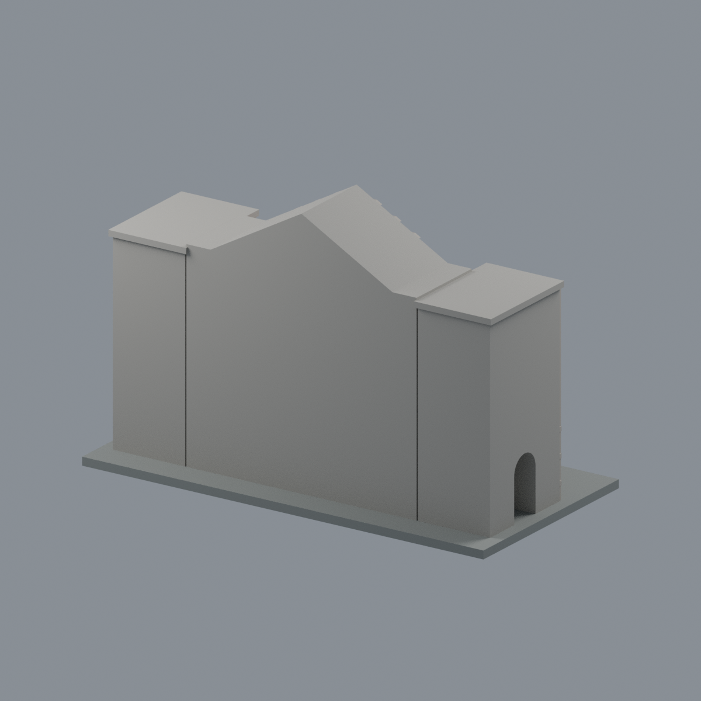
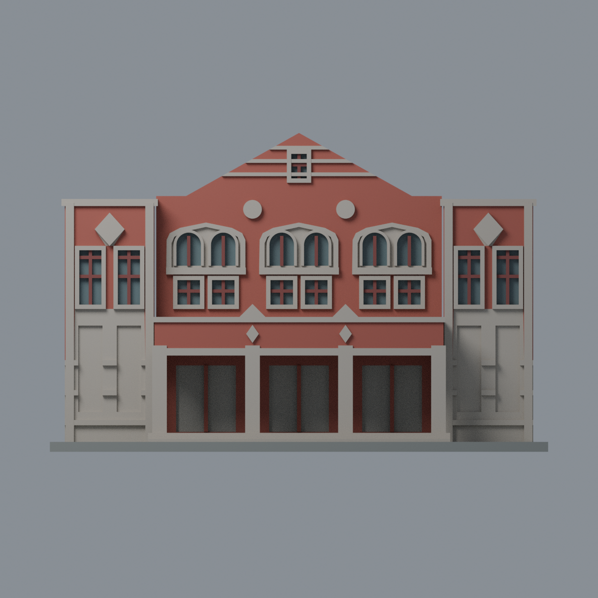
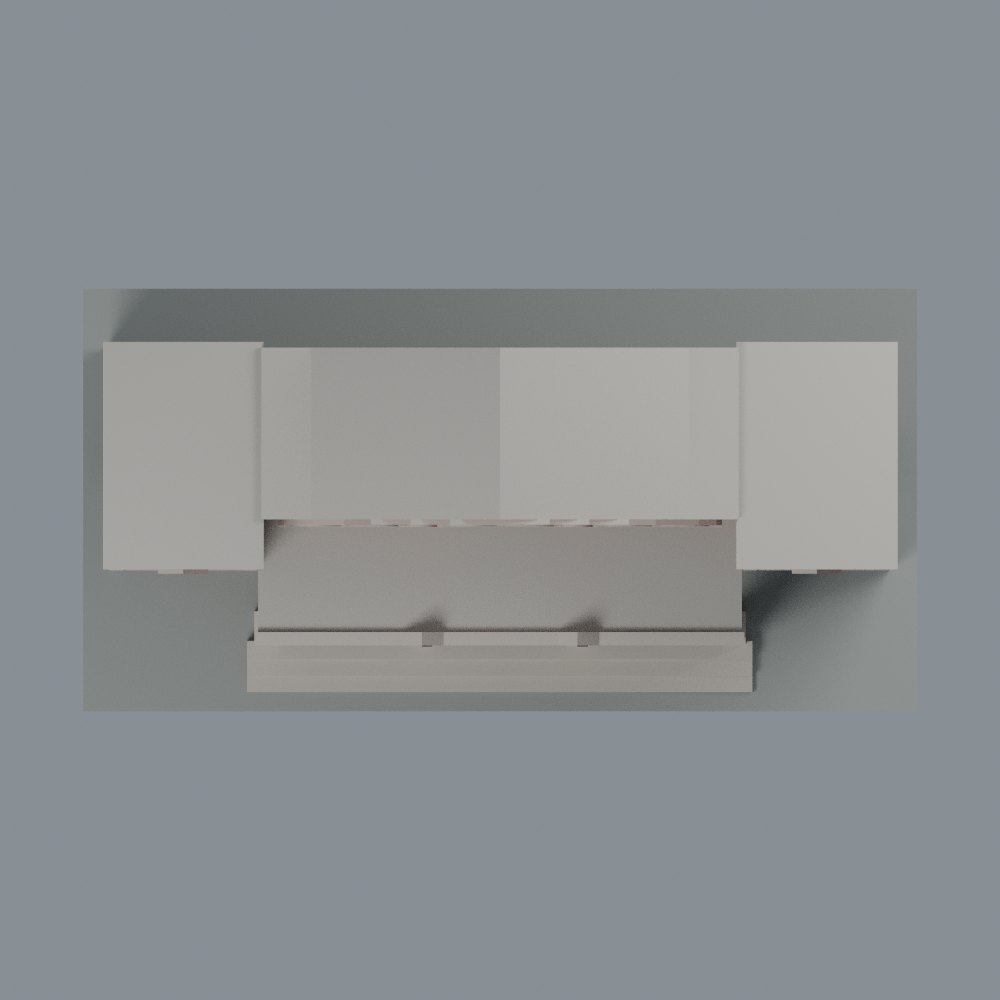

# 禮堂前棟入口段：六材質外觀版

沿用原 **7,252 三角面／3,516 頂點**，不改原 STL 位元、座標、面序或幾何；這是既有模型外觀改版，不增加模型包數。

| 模型預覽 | 模型預覽 | 模型預覽 |
| :---: | :---: | :---: |
| 正面  | 背面保持中性  |  |
|  |  |  |

[表面色 3MF](auditorium-appearance.3mf) · [可編輯 Blender](scene.blend) · [材質色表](palette.json) · [逐面指派與依據](face-materials.json) · [原 STL](../model.stl)

## 來源與配色邊界

親自查看[校方百年校慶募款頁](https://give.ntnu.edu.tw/goweb2/include/century-celebration.php)的[禮堂正面照片](https://give.ntnu.edu.tw/goweb2/include/images/project/century-celebration/campus-pic01.jpg)，並比對[《臺灣扶輪》2022 年 3 月刊 PDF](https://taiwan-rotary.org/upload/monthly/20220223105651.pdf)第 84 頁／印刷頁 82 的正面與側面歷史照片。頁面版權年份或刊物年月不是照片精確拍攝日期；本版不宣稱 2026 現況。照片及 PDF 圖頁均不隨模型或備份散布。

- 只登錄前棟正立面：紅磚面、暖灰石基座／塔身下部飾板／窗罩／前廊柱與楣、紅褐窗框、低飽和玻璃代理。
- 兩側塔樓下方成對長凹格是**石質飾板，不是藍色窗戶**；照片可見下部連續石面，因此既有前面三角形在可限定範圍內同給石色。未細分跨界三角面追畫新的邊界。
- 上部實際窗洞的背面才配玻璃；模型既有窗梃仍為簡化。三組雙聯窗的石質罩與圓形、菱形裝飾只對既有形狀換色，不假裝重現細部雕花。
- 前廊保持原挑空；照片入口黑暗是陰影，**不把整片牆染黑**。深退後入口保持原中性代理，沒有加入金色館名或其他文字。
- 大屋頂、後截面、側返及不能可靠登錄部分中性；不從正面照片猜造後立面。這仍是原前棟入口局部模型，不是整座禮堂。
- 色值未校正，不能當建材色票。沒有新增磚縫、招牌、植物、設備或裝飾；展示底座不代表真實地面。

[原完整來源](../sources.json) · [原幾何與年代界線](../README.md) · [本次來源覆核](qa/source-review.json)

## 重建與核驗

安裝 [依賴](source/requirements.txt)，Blender 使用 4.3.2。由本資料夾上層提供原 model.stl：

1. `python appearance/source/build_appearance.py`
2. `python appearance/source/verify_exchange.py`
3. `blender -b -t 3 --python-exit-code 1 -P appearance/source/render_appearance.py`
4. `blender -b -t 3 --python-exit-code 1 -P appearance/source/verify_scene.py`

[獨立重建 ZIP](rebuild-source.zip)含原 STL、四支程式及依賴，不含第三方照片；不取代原建模腳本。[逐檔 SHA256](SHA256SUMS)

[交換／拓撲 QA](qa/exchange-validation.json)核對原座標與面序、全部面材質、單連通、有向水密邊、頂點 link 單環、正體積與零退化／重複面；lib3mf 嚴格讀取零警告，實際編輯單材質再存讀，其他材質及面指派不變。SDK 六位小數量化誤差另列。

[Blender 存讀與編輯](qa/scene-validation.json) · [渲染記錄](qa/render-manifest.json) · [獨立重建](qa/rebuild-validation.json)

## 製造限制照舊

尺寸仍為 150 × 76 × 96 mm；原 STL、建模程式、場景及歷史 QA 保留。原層檢與薄特徵檢查本次未重跑，不能由材質 QA 代替。

3MF 是同一網格的表面色，不是六個封閉分色實體、切片專案、噴頭映射或 G-code。切片 GUI、多材料路徑與實體列印未測；窗罩、挑空門廊、石質飾板及細窗梃仍須評估材料、支撐及拆除風險，沒有保證可印或免支撐。
