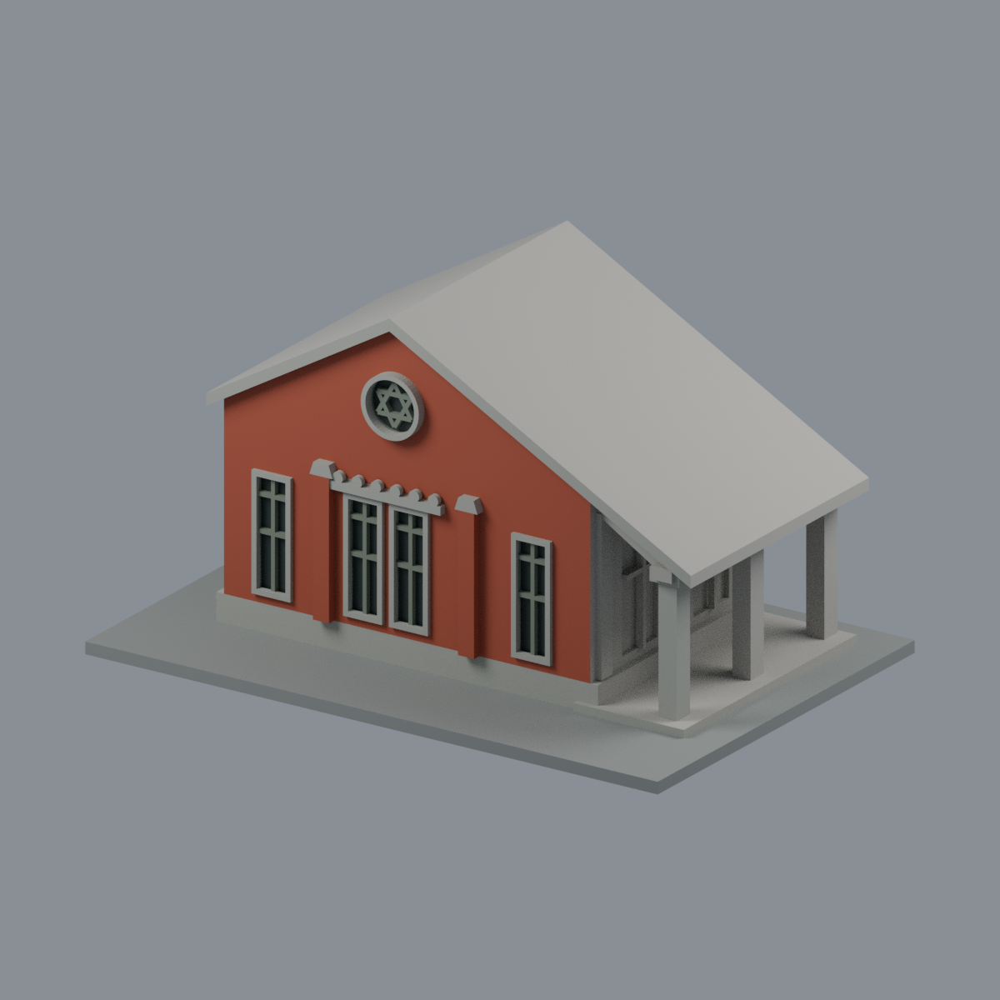
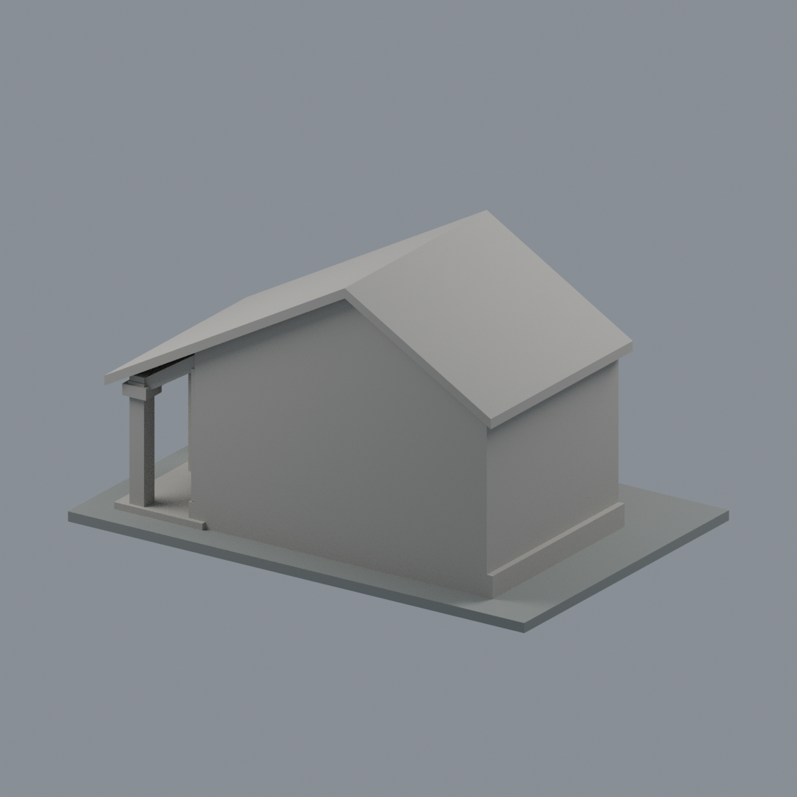

# 文薈廳圓窗山牆與蝙蝠廊段

國立臺灣師範大學 · 和平校區I · 校圖 H105  
這是依公開外觀照片自建的局部近似模型，**不是完整單棟、測繪模型或2026現況複製品**。未使用第三方3D mesh。

## 最新六材質外觀版（2026-10-20）

| 正面原幾何配色 | 背面保持中性 |
|---|---|
|  |  |

[來源界線與四視角](appearance/README.md) · [表面色 3MF](appearance/wenhui-appearance.3mf) · [可編輯場景](appearance/scene.blend)

只對2011／2023官方照片可登錄山牆與最前廊柱配色；屋頂大面、背面及深廊中性。原STL與歷史QA不變，不是新增幾何。[原單色正面](previews/front.png)／[原單色背面](previews/rear.png)

[俯視](previews/top.png) · [正立面](previews/elevation.png)

## 下載與重建

- [可列印網格 model.stl](model.stl)
- [可編輯 Blender 網格 scene.blend](scene.blend)
- [參數化來源 build_model.py](build_model.py) · [requirements.txt](requirements.txt)
- [STL 渲染腳本](render_preview.py)
- 含底座外框：**150 × 101 × 85 mm**；每件獨立比例，不是各館等比校園。STL 無內建單位，匯入請指定毫米。
- Python 3.12 安裝 requirements.txt 後執行 build_model.py；接著用 Blender 4.3.2+ 執行 render_preview.py。scene.blend 是實際交付 STL 匯入的可編輯網格，參數調整請改 Python 來源重建。

## 保留特徵

- 不對稱雙坡：屋面向蝙蝠廊側延伸，廊道保持通空
- 端面中央雙長窗與左右單長窗，共四個主要窗洞
- 圓形山牆窗、六芒星粗化浮雕、窗上六格裝飾
- 三根加粗蝙蝠廊柱與斜撐、柱頭台階

## 證據範圍與簡化

- 此件是圓窗山牆與相接三柱廊段；完整蝙蝠廊文獻記載六柱，不把三柱模型稱完整文薈廳。
- 背面是截斷面，另一端／原火災廚房與完整長邊窗數未重建。
- 廊內兩個開口只依可見構造取樣，非完整門窗測繪；背、進深為選段尺寸。
- 六芒星與柱頭以約1毫米以上相連浮雕處理；未重做所有門窗玻璃格及葉紋。
- 2011修復後照片與2023展覽現場照片互核；1930老照片不用作修復後現況依據。

- 別名：生徒控所、生徒控室、東教室大樓、Wenhui Hall。
- [2026-09-23官方校圖](https://www.ga.ntnu.edu.tw/ntnu_map/)只核名稱、位置與棟界，不能用校圖符號當實拍外觀。
- 逐條來源、年代、支持特徵見 [sources.json](sources.json)。來源原照／PDF不隨此公開模型包重新散布。

## 列印與QA限制

- 底座朝下，建議先以 0.4 mm 噴嘴、0.2 mm 層高在自己的切片軟體預覽；這只是參考，不是已驗證設定。
- 入口、廊道與橫梁有挑空，請檢視懸垂與支撐可拆性；窗框、圓窗、女兒牆等細件需注意速度、材料、比例及脆弱處。
- 原STL硬檢：[validate_model.py](validate_model.py)／[validation.json](validation.json)，不使用 repair 修掉原始失敗證據。
- 0.2 mm逐層有效輪廓：[check_contour_validity.py](check_contour_validity.py)／[contour-validity-check.json](contour-validity-check.json)。固定起點 z=0.071 mm 避免共面退化，檢查 degree 2、單圈及組合多邊形有效，不吞 invalid。
- thin-v2：[check_thin_features.py](check_thin_features.py)／[thin-feature-check.json](thin-feature-check.json)，0.8 mm參考寬度形態 opening，採 canonical shared-edge interpolation，1 mm取樣間距。這不是全面最小壁厚量測。
- **數位幾何QA不是Cura／Prusa真切片、實際工具路徑或實體試印，不能宣稱保證可印或免支撐。**
- 檔案校驗：[SHA256SUMS](SHA256SUMS)。

研究截至 2026-10-13。這件只涵蓋已標示局部，學校其餘建物仍待續接。
