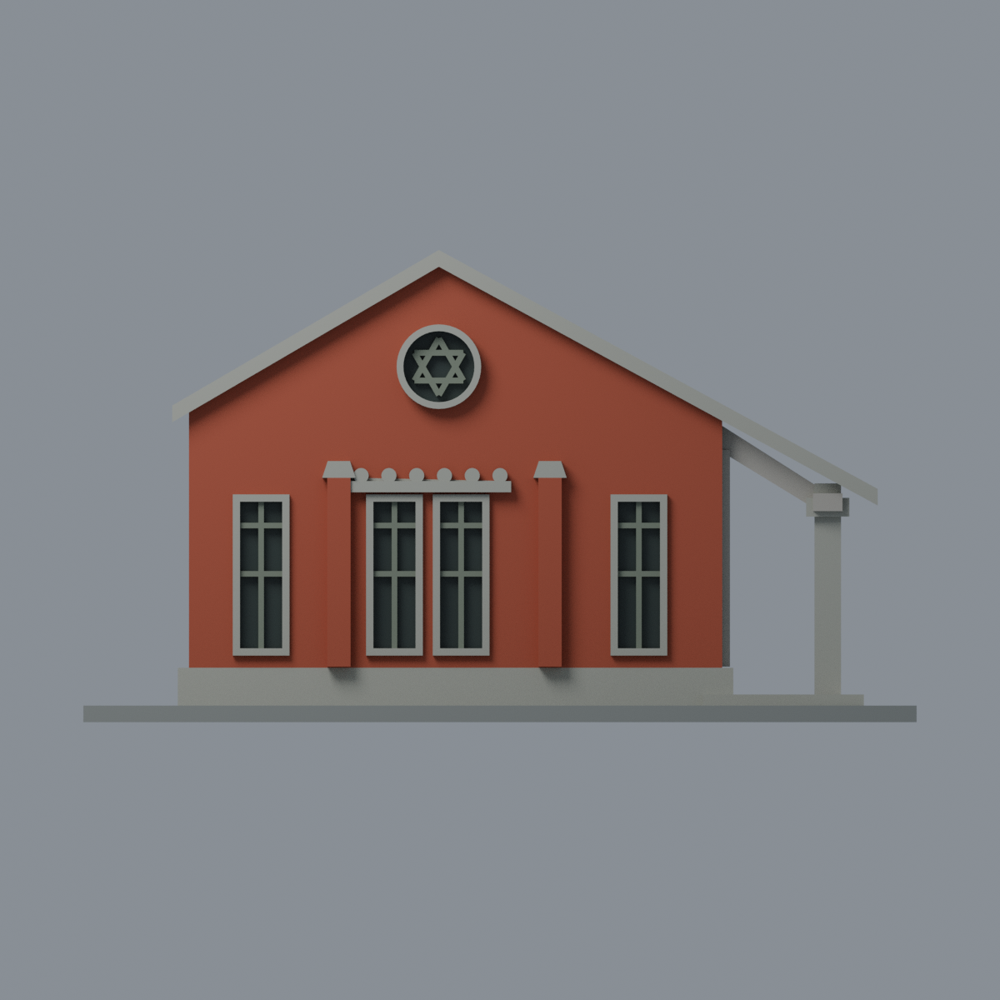

# 文薈廳圓窗山牆與蝙蝠廊段：六材質外觀版

沿用原 **3,508 三角面／1,686 頂點**，不改原 STL 位元、座標、面序或幾何；這是既有模型外觀改版，不增加模型包數。

| 模型預覽 | 模型預覽 | 模型預覽 |
| :---: | :---: | :---: |
| 正面  | 背面保持中性  |  |
|  |  |  |

[表面色 3MF](wenhui-appearance.3mf) · [可編輯 Blender](scene.blend) · [材質色表](palette.json) · [逐面指派與依據](face-materials.json) · [原 STL](../model.stl)

## 來源與配色邊界

親自查看 [2011-09-29 校方〈文薈廳復舊再生〉報導](https://pr.ntnu.edu.tw/ntnunews/index.php?id=10656&mode=data&type_id=72)與[正面照片](https://pr.ntnu.edu.tw/archive/news/201109292DSC_0005.JPG)，以及 [2023-05-18 校史影像特展報導](https://pr.ntnu.edu.tw/ntnunews/index.php?id=21598&mode=data)與[山牆及右廊照片](https://pr.ntnu.edu.tw/archive/news/d35c3de50ed591b61481764308271df8.jpg)。日期為報導發布日，不推定照片精確拍攝時刻，也不宣稱 2026 現況。來源照片不隨模型或備份散布。

- 登錄四長窗與圓窗山牆正面：橘紅磚面／凸柱、灰石基座與圓窗邊框／現有簡化裝飾楣、灰綠窗梃與六角星紋、深色凹窗背面。
- 前簷現有厚板對應較亮的簷口表面；照片頂端薄黑瓦邊沒有獨立幾何，**不把整塊厚簷染黑，也不細分新面追造薄黑線**。
- 現有六小圓浮雕仍是舊模型的簡化，不假裝重現精細花紋；六角星只換原有條桿色，不新增符號或裝飾。
- 右廊只給最前柱的可登錄石質部分；其餘深廊、側窗、背截面、左側及大屋面保留中性，不憑單一正面補造背面配色。模型只含原三柱廊段，不宣稱整座文薈廳。
- 色值未校正，不能當建材色票。凹窗用不透明展示玻璃代理，不把樹影、污漬或室內陰影畫成表面塗料。
- 沒有新增磚縫、字樣、招牌、植物或設備。底板是展示底座，不代表現場道路與草地。

[原完整來源](../sources.json) · [原幾何與年代界線](../README.md) · [本次來源覆核](qa/source-review.json)

## 重建與核驗

安裝 [依賴](source/requirements.txt)，Blender 使用 4.3.2。由本資料夾上層提供原 model.stl：

1. `python appearance/source/build_appearance.py`
2. `python appearance/source/verify_exchange.py`
3. `blender -b -t 3 --python-exit-code 1 -P appearance/source/render_appearance.py`
4. `blender -b -t 3 --python-exit-code 1 -P appearance/source/verify_scene.py`

[獨立重建 ZIP](rebuild-source.zip)含原 STL、四支程式及依賴，不含第三方照片；不取代原建模腳本。[逐檔 SHA256](SHA256SUMS)

[交換／拓撲 QA](qa/exchange-validation.json)核對原座標與面序、全部面材質、單連通、有向水密邊、頂點 link 單環、正體積與零退化／重複面；lib3mf 嚴格讀取零警告，實際編輯單材質再存讀，其他材質及面指派不變。SDK 六位小數量化誤差另列。

[Blender 存讀與編輯](qa/scene-validation.json) · [渲染記錄](qa/render-manifest.json) · [獨立重建](qa/rebuild-validation.json)

## 製造限制照舊

尺寸仍為 150 × 101 × 85 mm；原 STL、建模程式、場景及歷史 QA 保留。原層檢與薄特徵檢查本次未重跑，不能由材質 QA 代替。

3MF 是同一網格的表面色，不是六個封閉分色實體、切片專案、噴頭映射或 G-code。切片 GUI、多材料路徑與實體列印未測；屋簷、蝙蝠廊梁、圓窗紋飾及細窗梃仍須評估材料、支撐及拆除風險，沒有保證可印或免支撐。
