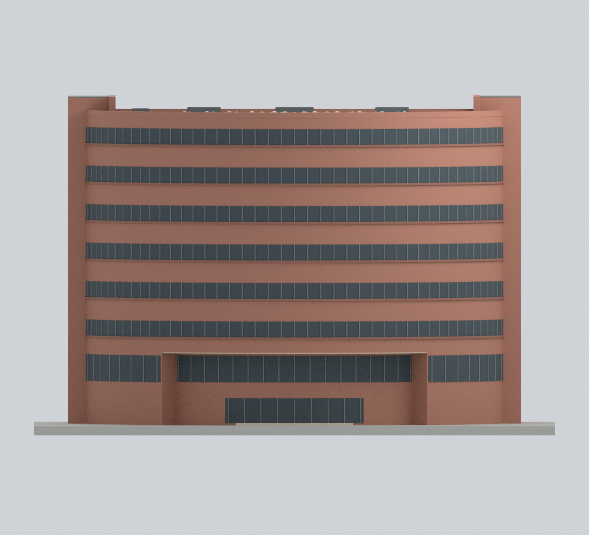

# 國立臺灣師範大學和平校區II建築模型圖鑑

本校區目前收錄H202圖書館總館一套；另有[和平校區I的3件局部模型](../和平校區I/README.md)，全校合計4套，並非全校或本校區逐棟完成。[回學校圖鑑](../README.md)。

| 建築模型 | 建築模型 | 建築模型 |
| :---: | :---: | :---: |
|  **[圖書館總館｜整棟地上外觀有限細節近似](buildings/ntnu-main-library/README.md)** |  |  |

和平校區II H202圖書館總館：八層D形整棟地上有限外觀近似，混合2020／2023形體、2025修繕報導及2025年1／2／5月南側街景，非精確定年復原、已核實2026現況或測繪縮尺。保留北弧形窗帶、南直線上部、兩端高量體、低層入口與覆頂中庭；南側兩個低層閉合凹口及三個中間／端部實體區塊，上部連續。西凹口背界為中性不透明近似，不宣稱觀察到精確磚牆／玻璃面，也不鏡像東側書店細節；中庭不挖露天洞。230×151×148.5mm為含展示底座模型尺寸，10材質3MF、STL、可編輯Blend及636隱藏建構分件、公開Python與9張實際圖；隱藏重疊分件不可與成品同印。無室內、地下室、鄰棟或博愛樓太陽能板；簷底、南凹口、木門框需橋接／支撐，約0.37–0.44mm附著窗框浮雕及230mm底座需評估縮尺和平台，尚未實體試印。

[完整模型、九視圖與重建說明](buildings/ntnu-main-library/README.md) · [STL](buildings/ntnu-main-library/ntnu-main-library.stl) · [彩色3MF](buildings/ntnu-main-library/ntnu-main-library.3mf) · [可編修Blend](buildings/ntnu-main-library/ntnu-main-library.blend)

校區身分依[官方校園配置圖](https://www.ga.ntnu.edu.tw/ntnu_map/)的和平校區II H202標示及[官方校區說明](https://www.sce.ntnu.edu.tw/home/course/campus.php)核對；與和平校區I分列，不另增加學校數。不包含博愛樓舊圖書館、公館／林口分館、鄰棟或其他校園設施；來源照片／地圖／示意圖不公開散布。
