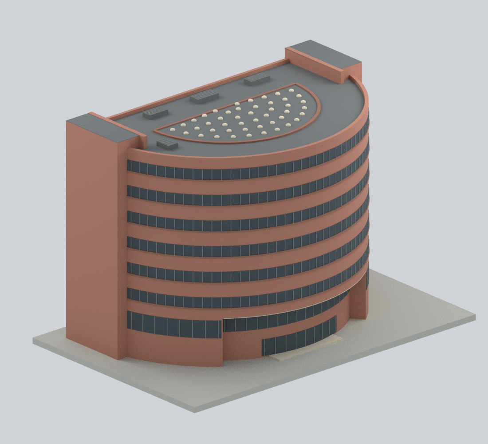
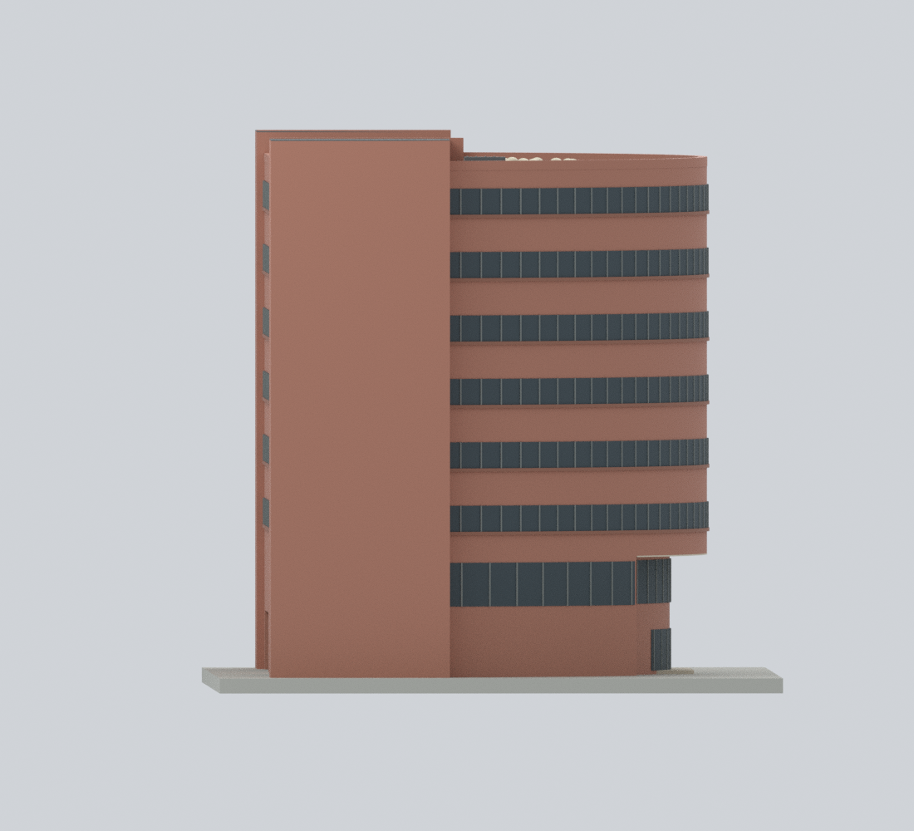
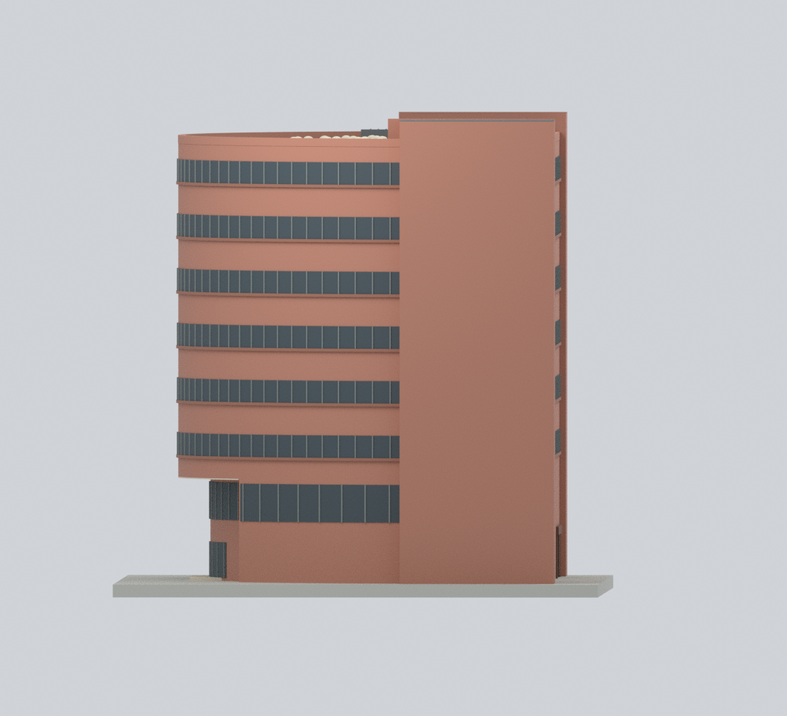
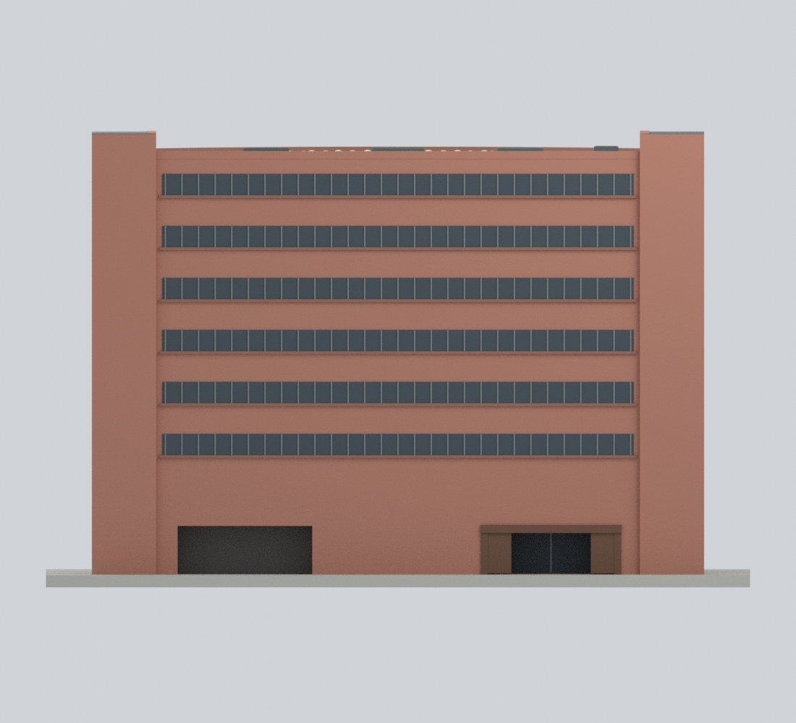
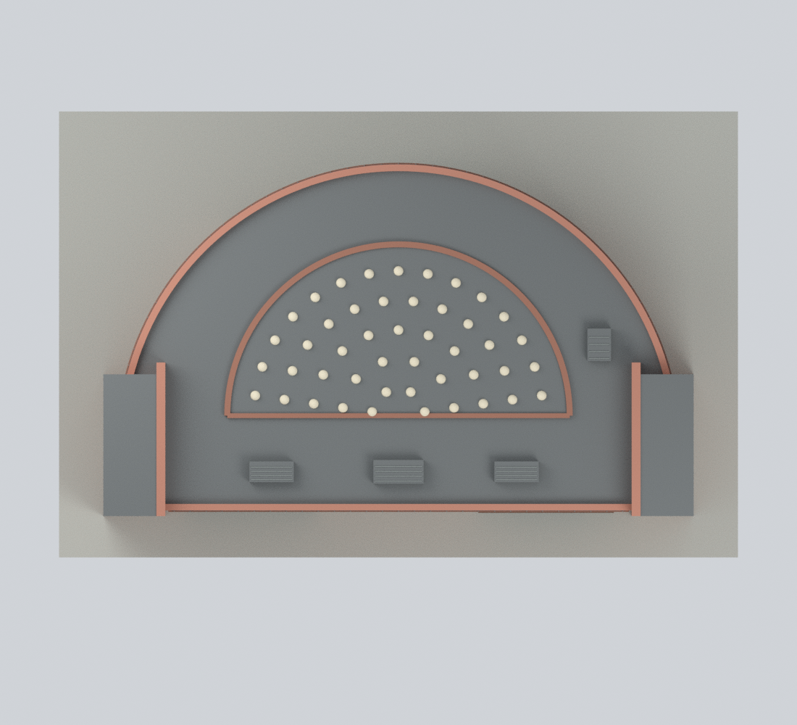
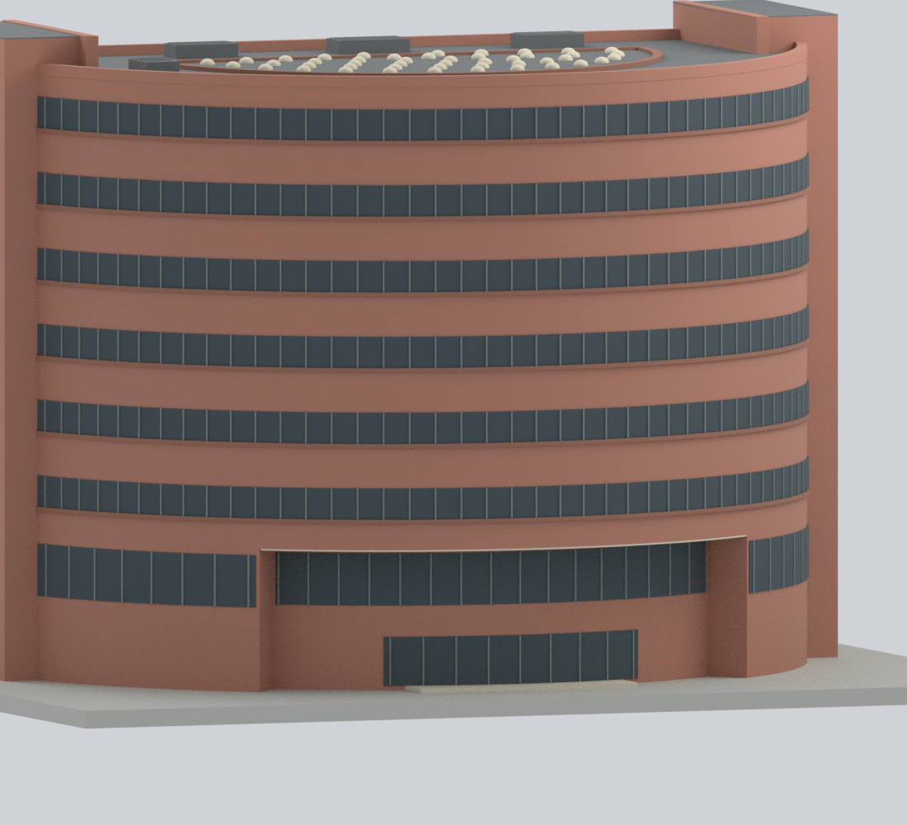
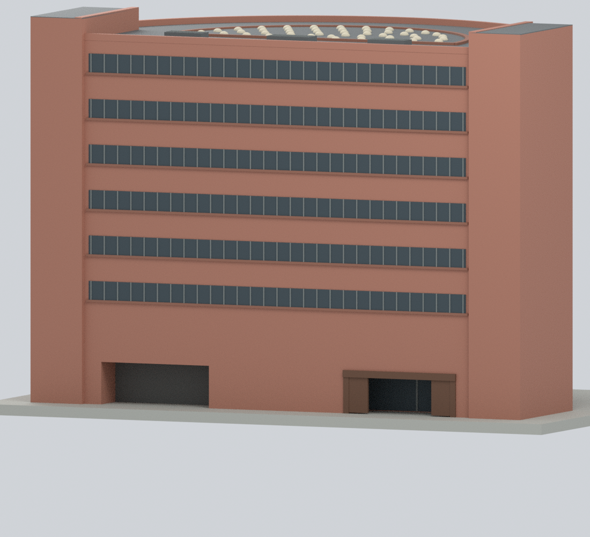
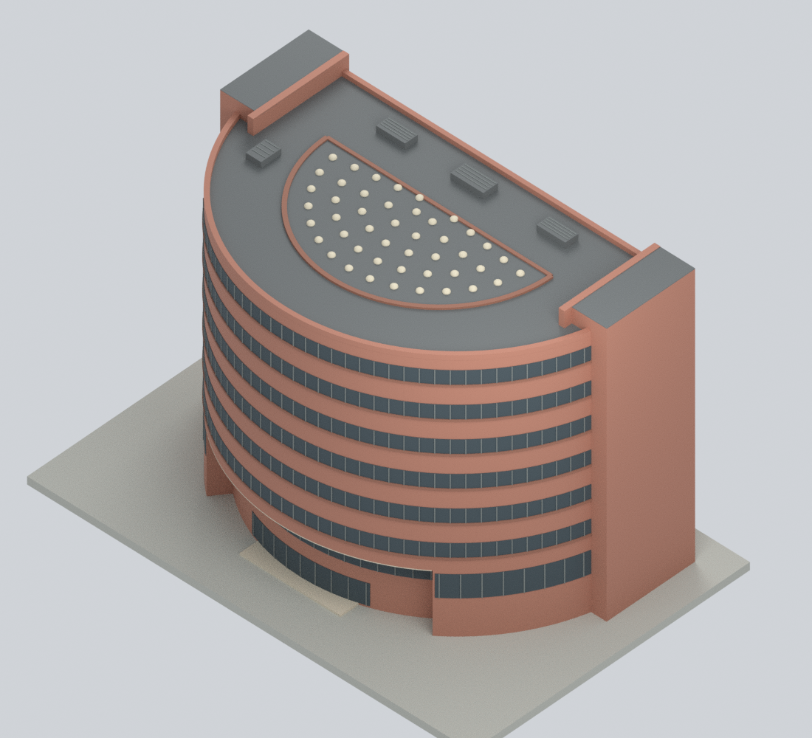

# 國立臺灣師範大學圖書館總館 — 彩色整棟外觀近似模型

## 模型預覽

| 北側正面 | 東北斜視 | 東側 |
|---|---|---|
|  |  |  |
| 西側 | 南側背面 | 俯視 |
|  |  |  |
| 北入口近景 | 南側凹入近景 | 屋頂斜視 |
|  |  |  |

和平校區 II 的 H202 現代圖書館總館，**不是**博愛樓舊圖書館、公館分館或林口分館。保留八層 D 形主體、北側弧形橫窗、南側直線上部、兩端高量體、低層入口凹入及有採光罩的封閉中庭屋頂。

**這是有限外觀的原創近似模型，不是測繪、施工圖、室內模型或經確認的 2026 年現況。** 模型採用跨年度參考：2020／2023 年形體、2025 年修繕報導照片，以及 2025 年 1／2／5 月南側街景。2025-04-11 官方文章表示外牆及屋頂修繕完成；文章日期不等於每張照片的拍攝日。航照上的 NLSC2024 字樣也不直接證明拍攝年份。

## 九張實際模型預覽

全部由交付幾何及原創純色材質渲染，沒有參考照片貼圖。


## 檔案

- [`ntnu-main-library.blend`](ntnu-main-library.blend)：可編輯 Blender 原生檔。可見物件為合併後材質網格；隱藏的 `EDITABLE authored components` 集合保留分件。分件為布林合併前的重疊構件，不可當成另一份可直接列印的網格。
- [`ntnu-main-library.3mf`](ntnu-main-library.3mf)：每三角面實際指定基礎材質的彩色 3MF，不是單一灰色 STL 改副檔名，也不是印表機線材設定。
- [`ntnu-main-library.stl`](ntnu-main-library.stl)：單一封閉的無色列印網格；STL 本身不保存色彩。
- [`build_model.py`](build_model.py)、[`parameters.json`](parameters.json)：獨立可重建的幾何程式及數值參數；[`export_3mf.py`](export_3mf.py)、[`render_model.py`](render_model.py) 產生彩色檔及九張預覽。
- [`sources.json`](sources.json)、[`evidence-map.json`](evidence-map.json)：來源網址、日期、權利與幾何簡化對照。
- `qa/`：實際輸出之網格、截面、射線、自交、原生編輯重開及重建比對報告；[`manifest.json`](manifest.json) 與 `SHA256SUMS` 列出交付內容。

## 幾何邊界及不確定性

1. 官方樓層圖片是**無尺度軸測示意**，不是實測正投影平面。所有尺寸都是代表性模型毫米；沒有聲稱建築實體公尺數或精確縮尺。整體含展示底座約 **230 × 151 × 148.5 模型毫米**；+X 約東、+Y 約北，非測量控制座標。
2. 南側一樓保留**兩個不同的低層凹口與三個中間／端部實體區塊**，上方二樓及更高樓層仍是連續直線條帶。西凹口有側向回折與內側背板，不是隧道、開放庭院或多層缺口；深度及上緣只是近似。
3. 西側凹口實際細部被樹木及候車亭遮蔽，使用中性不透明背板表示有邊界的閉合，**不代表已觀察到實心磚牆或精確玻璃線**。沒有將東側店門、木閘或細部鏡像到西側。
4. 東側保留實際可辨識的退縮書店玻璃入口及簡化木門框，省略招牌字形、細部五金及室內。北側入口的弧面、側回折與淺色簷底為近似，不建構室內通路。
5. 中庭是**有屋頂的室內中庭**。屋頂封閉且採光罩位於屋頂層，沒有因樓層圖留白而挖成露天院落，也沒有臆造數層下降的中央屋面。屋頂高差、設備、罩數及曲率均簡化；相鄰博愛樓的太陽能板不屬於本模型。
6. 窗格數、精細窗框、設備及色彩是未經色卡校準的概括。未重建文字、徽章、植栽、候車亭、鄰棟、地下室或家具。底座及入口門檻只是展示／連接用途，非實測地形。

## 重建及檢查

需 Python 3.12、Blender 4.3.2 和 [`requirements-model.txt`](requirements-model.txt) 所列套件。所有執行輸入都在本目錄，不需要參考照片、網路或外掛。

```bash
python -m venv .venv
. .venv/bin/activate
pip install -r requirements-model.txt
python reproduce.py --out ./rebuild --blender blender
```

如果 `lib3mf` 安裝在另一個 Python，可加 `--export-python /path/to/python`。重建程式會產生幾何、3MF、實際九視圖、驗證原生頂點與材質編輯再開啟，並檢查預覽輸出路徑為相對路徑。`--skip-slow-checks` 只略過較耗時的自交測試與其控制組，不等於完整檢驗。

可修改 `parameters.json` 調整代表性比例、凹口、窗帶及採光罩；調整後必須重新執行完整驗證。色盤在 `build_model.py`。Blender 內可直接編輯可見網格的頂點和材質，或取消隱藏分件後修改；分件的編輯不會自動重新布林更新可見網格，程序性更新請重建。

## 已完成的實際檢驗

- 14,192 頂點、28,380 三角面，單一封閉正體積網格；非流形邊／頂點、退化面、重複面均為 0。
- 742 個有效水平截面、11 組空隙／實體射線與自交檢查通過；正負控制組也得到預期結果。
- 10 種 3MF 基礎材質逐面驗證及嚴格讀回通過。Blender 636 個原始分件可編輯，原生頂點、材質及分件頂點修改均實際儲存並重開確認。
- 只複製公開程式及參數到乾淨目錄，重新產生的頂點／面／材質陣列、STL 位元組及 **9 張 PNG 的像素與位元組全部相同**。實際重開交付 Blender 場景再渲染亦與正面預覽一致。

可再次執行 `python verify_reproducibility.py --out . --blender blender` 重做完整乾淨重建比對。這些檢查只證明檔案與幾何性質，不證明建築測量精度或實體列印成功。

## 列印限制

輸出為單一封閉正體積表面；幾何截面檢查**不是**真正切片器路徑或實體列印測試。北側簷底、南側凹口及東側木門框需要檢查橋接／支撐；約 0.37–0.44 mm 的附著窗框浮雕受噴嘴及縮尺影響。230 mm 底座可能超出一般平台，縮小後要重新做切片與細節檢查。3MF 的材質不自動對應多材料機台；單色列印可用 STL。

## 來源及權利

主要形體、修繕及照片參考：[官方樓層示意](https://libroot.lib.ntnu.edu.tw/about/intro_08.jsp)、[2020 改造文章](https://pr.ntnu.edu.tw/news/index.php?id=19424&mode=data)、[2023 圖書館文章](https://pr.ntnu.edu.tw/news/index.php?id=22135&mode=data)、[2025 修繕完成文章](https://pr.ntnu.edu.tw/ntnunews/index.php?id=23359&mode=data)、[官方英文簡介](https://en.ntnu.edu.tw/library.php)、[出版中心](https://press.lib.ntnu.edu.tw/)、[國資圖書店介紹](https://www.nlpi.edu.tw/JournalDetailC003313.aspx?Cond=7cb51f05-c24d-42b5-8450-2d04e45efc95)。航空及街景的具體網址列於 `sources.json`。

網站公開及官方來源不等於影像可自由重製。大學、Google、國土測繪中心及國資圖來源的影像權利仍屬其權利人；國資圖入口照片標示攝影資料由出版中心提供，2023 外觀照標示張適。本交付不含外部照片、地圖像素、軸測圖或它們的衍生貼圖，只包含獨立建模的幾何、原創純色材質和模型渲染；來源連結不授予其照片再散布權。
