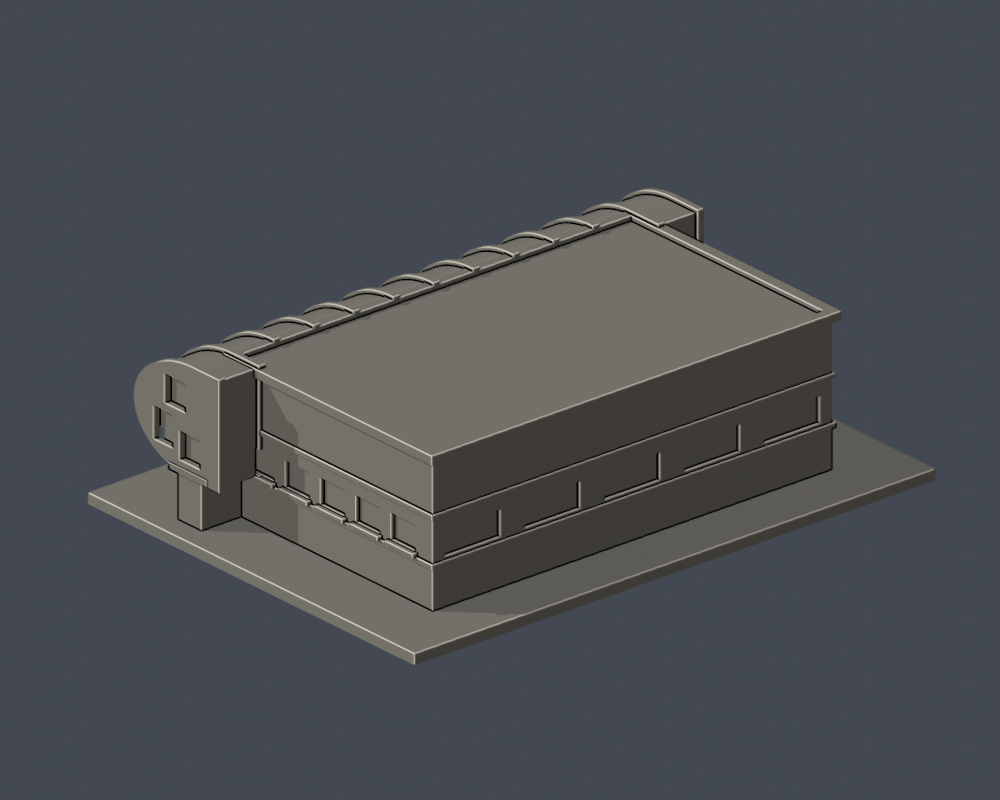

# 北寧校區體育館｜場側立面修版

既有模型修正，不增加學校或模型件數。完整外觀有界近似，150 × 111 × 41.9 mm（含底）。沿用原參數曲殼與主館；不是測繪、內部結構或全校完成件。

| 實際 STL 正面 | 同件背面 |
|---|---|
|  |  |

[頂圖](previews/top.png) · [場側全高](previews/elevation.png) · [入口局部](previews/entry-detail.png) · [場側局部](previews/field-detail.png) · [左側局部](previews/left-detail.png)。front、rear、top、elevation為4張完整全貌，entry-detail、field-detail、left-detail為3張局部；全部由本包 STL 渲染，沒有來源合成圖。

## 這次修正
以官方2000px正面與2026-03-19公開近側照，撤除舊規則全長通空柱廊及大外挑棚；補中央兩跨深入口、粗圓柱、左錯層短窗和小門棚、右兩組背接寬窗與頂小通風帶。右窗框為列印加粗淺浮雕。

照片左右對應模型 local y負場側，未靠未核北箭頭鏡射。新正照兩端裁切，不能將2000px拉滿全長。入口退深約7.5mm、柱半徑1.45mm、小棚柱半徑0.6mm是模型名義值，原型深度仍有界；未知末端保守素面，未逐窗確認背側。上曲殼、13肋及主館比例沿舊近似，不以本次立面照片宣稱其精確。

既有側窗底與窗台相交曾產生薄唇，這次把窗切口底15.00升至15.25mm、窗頂維持21.60mm，為列印源修。沒有對STL做修補、刪面或容差焊接。

## 數位檢查與限制
5630原三角、單表面水密、原法向/頂點鏈/共面相反重疊篩查通過；源重建STL SHA、Blend幾何、7張PNG位元與像素重建一致。
210個0.2mm層、432個原Polygon均不分裂/消失。60個Polygon opening loss >1%：24筆端肋（z20.071–22.271）、36筆上肋末端（z41.271–41.871）；峰5.1513425349%，保留94.8486574651%。原嚴格檢查維持false/exit1，限定裁定已完成，詳見獨立補充。
56300原面密點中1227短首弦，最小0.0000335533604338mm。每筆保留真入/出面、後段空氣及局部相鄰曲面patch真邊；補證連續根最短6.65393095985mm、真邊距最大0.782656059265mm，不等於全域最薄壁。原strict false不改綠。
完整法向後區間有12射線/24原三角沿面段；原8個parity flags的after點均落其中，沿面不計作體積空氣，面上winding 0/1不裁定內外。528個非邊界控制通過，72個面上值僅診斷。

底座朝下；曲殼下緣、入口梁與小門棚可能需要支撐。拆支撐留意細柱/窗框/肋端；勿任意縮小。尚未實體試印，也未做任何切片器工具路徑驗證。數位檢查不是全方位minimum-wall保證。

[檢查細節](QA.md) · [修訂紀錄](CHANGELOG.md) · [來源](sources.json) · [SHA256](SHA256SUMS.txt)

## 重建
Python 3.12 與 requirements.txt 套件、Blender 4.3.2、g++（OpenMP）。執行 python -B build_model.py；blender -b -t 4 -P render_preview.py；python -B run_checks.py。後者會保留嚴格未過結果並以exit1結束，請讀qa-summary，不等於作者准印。gzip資料可用Python gzip.open(path,'rt')或gzip -dc完整讀取。

[獨立修版覆核、162項覆蓋更正與限定例外](INDEPENDENT-REVISION-AUDIT.md) · [密面重現](independent-audit/dense/README.md)
[逐層與真正支承位置](independent-audit/components/ntou-revision-components-REPORT.md) · [精確後沿面重現](independent-audit/boundary/README.txt)
