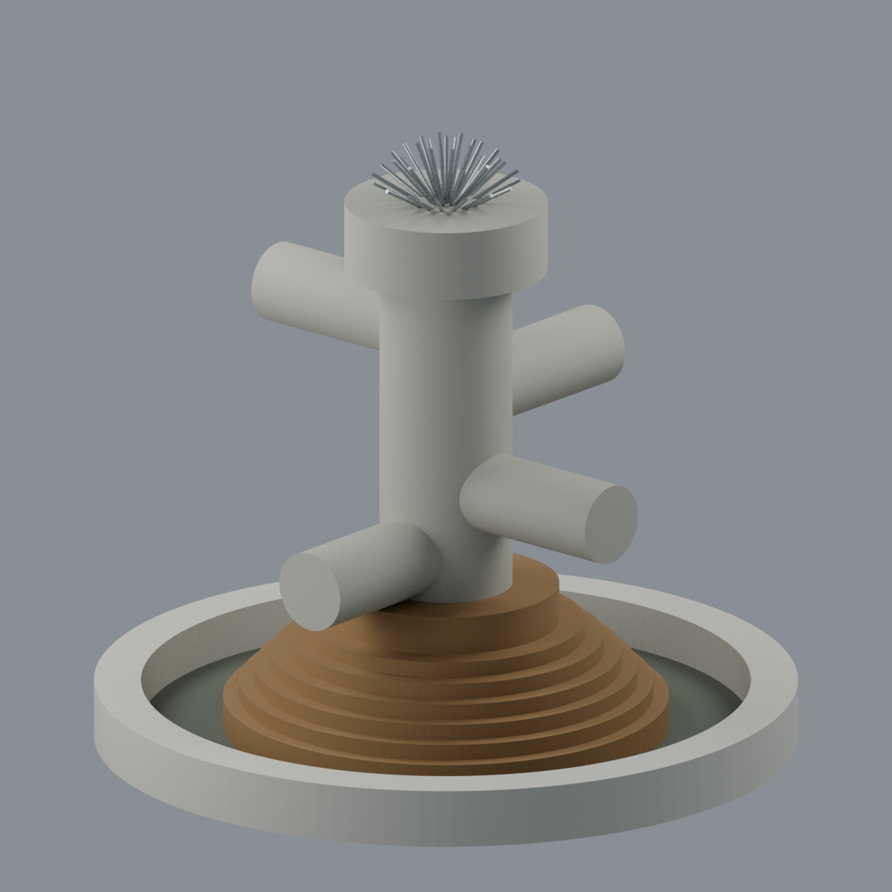
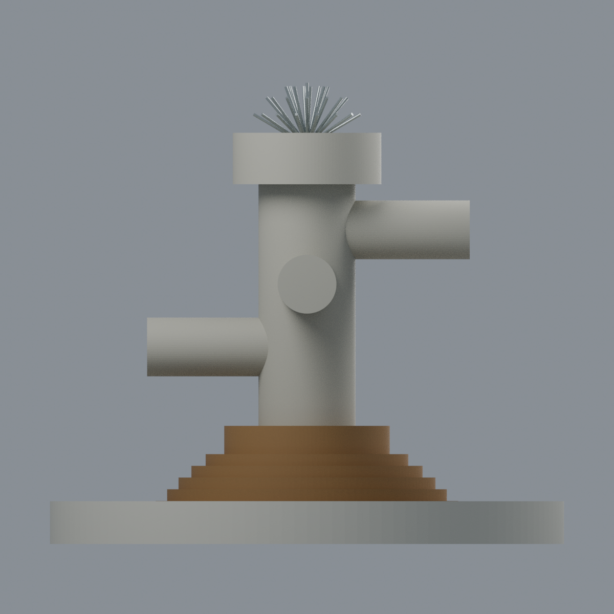
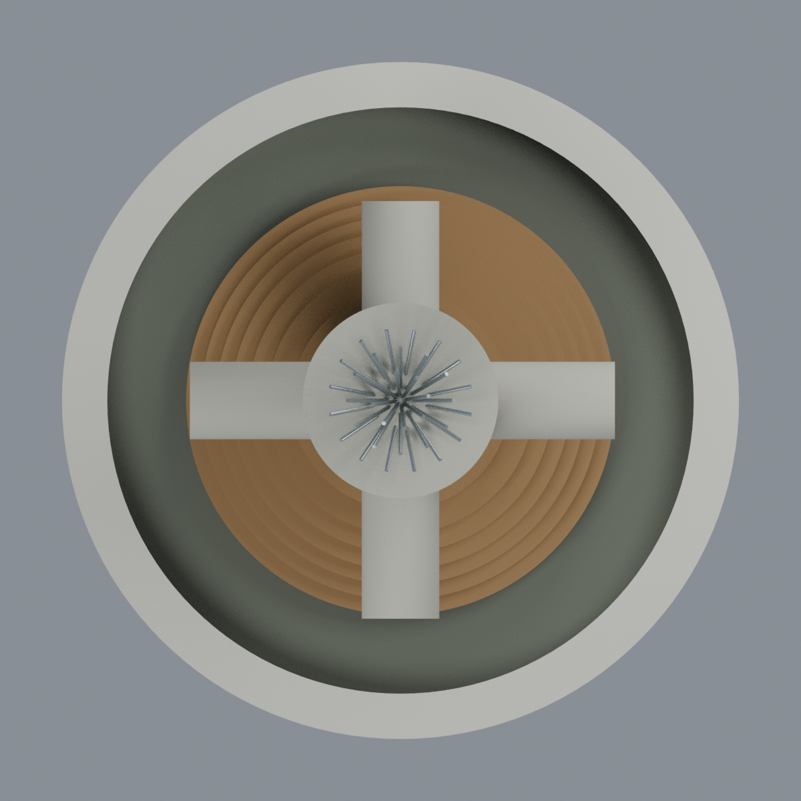
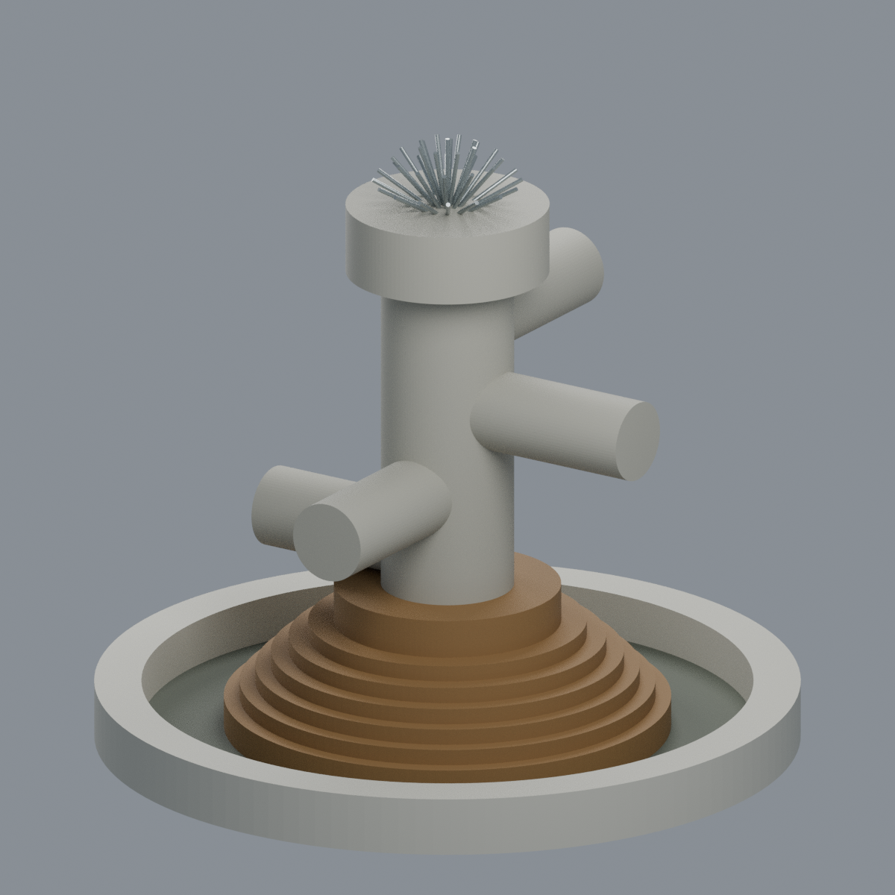

# 海洋大學夢泉（2018可見版本）

## 模型預覽

| 模型預覽 | 模型預覽 | 模型預覽 |
| :---: | :---: | :---: |
|  |  |  |

**國立臺灣海洋大學｜祥豐校區｜完整夢泉噴泉地標外觀近似。** 包含中央雕塑、七級圓階及完整環形圓池；不是夢泉商場建築，也不是整個夢泉廣場。


## 保留的主要構成

- 一支粗直立圓柱及較寬厚頂鼓，鼓底環形懸挑保留。
- **四個方向、四個不同高度的水平圓柱臂**；最高與第三高相對，次高與最低相對。端面封閉，不是敞口排水管，也不是兩層等高十字。
- 三維**半球形放射細管束**；不是實心球、平面扇或單尖錐。
- **頂部較高圓台＋下方六圈逐級擴大環階，共七級**。棕褐色依2018濕階近似，沒有混入2013舊乾灰基座。
- 外圍完整閉合淺圓池；中央階座與池壁之間保留真實360度環形空槽，**不以實心圓盤或透明塊填平水域**。動態水流與水面省略。

## 尺度、年代與近似限制

模型約**180×180×161.50mm**，輸出單位為毫米，但**不是經量測的實物比例尺**。所有尺寸、臂長、各高度與環階厚度均由照片估值，模型座標不宣稱地理方向。

主據四張具EXIF的2018-07-28實拍，2013反側照片只補主柱與四臂，2025官方手冊補身份及不同側形體。**2018是照片版本年，不是建造年；2025手冊建檔日期也不是攝影日期。** 不宣稱2026現況測繪。[來源與沿革](SOURCES.md)。

頂部以**37根、1.1mm直徑加厚實心桿**表現噴管外輪廓；根數、孔徑、角度及接頭未能精確核實。鼓頂不可見內深未知，採簡化平頂，**未猜造深碗或內部機構**。池底深度／斷面、照片濕乾色差同屬近似。沒有額外基地底板；不附廣場、餐廳、牌架、樹木與動態水。

## 編輯、材質及列印

Blend及3MF保留**5種逐面材質**；STL不含顏色。交付是融合單閉殼，可編輯頂點、面材質及重建程式參數，**不是已拆件可動裝配**。材質沒有來源照片貼圖，原照片／PDF／HTML／裁圖均不公開。

**未實印，不保證免支撐。** 四臂、鼓底及斜噴管有大懸挑與細長件，需依材料、縮放、擺向與切片器設計支撐。全局切層保留尖端薄層警告，局部所有小切塊亦計入，不因水密而稱通過列印認證。[QA詳情](QA.md)。

## 交付與五視圖

| 檔案 | 用途 |
|---|---|
| `model.stl` | 無色毫米網格 |
| `model.3mf` | 相同幾何、5種逐面材質 |
| `scene.blend` | 可編輯網格、材質、相機及燈光 |
| `build_model.py`、`render_model.py` | 參數生成及五張實際mesh渲染 |
| `mesh.json`、`palette.json` | 幾何與逐面材質對照 |
| `qa_model.py`、`check_features.py`、`verify_*.py` | 原始拓樸、切層、局部實體／空氣、格式與場景往返 |
| `rebuild.py` | 隔離生成核心4檔與5PNG，逐檔bytes核對 |
| `QA.md`、`qa/`、`qa-*.json` | 數值結果、警告及綁hash來源終審 |
| `SOURCES.md`、`sources.json`、`SHA256SUMS` | 來源、版本限制及完整校驗 |

[前斜視](previews/front.png) · [反斜視](previews/rear.png) · [正立面](previews/elevation.png) · [俯視](previews/top.png) · [另一側斜視](previews/left_oblique.png)

| 模型預覽 | 模型預覽 | 模型預覽 |
| :---: | :---: | :---: |
| 反斜視<br> | 正立面<br> | 俯視<br> |
| 另一側斜視<br> |  |  |

五圖由同一交付網格渲染，不是來源照片、AI概念圖或實印成果。

## 重建與驗證

依賴版本見`requirements.txt`，Blender須另行安裝。同環境、CPU與固定seed下可重建：

```bash
python build_model.py
python qa_model.py
python check_features.py
blender -b -t 8 --python-exit-code 1 --python render_model.py
python verify_exchange.py
blender -b -t 8 --python-exit-code 1 --python verify_scene.py
blender -b -t 8 --python-exit-code 1 --python verify_render.py
python rebuild.py --output ../independent-rebuild-new --blender blender --threads 8
python verify_package.py
```

`rebuild.py`要求不存在的新目錄；比較STL、3MF、mesh.json、palette.json及五個PNG的精確bytes。變更幾何／材質後須重建五圖與QA，不能沿用舊hash審查。模型授權見`LICENSE`，不移轉第三方素材權利。
