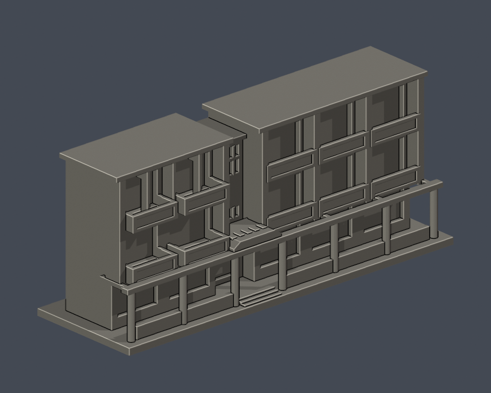
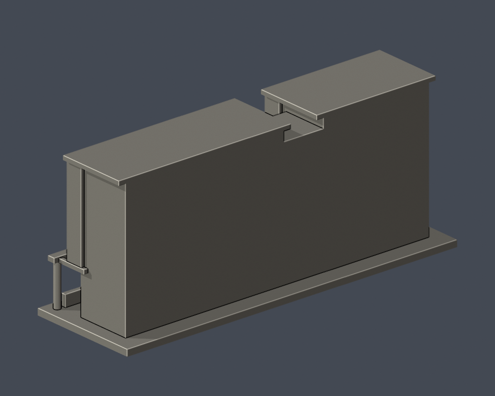
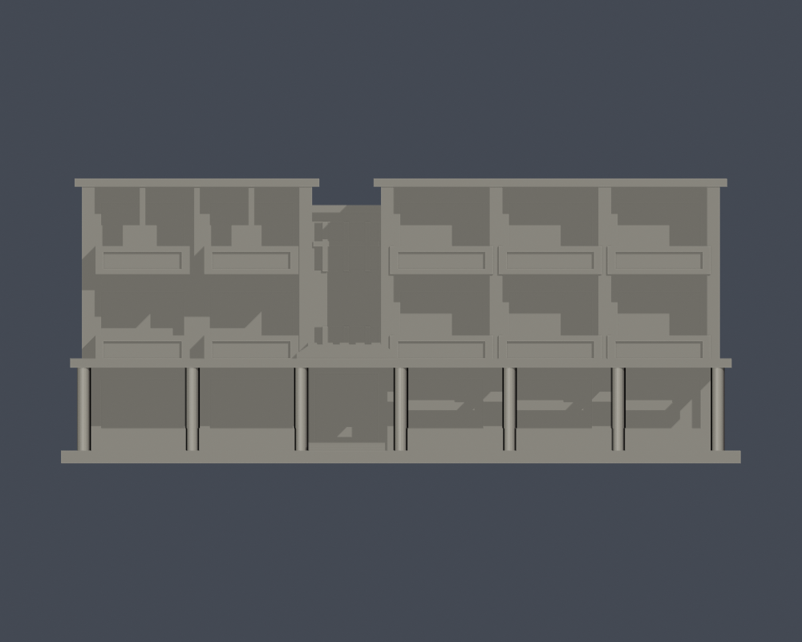
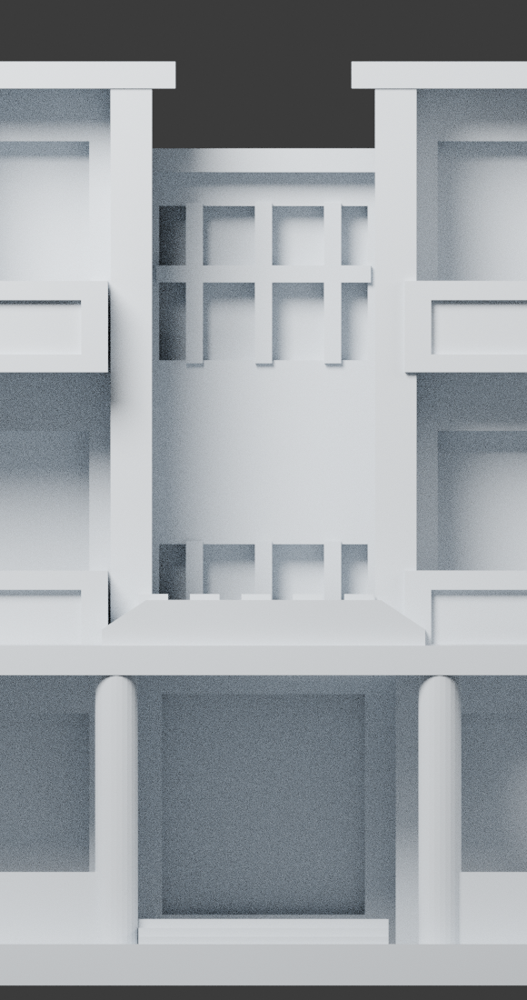
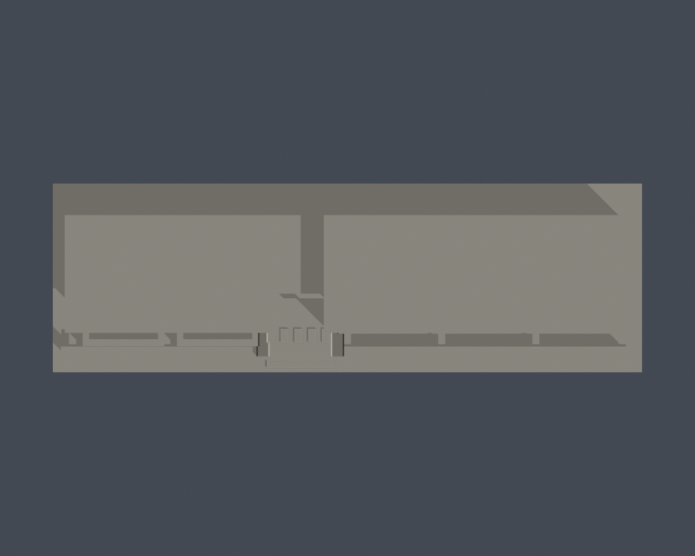

# 王光祥暨海大校友國際學舍・入口立面段

## 模型預覽

| 模型預覽 | 模型預覽 | 模型預覽 |
| :---: | :---: | :---: |
| 正面  | 背面／截面  |  |

國立臺灣海洋大學／馬祖校區。局部件，不計全棟。依公開實照自建的近似縮模，非測繪、非建築施工模型。

[正立面](previews/elevation.png) · [中央窗組近圖](previews/center-detail.png) · [俯視](previews/top.png) · [STL](model.stl) · [可編輯Blender檔](scene.blend) · [重建程式](build_model.py)

| 模型預覽 | 模型預覽 | 模型預覽 |
| :---: | :---: | :---: |
| 正立面  | 中央窗組近圖  | 俯視  |

## 範圍與外觀
- 保留左2右3開間、外凸／齊平陽台、退縮入口、中央上層橫直分格窗、柱廊、小瓦簷
- 僅截取正面24mm名義深度，背面是人為平直截面，絕非實際背立面
- 主屋頂坡形、後棟進深、左右全側面尚未查得，本件沒有填入假造全館
- 石牆材質與極細壓瓦石紋以簡化有背板浮雕表示

## 列印資訊
- 單位：毫米（mm）。含底座尺寸約 150.0 × 48.0 × 62.8 mm；各館獨立比例，最長150mm。
- 底座z=0朝下；先以0.2mm層高檢視實際切片預覽，再決定方向、支撐、填充與材料。
- 陽台底板、遮陽板與前柱廊樑需要切片器支撐檢視。
- 中央窗分格名義寬1.15mm，圓柱直徑2.9mm；薄材不得再任意縮小列印。

## 可重建來源與檢查
Python需求見[requirements.txt](requirements.txt)。依序執行 build_model.py，再用 Blender背景模式執行 render_preview.py（會匯入實際STL並保存scene.blend及預覽），中央窗組近圖由 [render_detail.py](render_detail.py) 另行匯入同一實際STL渲染。再執行 validate_model.py、check_contour_validity.py、thin_canonical_v2.py。

- [原STL／重建／Blend驗證](validation.json)：水密、單一連通表面、每邊兩面、vertex link單環、原始法向與正體積、尺寸、重建SHA及Blend幾何一致。
- [0.2mm層輪廓](contour-validity-check.json)：起始z=0.071mm，逐層degree2閉合；各個及組合Polygon有效。
- [0.8mm形態opening輔助篩檢](thin-feature-check.json)：每1.0mm取樣；不是全面最小壁厚或噴嘴路徑模擬。腳本使用 canonical 共享邊插值，並以 assert 拒絕無效組合Polygon，不自動修復輪廓。
- [綜合QA](qa-summary.json)、[逐檔SHA256](SHA256SUMS)、[來源及限制](sources.json)。

以上是數位幾何檢查，沒有實體試印，也未在Cura／PrusaSlicer驗證實際工具路徑；不保證所有機器、材料、縮放均可列印。scene.blend為實際STL匯入的可編修網格，參數重建來源是build_model.py。

## 授權與來源
僅提供自建模型與程式。第三方照片與圖資沒有隨包再散布；各來源網址及年代載於sources.json。未主張第三方建築設計或商標的權利。
