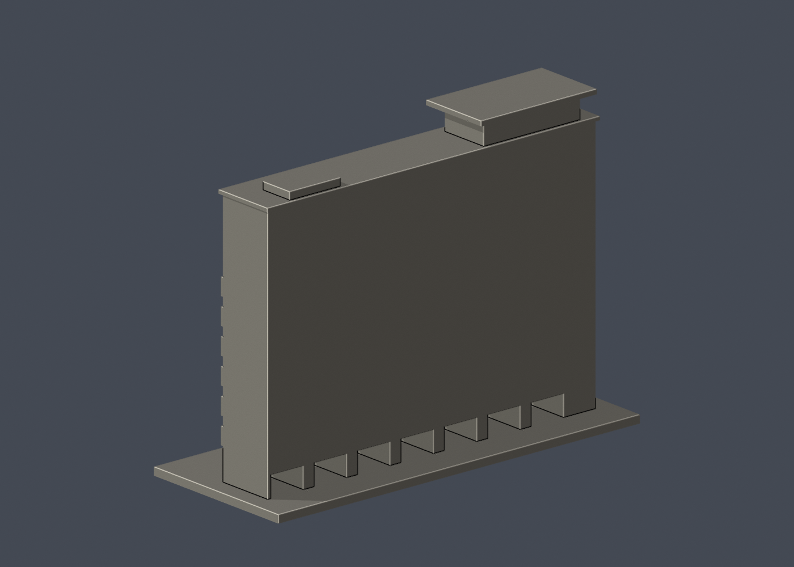

# 研揚大樓運動場立面段

## 模型預覽

| 模型預覽 | 模型預覽 | 模型預覽 |
| :---: | :---: | :---: |
| 正面，實際STL  | 背面，實際STL  |  |

國立臺灣科技大學・校本部。照片推估、可供3D列印研究的局部外觀模型；非校方測繪、非工程圖、非全棟完模。查閱日：2026-10-13。

## 範圍與尺度

僅製作面向運動場的主要立面及照片可見屋頂量體，22毫米模型進深為支撐用研究背板，不代表原館進深。

- 所屬建物：研揚大樓；別名／代號：TR、教學研究大樓、AAEON Building
- 單位：毫米（mm）；含底座外包尺寸：150.00 × 61.00 × 111.30 mm
- 各館獨立比例，最大尺寸150 mm；不可把不同件比例當成相同
- 底座平面朝下（Z=0）列印。STL本身不含單位，匯入切片器時選毫米

## 保留特徵

- 主要立面下部的成組豎向遮陽片
- 左側無遮陽長窗帶與狹窄窗列
- 上方两層小型成對窗群
- 偏左的屋頂退縮層、挑簷及少數粗化柱
- 低層入口凹部

## 證據邊界與省略

- 未重建街側背面、整棟側向進深、內部挑空與地下運動設施。
- 遮陽片以每組五片、厚1.15毫米放大概括；不對原館精確片數與構件尺寸作保證。
- 本件只有立面段，不計為全棟建模完成。
- 來源照片拍攝於2009／2010，2025配置圖只支持名稱與位置，不能視作2026外牆現況實拍。

## 列印與細件注意

遮陽片、入口凹部與屋頂挑簷有懸垂；須由實際切片器確認支撐。細片宜慢速並小心移除支撐。

0.8 mm參考寬度形態opening僅作輔助篩檢，並非全面最小壁厚量測；尖角也會形成面積損失。單一網格、輪廓閉合不代表工具路徑、黏床、橋接、冷卻、支撐可清除性或實體強度已驗證。尚未做Cura／PrusaSlicer完整工具路徑或實體試印，不能保證可印或不需支撐。別任意縮小本模型。

## 檔案與重建

- [列印STL](model.stl)
- [可編輯Blender網格](scene.blend)：由交付STL匯入；參數化來源是腳本
- [独立參數腳本](build_model.py)、[Python套件版本](requirements.txt)、[STL渲染腳本](render_preview.py)
- [原STL與重建／Blend驗證](validation.json)、[0.2mm輪廓](layer-check.json)、[個別與组合Polygon有效性](valid-sections.json)、[0.8mm輔助薄件篩檢](thin-feature-check.json)、[QA總結](qa-summary.json)
- [檔案SHA256](SHA256SUMS.txt)

重建順序：python -m pip install -r requirements.txt；python build_model.py；blender -b -t 2 -P render_preview.py；python validate_model.py；python check_layers.py；python check_valid_sections.py；python thin_canonical_v2.py。每個驗證程序均須exit 0。輸出更動後，舊SHA與QA不再適用。

## 本版數位驗證

- 原始STL水密、每邊兩面、頂點link單環、法向及繞序一致、正體積、單一連通表面、無分離封閉內殼：全部通過
- 獨立重建STL SHA256與保存的Blend三角幾何核對：通過
- 0.2 mm層距，固定起始Z=0.071 mm，共557層；輪廓degree2閉合、每個環及組合Polygon valid；無修補輸入
- canonical薄件截面每1.0 mm一次、起始Z=0.071 mm，opening參考寬度0.8 mm；最大面積損失 0.2173%
- STL SHA256：d2722ddd9101bceb87ef8540d46127b753451052b5d1e6ec0b0ef0a6963fb3f0

## 公開來源

原始第三方照片與PDF不隨本包散布。照片、PDF或網頁的更新／上傳日期不自動等於攝影日期。詳見 [sources.json](sources.json)。

- [臺科大現行校內配置圖](https://www.ntust.edu.tw/p/412-1000-102.php?Lang=zh-tw)：校本部建物位置與現名，平面圖不是外觀實拍；來源日期：圖檔名稱日期2025-12-05。
- [校內配置圖文字說明](https://www.ntust.edu.tw/p/404-1000-88778.php?Lang=zh-tw)：現名、代號與使用單位；33項不代表33棟；來源日期：頁面未標更新日，2026-10-13查閱。
- [官方教學研究大樓新建統包工程（已竣工）](https://www.general.ntust.edu.tw/p/412-1054-177.php?Lang=zh-tw)：研揚大樓工程名稱、地上10層加屋頂1層及實拍；來源日期：2009-06-30竣工；2009-07-29啟用。
- [官方運動場側高處實拍](https://www.general.ntust.edu.tw/var/file/54/1054/img/1340/P1100012.jpg)：立面全高及可見端部與屋頂；來源日期：頁面未標发布日期。
- [官方運動場側正面實拍](https://www.general.ntust.edu.tw/var/file/54/1054/img/1340/P1250616.jpg)：窗帶、百葉分組、屋頂退縮層與館名；來源日期：頁面未標發布日期。
