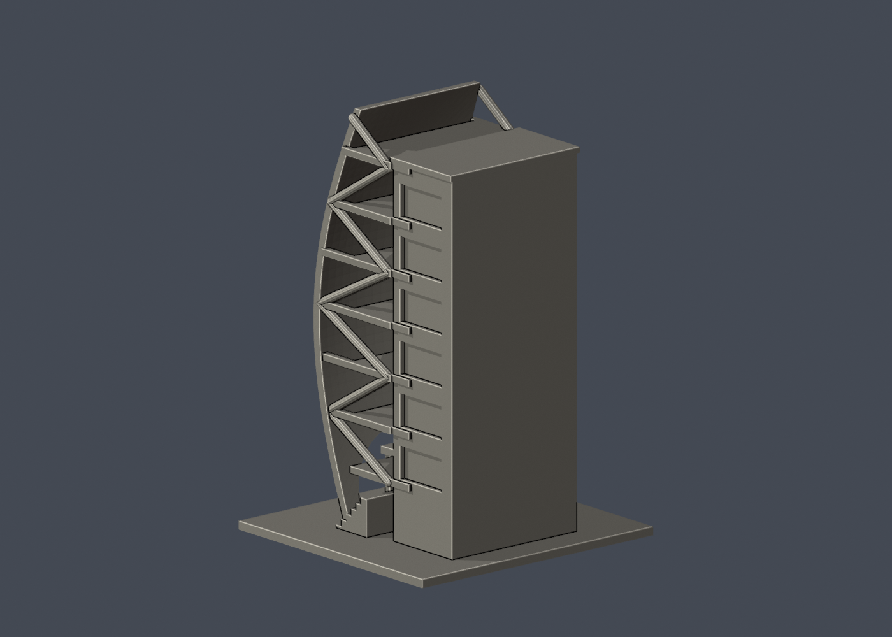

# 浩揚實驗大樓風帆側段

國立臺灣科技大學・校本部。照片推估、可供3D列印研究的局部外觀模型；非校方測繪、非工程圖、非全棟完模。查閱日：2026-10-13。

## 範圍與尺度

風帆曲面外皮、下部大開口、兩側開放樓板與斜撐、入口雨棚及研究背板。背面未按現場調查重建，因此定名風帆側段。

- 所屬建物：浩揚實驗大樓；別名／代號：臺灣建築科技中心大樓、帆船大樓、Haoyang Experimental Building
- 單位：毫米（mm）；含底座外包尺寸：102.04 × 95.92 × 150.00 mm
- 各館獨立比例，最大尺寸150 mm；不可把不同件比例當成相同
- 底座平面朝下（Z=0）列印。STL本身不含單位，匯入切片器時選毫米

## 模型預覽

| 模型預覽 | 模型預覽 | 模型預覽 |
| :---: | :---: | :---: |
| 正面，實際STL  | 背面，實際STL  |  |

## 保留特徵

- 前後與橫向略帶雙曲率的帆形皮層
- 帆形底部大拱形開口與兩側落地支點
- 連續七層樓板與可從側面看穿的深凹空間
- 兩側的交替斜撐與粗化支架
- 低入口雨棚及短階梯

## 證據邊界與省略

- 後立面、實驗室配置、背板深度、完整側向門窗均不是現場測量。
- 外皮三角板微細分縫、沖孔、原欄杆與管線省略；不將沖孔板改成脆弱網格。
- 曲面半徑與斜撐形狀從多張實拍近似；模型有意粗化支點、斜撐與樓板。
- 綠建築協會頁2011發布；建築師圖片2024上傳路徑不代表2024拍攝。2026辦公公告確認仍使用，未能驗證所有近期外觀變更。

## 列印與細件注意

帆形大開口、外皮與研究背板間的樓板、斜撐和雨棚需要評估支撐；內凹處支撐移除困難，請先檢查切片。

0.8 mm參考寬度形態opening僅作輔助篩檢，並非全面最小壁厚量測；尖角也會形成面積損失。單一網格、輪廓閉合不代表工具路徑、黏床、橋接、冷卻、支撐可清除性或實體強度已驗證。尚未做Cura／PrusaSlicer完整工具路徑或實體試印，不能保證可印或不需支撐。別任意縮小本模型。

## 檔案與重建

- [列印STL](model.stl)
- [可編輯Blender網格](scene.blend)：由交付STL匯入；參數化來源是腳本
- [独立參數腳本](build_model.py)、[Python套件版本](requirements.txt)、[STL渲染腳本](render_preview.py)
- [原STL與重建／Blend驗證](validation.json)、[0.2mm輪廓](layer-check.json)、[個別與组合Polygon有效性](valid-sections.json)、[0.8mm輔助薄件篩檢](thin-feature-check.json)、[QA總結](qa-summary.json)
- [檔案SHA256](SHA256SUMS.txt)

重建順序：python -m pip install -r requirements.txt；python build_model.py；blender -b -t 2 -P render_preview.py；python validate_model.py；python check_layers.py；python check_valid_sections.py；python thin_canonical_v2.py。每個驗證程序均須exit 0。輸出更動後，舊SHA與QA不再適用。

## 本版數位驗證

- 原始STL水密、每邊兩面、頂點link單環、法向及繞序一致、正體積、單一連通表面、無分離封閉內殼：全部通過
- 獨立重建STL SHA256與保存的Blend三角幾何核對：通過
- 0.2 mm層距，固定起始Z=0.071 mm，共750層；輪廓degree2閉合、每個環及組合Polygon valid；無修補輸入
- canonical薄件截面每1.0 mm一次、起始Z=0.071 mm，opening參考寬度0.8 mm；最大面積損失 0.0985%
- STL SHA256：7519576d2584246bb55c3b159c2226ff2081553c22b70ae74d8f6243feac0103

## 公開來源

原始第三方照片與PDF不隨本包散布。照片、PDF或網頁的更新／上傳日期不自動等於攝影日期。詳見 [sources.json](sources.json)。

- [臺科大現行校內配置圖](https://www.ntust.edu.tw/p/412-1000-102.php?Lang=zh-tw)：校本部建物位置與現名，平面圖不是外觀實拍；來源日期：圖檔名稱日期2025-12-05。
- [校內配置圖文字說明](https://www.ntust.edu.tw/p/404-1000-88778.php?Lang=zh-tw)：現名、代號與使用單位；33項不代表33棟；來源日期：頁面未標更新日，2026-10-13查閱。
- [臺灣綠建築發展協會案例](https://www.taiwangbc.org.tw/tw/modules/news/article.php?storyid=105)：地上七層、曲面皮層、三角遮陽板與側廊實拍；來源日期：2011-12-23。
- [協會外觀斜俯視實拍](https://www.taiwangbc.org.tw/tw/uploads/news/1000/2/3ddc8e51295bde44.jpg)：曲面、斜撐、七層與低雨棚；來源日期：附屬2011案例頁。
- [協會案例附件PDF](https://www.taiwangbc.org.tw/tw/modules/news/visit.php?fileid=615)：第1、2頁完成實拍支持側向深凹、底部大開口與曲面；效果圖未作現況依據；來源日期：PDF metadata建立2016-04-01；案例頁2011-12-23。
- [陳章安建築師教育建築作品](https://www.archtext.com.tw/educational_facilities/)：確認作品名與下部拱形開口實拍；來源日期：頁面未標照片日期。
- [建築師下部仰視實拍](https://www.archtext.com.tw/wp-content/uploads/2024/10/台北科技大樓.jpg)：大開口與曲面外皮細部；來源日期：路徑2024/10；不是攝影日期。
- [官方命名報導](https://www.ad.ntust.edu.tw/%E6%B5%A9%E7%80%9A%E5%AD%B8%E6%B5%B7%E3%80%81%E6%8F%9A%E5%B8%86%E9%A0%98%E8%88%AA-%E8%87%BA%E7%A7%91%E5%A4%A7%E6%B5%A9%E6%8F%9A%E5%AF%A6%E9%A9%97%E5%A4%A7%E6%A8%93%E5%91%BD%E5%90%8D%E6%9A%A8%E6%8F%AD/)：原臺灣建築科技中心／帆船大樓改名浩揚實驗大樓；來源日期：2022-12-15。
- [115學年度第一學期辦公時間及地點](https://innc.ntust.edu.tw/p/406-1111-151371,r2123.php?Lang=zh-tw)：浩揚大樓六樓仍供智慧製造科技研究所辦公；不等於外觀證據；來源日期：2026-09-04。
