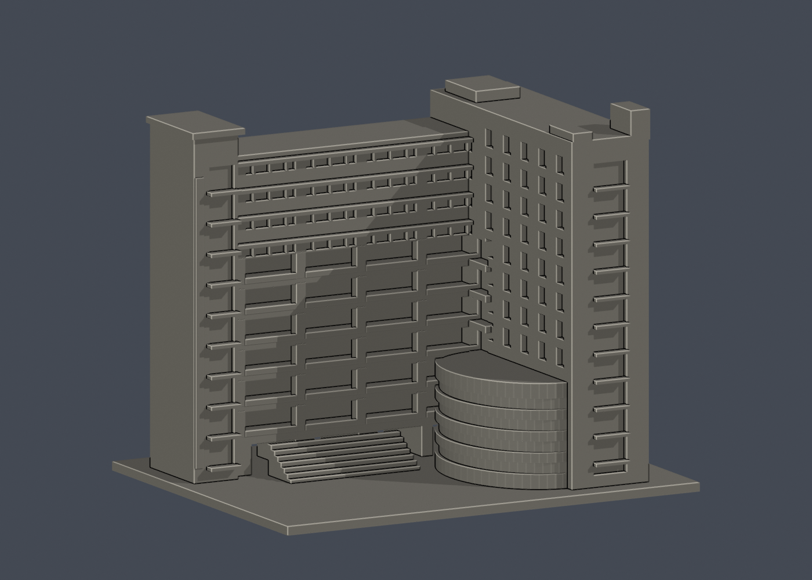
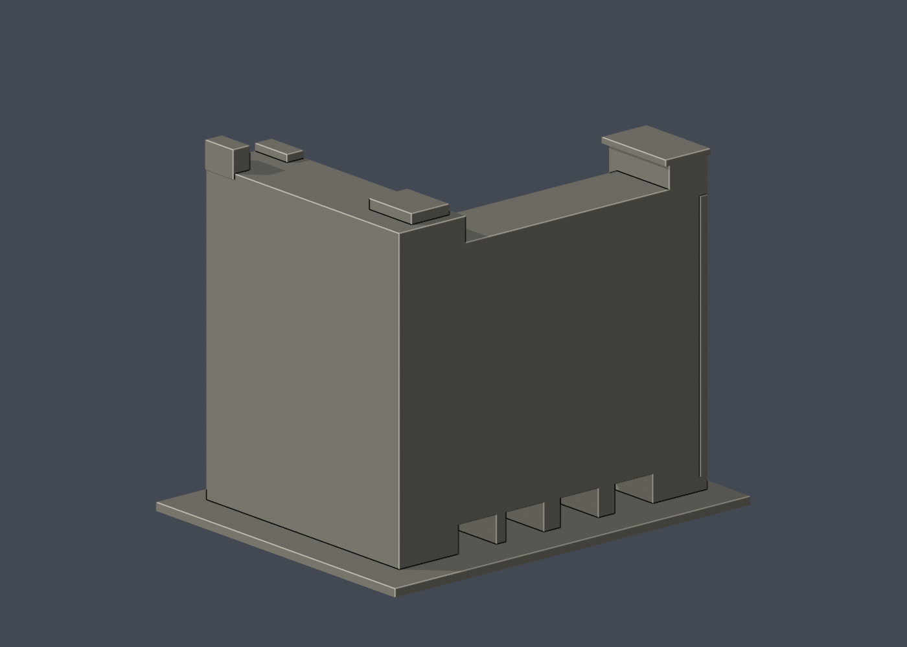

# 國際大樓廣場側段

國立臺灣科技大學・校本部。照片推估、可供3D列印研究的局部外觀模型；非校方測繪、非工程圖、非全棟完模。查閱日：2026-10-13。

## 範圍與尺度

廣場可見的L形相接雙翼、左側電梯塔、街向端部及弧形低翼。此件是廣場側局部外觀模型，不是整棟測繪。

- 所屬建物：國際大樓；別名／代號：IB、International Building
- 單位：毫米（mm）；含底座外包尺寸：150.00 × 119.00 × 125.00 mm
- 各館獨立比例，最大尺寸150 mm；不可把不同件比例當成相同
- 底座平面朝下（Z=0）列印。STL本身不含單位，匯入切片器時選毫米

## 模型預覽

| 模型預覽 | 模型預覽 | 模型預覽 |
| :---: | :---: | :---: |
| 正面，實際STL  | 背面，實際STL  |  |

庭院保持開放，頂視可核對兩翼關係：

| 模型預覽 | 模型預覽 | 模型預覽 |
| :---: | :---: | :---: |
|  |  |  |

## 保留特徵

- L形兩翼之間的開放庭院
- 地面四處穿通門廊與分層凹廊
- 上部連續水平遮陽線與分組窗帶
- 街向端部的直向玻璃槽與高低塔頂
- 低翼的曲線輪廓與水平玻璃分帶

## 證據邊界與省略

- 完整後立面、外側長面、所有屋頂設備與管線沒有足够實拍，保留素面研究背板，不鏡射前窗。
- 兩翼進深、層高、窗寬、屋頂機房尺寸以照片比例估算，未按原圖實測。
- 精誠雕塑、水池、植栽與校園景觀未納入。
- 2012照片可以確認增建後外形，但不能保證2026外牆設備與遮陽色彩完全未變。

## 列印與細件注意

凹廊頂板、地面穿廊、遮陽板、窗沿及屋頂突出部有懸垂；須由實際切片器確認支撐與可清除性。

0.8 mm參考寬度形態opening僅作輔助篩檢，並非全面最小壁厚量測；尖角也會形成面積損失。單一網格、輪廓閉合不代表工具路徑、黏床、橋接、冷卻、支撐可清除性或實體強度已驗證。尚未做Cura／PrusaSlicer完整工具路徑或實體試印，不能保證可印或不需支撐。別任意縮小本模型。

## 檔案與重建

- [列印STL](model.stl)
- [可編輯Blender網格](scene.blend)：由交付STL匯入；參數化來源是腳本
- [独立參數腳本](build_model.py)、[Python套件版本](requirements.txt)、[STL渲染腳本](render_preview.py)
- [原STL與重建／Blend驗證](validation.json)、[0.2mm輪廓](layer-check.json)、[個別與组合Polygon有效性](valid-sections.json)、[0.8mm輔助薄件篩檢](thin-feature-check.json)、[QA總結](qa-summary.json)
- [檔案SHA256](SHA256SUMS.txt)

重建順序：python -m pip install -r requirements.txt；python build_model.py；blender -b -t 2 -P render_preview.py；python validate_model.py；python check_layers.py；python check_valid_sections.py；python thin_canonical_v2.py。每個驗證程序均須exit 0。輸出更動後，舊SHA與QA不再適用。

## 本版數位驗證

- 原始STL水密、每邊兩面、頂點link單環、法向及繞序一致、正體積、單一連通表面、無分離封閉內殼：全部通過
- 獨立重建STL SHA256與保存的Blend三角幾何核對：通過
- 0.2 mm層距，固定起始Z=0.071 mm，共625層；輪廓degree2閉合、每個環及組合Polygon valid；無修補輸入
- canonical薄件截面每1.0 mm一次、起始Z=0.071 mm，opening參考寬度0.8 mm；最大面積損失 0.1410%
- STL SHA256：4cb5bfdbde4b9d544e6944dc1e6a9b72bafb310e6df4bace43f63c6ae0037d42

## 公開來源

原始第三方照片與PDF不隨本包散布。照片、PDF或網頁的更新／上傳日期不自動等於攝影日期。詳見 [sources.json](sources.json)。

- [臺科大現行校內配置圖](https://www.ntust.edu.tw/p/412-1000-102.php?Lang=zh-tw)：校本部建物位置與現名，平面圖不是外觀實拍；來源日期：圖檔名稱日期2025-12-05。
- [校內配置圖文字說明](https://www.ntust.edu.tw/p/404-1000-88778.php?Lang=zh-tw)：現名、代號與使用單位；33項不代表33棟；來源日期：頁面未標更新日，2026-10-13查閱。
- [官方國際大樓增建統包工程（已竣工）](https://www.general.ntust.edu.tw/p/412-1054-176.php?Lang=zh-tw)：工程範圍與完成後照片；曾以general-r.ntust.edu.tw同路徑讀取；來源日期：增建2007-11-30完成；頁面未標更新日。
- [官方廣場／街向實拍](https://www.general.ntust.edu.tw/var/file/54/1054/img/1340/916504554.jpg)：右翼街向塔端、左翼、整體高低與低層入口；來源日期：未標發布日期。
- [官方L形內側與曲線低翼實拍](https://www.general.ntust.edu.tw/var/file/54/1054/img/1340/110707229.jpg)：L形凹廊與曲線低翼；來源日期：未標發布日期。
- [官方內側近景](https://www.general.ntust.edu.tw/var/file/54/1054/img/1340/127044848.jpg)：地面穿堂、凹廊、窗帶、上部遮陽；來源日期：未標發布日期。
