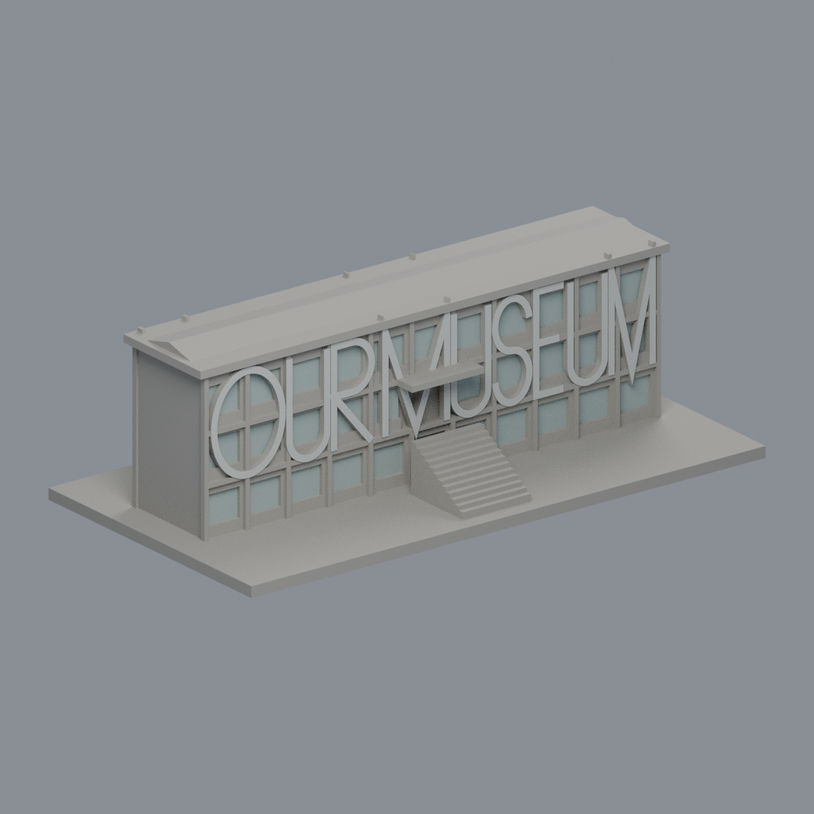

# 國立臺灣藝術大學｜公開外觀3D列印模型

本批為板橋校區3件，含1件圖書館入口立面段，並非全校完成；與國立臺南藝術大學不同。每件自行以公開照片建立毫米制幾何、含底座最大150 mm且各自獨立比例。

| 圖書館球體入口立面段 | 有章藝術博物館現館 | 臺藝表演廳 |
|---|---|---|
|  |  [歷史照片限域外觀](板橋校區/buildings/ntua-you-chang-museum/appearance/README.md) |  |

每件頁面提供STL、可編輯Blender場景、重建程式、前後STL渲染、來源及原始網格數位QA。第三方照片/PDF未再散布，只列來源網址。玻璃為實心曲面或背襯；未知側背、進深及細節估算逐件說明。

## QA與列印限制
原始STL水密、每邊兩面、頂點link、原法向、正體積、單一表面、重建SHA與savedBlend一致。0.2mm截面逐輪廓及組合Polygon valid；0.8mm每1mm層厚形態學篩查。這些不是實體試印、真切片或完整壁厚證明，懸挑/球體下緣/深簷/外梯可能需要支撐，細節有加厚和省略。

## 範圍與續接
已核板橋主校區（含北側藝術聚落、古蹟藝術修護園區），以及大觀路二段28號文化創意產學園區（二校區）。尚未把園區用途、群棟與連體建築全部拆解；55個2025防災地圖項目不是55棟，舊清單10研究項也不是10棟。

[逐項研究狀態及後續工作](research-progress.json)

優先續查：
1. 二校區官方園區圖逐棟辨識與實拍（尚未完成外觀研究）。
2. 北側藝術聚落、古蹟園區的群棟/別名去重（校圖有列名，棟界未解完）。
3. 新學生宿舍施工完成狀態；影音大樓更新後外牆；綜合大樓耐震補強後外觀（已發現工程資訊，現況未核完）。
4. 書畫大樓目前只有局部立面證據；其餘列名館舍尚待逐棟外觀研究。
5. 有章現館與北側新館計畫分開；新館效果圖不用作現況模型。
