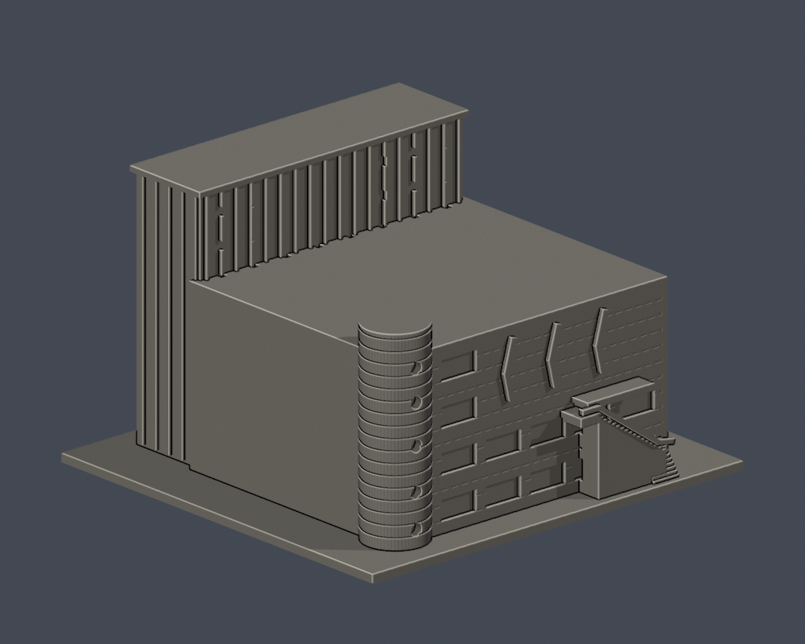
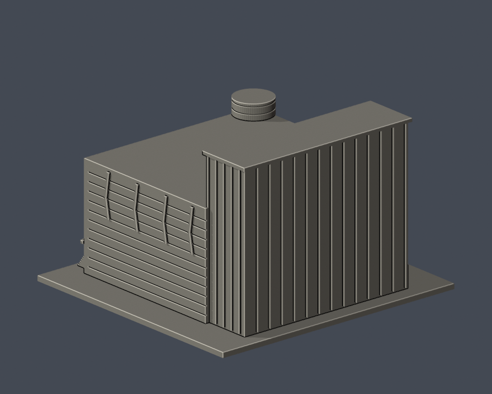

# 國立臺灣藝術大學｜臺藝表演廳

板橋校區。這是根據公開外觀照片自行製作的3D列印縮模，不是官方測量或施工模型；實際尺寸不詳，模型採獨立展示比例。含底座最長邊150 mm；檔案單位為毫米。

| 模型預覽 | 模型預覽 | 模型預覽 |
| :---: | :---: | :---: |
| 正面（直接STL）  | 背面（直接STL）  |  |

## 檔案
- [STL](model.stl)
- [可編輯Blender場景](scene.blend)：列印網格可編輯，與交付STL三角形幾何一致；參數來源另見Python
- [參數建模](build_model.py)・[依賴](requirements.txt)・[渲染](render_preview.py)
- [原始網格驗證](validation.json)・[0.2mm輪廓檢查](contour-validity-check.json)・[0.8mm細節篩查](thin-feature-check.json)
- [來源紀錄](sources.json)・[SHA-256](SHA256SUMS.txt)

## 外觀與限制
後側高舞台塔、較低主廳體、圓筒梯間、圓窗、水平外牆帶、彎折垂直燈條和入口雨庇。

以官方夜間空拍確認主要量體與屋頂輪廓，2012年訪客實照補圓窗和日間立面，非所有細節均有2026近照。未見的後側服務開口、進深與機房屋面從簡；不含連鄰的圖文／視傳系館及其他行政單位，不把表演藝術中心三場館當三棟。燈條僅為實心淺浮雕，不發光。外樓梯以靠牆的實心階梯體保留輪廓，省略樓梯下方中空；日景證實燈槽為外牆實體構件。

## 列印與數位QA
建議0.4mm噴嘴、0.2mm層高起始試切片，底座平放；請先檢查切片預覽。雨庇、圓筒突出部與入口階梯視切片方向可能需要局部支撐；燈條和細水平線接近噴嘴解析極限。

原始STL檢查包含水密、每邊兩面、頂點link單一循環、原始法向、正體積、單一連通表面、無獨立內腔殼、150mm、獨立重建SHA，以及保存的Blender幾何相符。0.2mm層截面檢查degree2閉合及個別／組合Polygon valid。0.8mm檢查是每1mm高度的形態學開運算篩查，銳角也可能被標示；不是全面壁厚測量。

這些僅為數位QA，不是實體試印、真切片驗證或對所有自交的窮盡證明。底座與主體為單件；部分細節被加厚或省略以便列印。

## 重建
Python 3.12 安裝requirements.txt後執行build_model.py，再以Blender 4.3.2以上執行render_preview.py。依序執行validate_model.py、check_contour_validity.py、check_thin_features.py。validate_model.py必須exit 0，且validation.json每個checks欄位為true。

## 來源
- https://artcenter.ntua.edu.tw/about
- https://artcenter.ntua.edu.tw/
- https://hpc-micasa.blogspot.com/2014/08/blog-post.html
- https://artcenter.ntua.edu.tw/images/about/intro.jpg

來源照片與PDF權利屬原權利人，未附在本公開模型資料夾；僅提供原始網址。STL、參數程式與預覽皆為本案自行製作。
