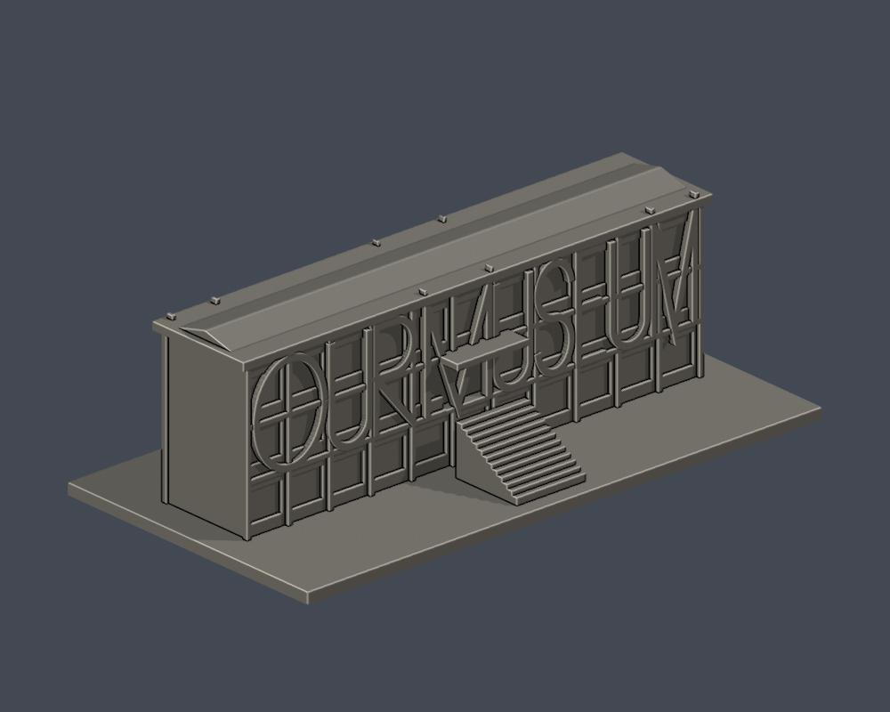
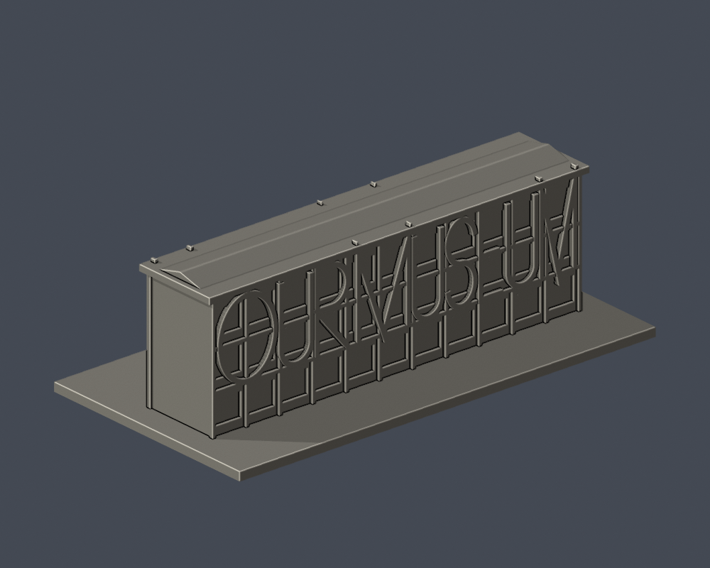

# 國立臺灣藝術大學｜有章藝術博物館現館

板橋校區。這是根據公開外觀照片自行製作的3D列印縮模，不是官方測量或施工模型；實際尺寸不詳，模型採獨立展示比例。含底座最長邊150 mm；檔案單位為毫米。

| 正面（直接STL） | 背面（直接STL） |
|---|---|
|  |  |

## 檔案
- [STL](model.stl)
- [可編輯Blender場景](scene.blend)：列印網格可編輯，與交付STL三角形幾何一致；參數來源另見Python
- [參數建模](build_model.py)・[依賴](requirements.txt)・[渲染](render_preview.py)
- [原始網格驗證](validation.json)・[0.2mm輪廓檢查](contour-validity-check.json)・[0.8mm細節篩查](thin-feature-check.json)
- [來源紀錄](sources.json)・[SHA-256](SHA256SUMS.txt)

## 外觀與限制
三層長條體、低雙坡屋頂、深簷、前後玻璃帷幕構架、OUR MUSEUM 巨型字樣、中央外樓梯與二樓入口。

此件為1967年舊行政大樓改造的現館，不是北側新館計畫。官方照片DSCF2826是改造前照片，只作歷史辨識，未當作現況背面。巨型英文字採自製簡化筆畫，不是字體或招牌精確複製。進深、端牆與屋脊高度均依公開外觀估計；不含鄰近綜合大樓或室內。

## 列印與數位QA
建議0.4mm噴嘴、0.2mm層高起始試切片，底座平放；請先檢查切片預覽。深簷、入口雨庇及字樣跨越窗凹處可能需要局部支撐。玻璃採實心背襯，細字、窗框已加厚，非透明帷幕構造。

原始STL檢查包含水密、每邊兩面、頂點link單一循環、原始法向、正體積、單一連通表面、無獨立內腔殼、150mm、獨立重建SHA，以及保存的Blender幾何相符。0.2mm層截面檢查degree2閉合及個別／組合Polygon valid。0.8mm檢查是每1mm高度的形態學開運算篩查，銳角也可能被標示；不是全面壁厚測量。

這些僅為數位QA，不是實體試印、真切片驗證或對所有自交的窮盡證明。底座與主體為單件；部分細節被加厚或省略以便列印。

## 重建
Python 3.12 安裝requirements.txt後執行build_model.py，再以Blender 4.3.2以上執行render_preview.py。依序執行validate_model.py、check_contour_validity.py、check_thin_features.py。validate_model.py必須exit 0，且validation.json每個checks欄位為true。

## 來源
- https://museum.ntua.edu.tw/B01.asp
- https://museum.ntua.edu.tw/F04.asp
- https://museum.ntua.edu.tw/upfiles/HF5/DSC05978.jpg
- https://museum.ntua.edu.tw/upfiles/HF5/04.jpg

來源照片與PDF權利屬原權利人，未附在本公開模型資料夾；僅提供原始網址。STL、參數程式與預覽皆為本案自行製作。

## 歷史照片限域彩色外觀層

[彩色3MF、可編輯Blend與五視角](appearance/README.md)：1132原面（1002巨字向外正面／130既有實心窗背），7428面中性。全部8560面與原STL bytes不變，不重建玻璃後磚木，不染字側框頂／屋尖／入口。依2007年自報日期官照的淺低飽和不透明代理，不是2026現況測繪或北側新館。原數位QA及估計幾何限制原樣保留。
