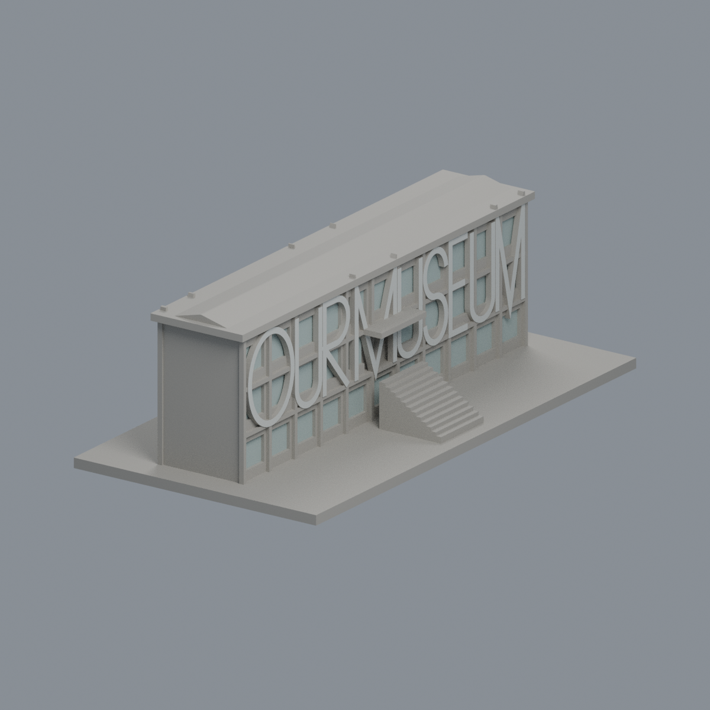
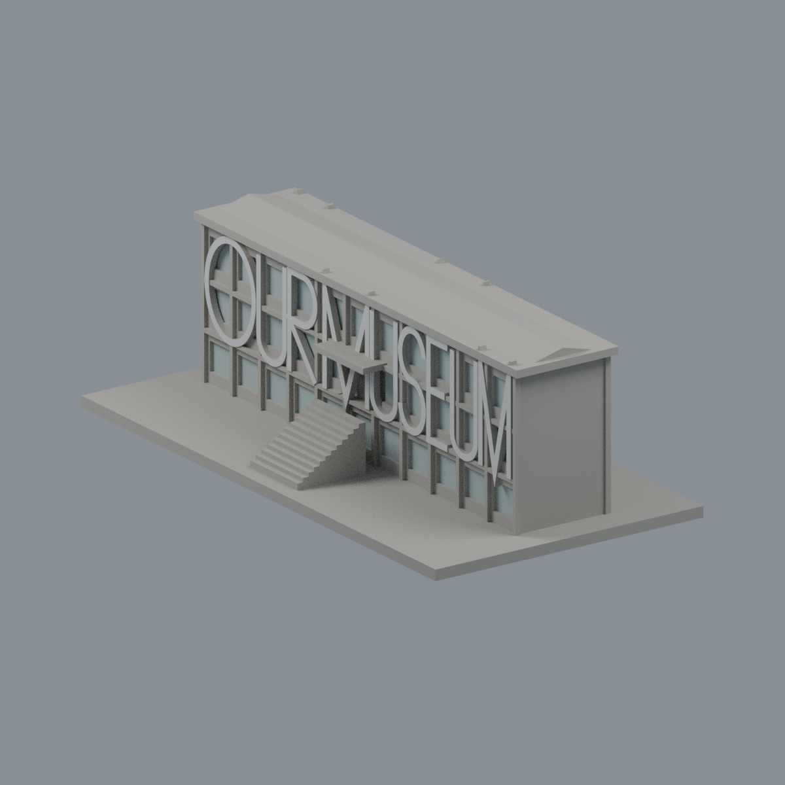
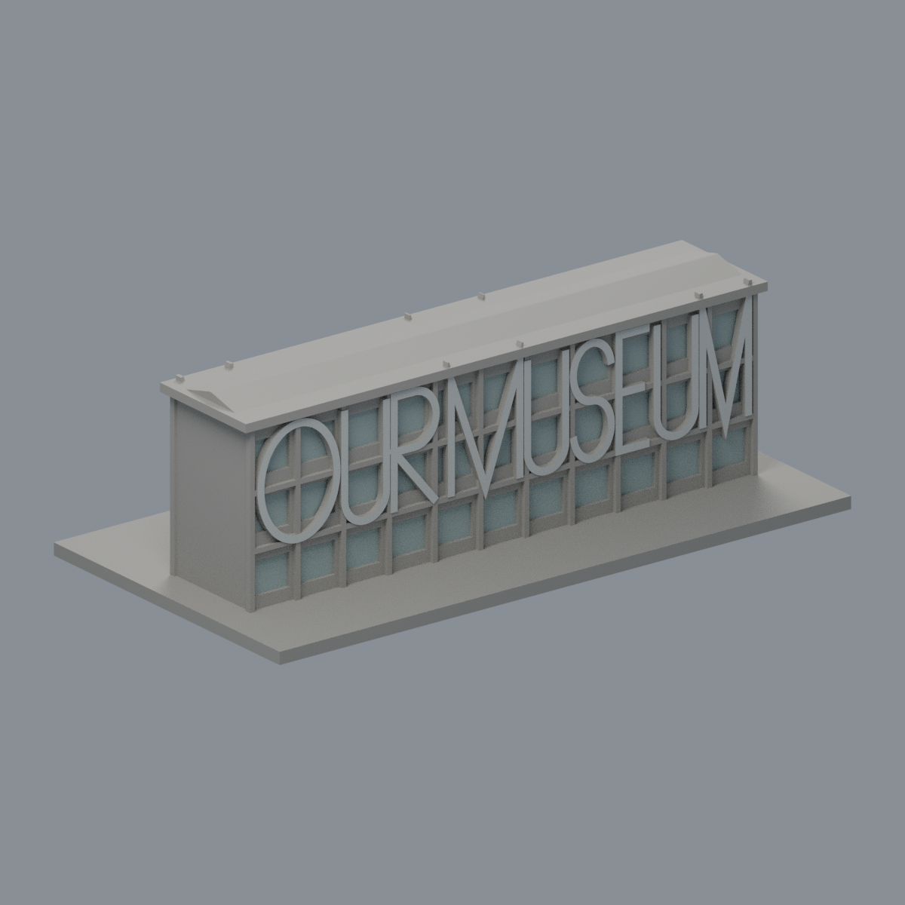
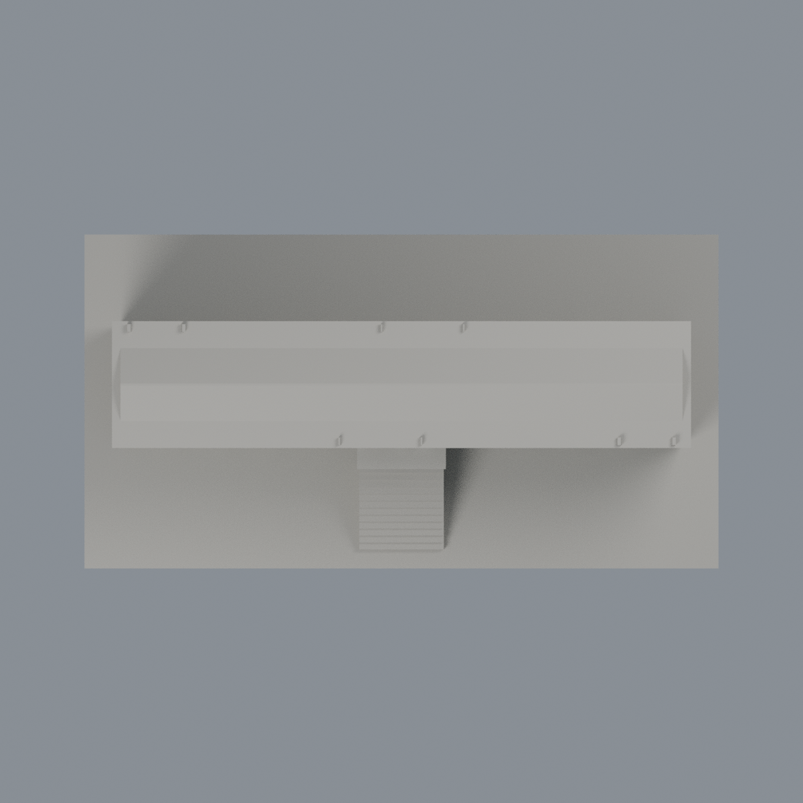
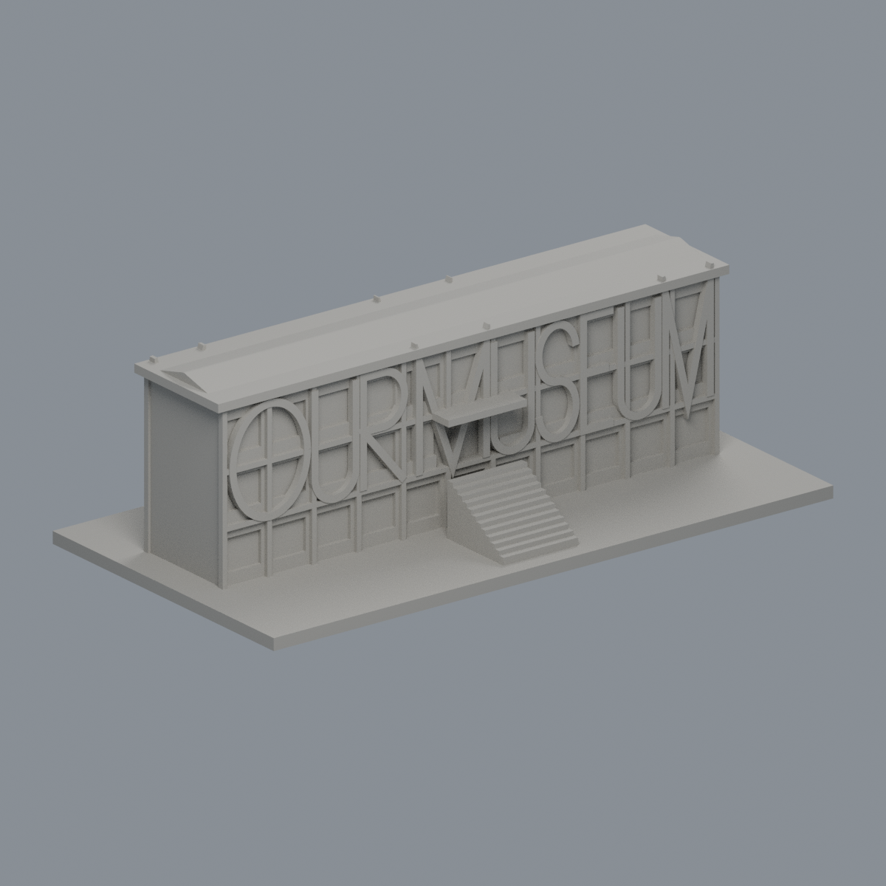

# 有章藝術博物館現館｜歷史照片限域外觀層

沿用原模型身份與全部8560面，不是北側新館、現況測繪或完整修復。只替1002巨字向外正面及130既有實心窗背加入克制代理色；其餘7428面中性。字側、頂底、共用框、屋頂碎尖與中央入口兩面不染色；保留原M字下尖8面連續筆畫。沒有新增、切割或移動三角形。

[彩色3MF](ntua-you-chang-museum-appearance.3mf) · [可編輯Blender](scene.blend) · [材質表](palette.json) · [逐面索引](face-materials.json) · [重建來源包](rebuild-source.zip) · [校驗](SHA256SUMS.txt)

| 正面／外梯側 | 左側 | 右側 |
|---|---|---|
|  |  |  |
| 水池側 | 頂視 | 同角度單色對照 |
|  |  |  |

## 色彩與證據界線
兩張官方歷史照片的原始EXIF自報2007-11-01及2007-10-24，無拍攝時區；2017為後製時間，2026-10-23為本次讀取日，均不得當作2026現況證明。巨字是原模型簡化加厚筆畫，非精確字體。淺低飽和灰藍綠窗色是不透明展示代理，不是透明玻璃、黑幕、校準色值或玻璃後紅磚木窗重建。

## 幾何與QA
原STL bytes、三角形座標、順序、法向不變：4202頂點／8560面，150×79×48.5mm，體積約191214.8385mm³。新QA檢查3MF嚴格讀入、材質實際修改存讀、Blend材質與頂點實改存讀及重開渲染。原資料夾歷史validation、243層0.2mm輪廓與49層0.8mm形態篩查原樣保全；閱讀舊報告不代表重跑，亦不是真切片或實體試印。深簷、入口雨庇、跨凹字樣可能需要支撐。進深、端牆、屋脊高度仍為估計。

## 可重建
安裝source/requirements.txt；使用Blender 4.3.2。解壓rebuild-source.zip，執行`python appearance/source/build_appearance.py`、`python appearance/source/verify_exchange.py`、`blender -b --python appearance/source/render_appearance.py`、`blender -b --python appearance/source/verify_scene.py`。正規STL保留於解壓根目錄，所有選面採實際外法向、完整三頂點有限域及筆畫全三角覆蓋，不用面中心推估。

詳見[SOURCES](SOURCES.md)、[權利說明](LICENSE-NOTICE.md)與qa。此層不提升原模型列印保證。
