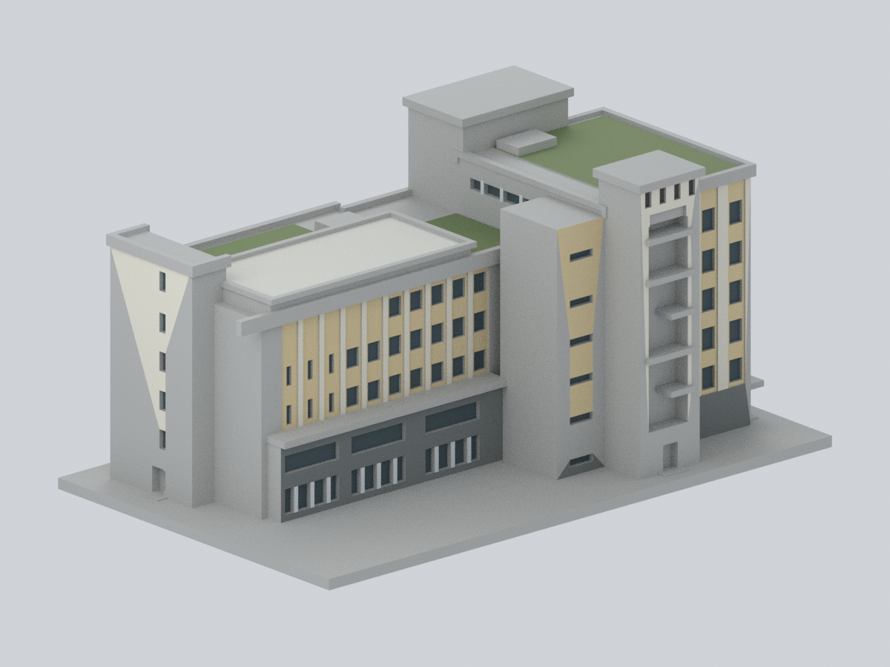
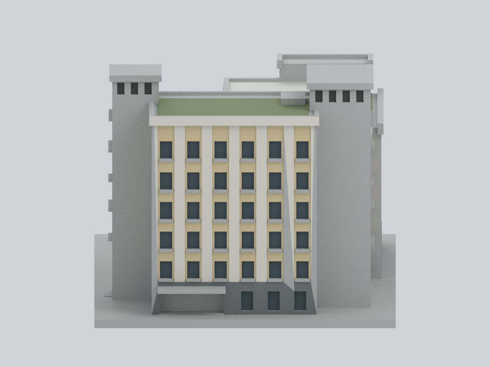
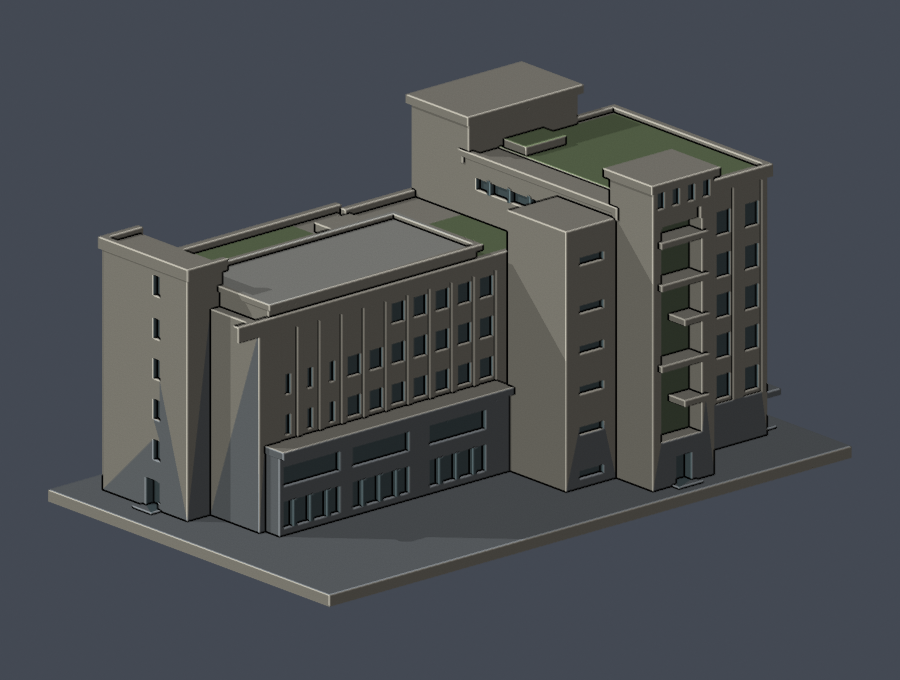
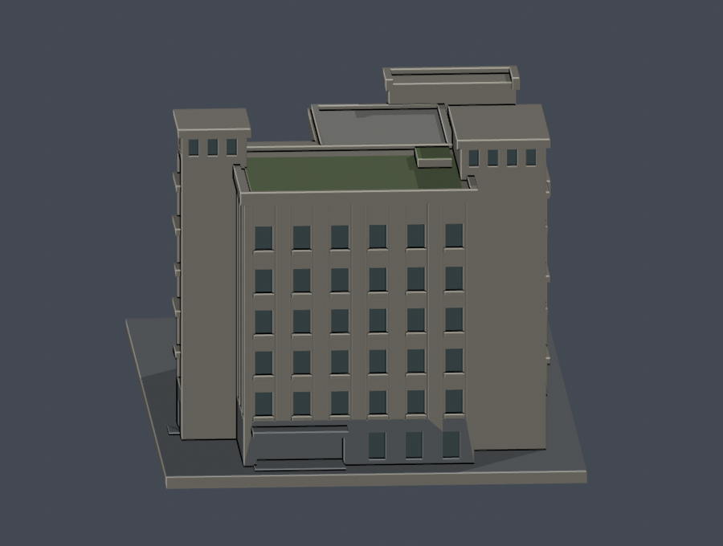
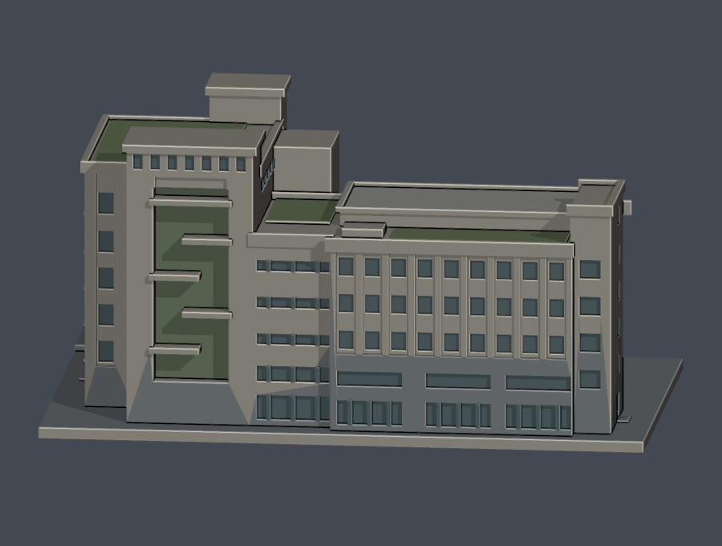
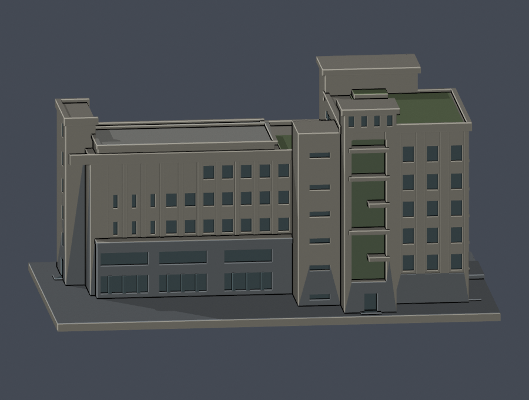
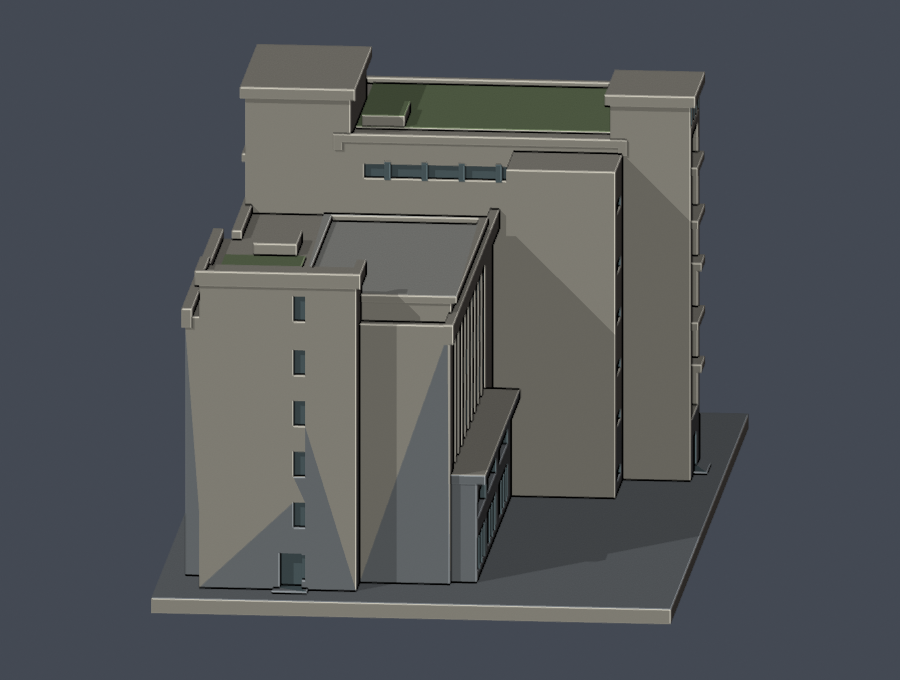
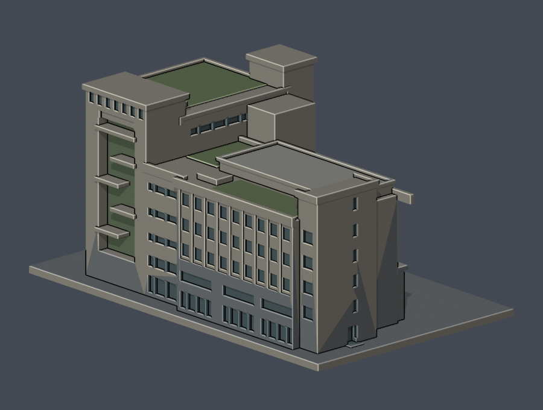
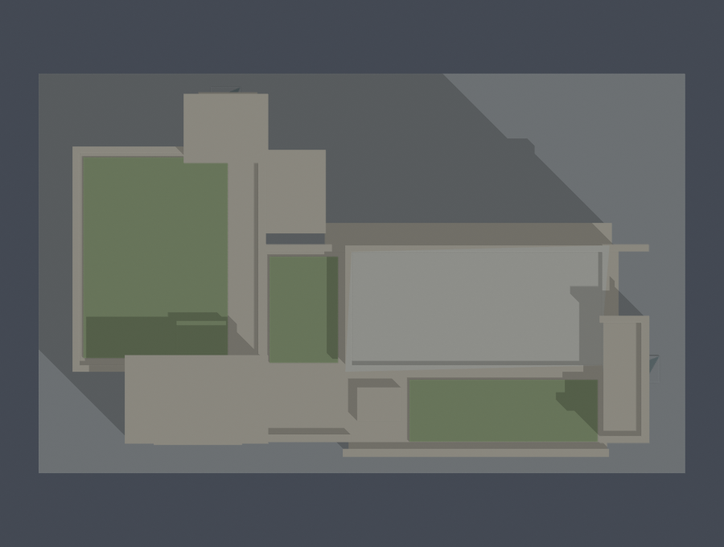

# 國立臺灣體育運動大學｜臺中校區｜長啓樓

**2017 竣工原主體外觀近似。** 本件是臺中國立臺灣體育運動大學長啓樓（工程原名：運動科學綜合大樓），不是桃園的國立體育大學。含高低樓翼、各端梯間、主要退台、原綠屋頂與入口雨遮。不是現況精密測繪，不代表全校建物已完成。

## 原三角面的來源限定配色

[配色模型、九視角與完整材料說明](appearance/README.md)保留原 STL 的 5,698 個三角面與面序，不新增建物或幾何。只有可與完整原三角面登錄的 1,783 面加入來源支持的代表色；其餘 3,915 面保持中性未知，不表示現場灰色材料。斜向色塊邊界來自原三角面可登錄範圍，不是實際立面斜向分色；照片未校色，並非完整逐面實測復原。

| 配色正面斜視 | 配色後側斜視 | 配色街面 |
| :---: | :---: | :---: |
|  |  |  |

下載[可編輯彩色 Blender](appearance/ntus-changqi-appearance.blend)或[逐面材料 3MF](appearance/ntus-changqi-appearance.3mf)；[Python 重建入口](appearance/rebuild.py)、面材質對照與來源網址一併保留。配色只涵蓋 2017 原主體的有據區域，不加後期太陽能棚；原尺寸近似、細節與支撐限制不變。STL 本身仍無色彩。

## 原始 STL 幾何預覽

以下保留原模型的八張實際幾何預覽與原辨識配色，供對照。


| 模型預覽 | 模型預覽 | 模型預覽 |
| :---: | :---: | :---: |
| 正面斜視：街面及南側<br> | 背面斜視：北側及端部<br> |  |

上圖直接由交付的 [model.stl](model.stl) 匯入渲染。深色窗、灰色基座及綠色屋頂僅為 Blender／PNG 的辨識用預覽色，**STL 本身沒有材質或色彩，也不包含植物實體**。主要深凹、雨遮與退台均為實際幾何，不是貼圖。另有 [街面](previews/street.png)、[南側](previews/south.png)、[北側](previews/north.png)、[端面](previews/end.png)、[東南斜視](previews/southeast.png)、[頂視](previews/top.png)。

| 模型預覽 | 模型預覽 | 模型預覽 |
| :---: | :---: | :---: |
| 街面<br> | 南側<br> | 北側<br> |
| 端面<br> | 東南斜視<br> | 頂視<br> |

## 尺寸與時間切片

- 單位：**毫米**；含底座約 **150 × 92.647 × 73.015 mm**。底座朝下，底面 Z＝0。
- 幾何尺度約 1:453.33；每一來源公尺換算為 2.205882 mm。各局部尚有照片／平面比例近似，不應將此比例當作測量精度。
- 以一樓樓面為零，剖面各層相對高度採 0、4.6、8.8、13.0、17.2、21.4、27.7 m，最高屋突約 31.9 m。31.9 m 是公開剖面分段推算，不是另列之基地測量高程。
- 原圖總括線 3590 cm 含地下部分；分段 3190＋340＝3530 cm 與該總線差 60 cm，GL／1F 基準未完全釐清。本件未將 35.9 m 當地上高度，也未擅自補上 0.6 m 高差。
- 高塊實驗室結構跨距 5.5＋6.2＋5＝16.7 m、長向兩跨 11.5＋11.5＝23 m 為尺度錨點；15.5 m 是另一張圖的實驗室淨空，未混用。走廊、外牆厚度、約 60 m 全長及低翼屋頂約 23.15 m 為依圖／照比例估計。
- 保留 2017 原綠屋頂，**排除後增太陽能棚架**。2022 公開文件所收錄的平面僅供原主體輪廓交叉核對，不代表 2022 或 2026 屋頂設備現況。

## 保留與簡化

- 依完工實拍保留街面 **6 欄 × 5 排**主窗、南側低翼 **9 欄 × 3 排**主窗；與低翼 1–2 樓三大玻璃框架跨、連接段橫向窗帶分開建模。設計彩色立面中不同的欄數未覆蓋完工照證據。
- 北側低翼保留上排局部留白與端部窄槽，未鏡像南面；高塊南北側窗欄數、梯塔寬度及外部平台亦分開處理。
- 北側凹入廣場向基地外部開放，沒有把室內挑空誤挖成穿透屋頂的封閉中庭。
- 屋頂高低、灰色階梯教室屋面、兩片低層露台、突出梯間及大形設備包絡均保留。細窗框、百葉片、欄杆、磁磚、管線及設備細節依縮尺省略或加粗；植栽只用預覽色辨識。
- 不建地下室、室內房間、鄰棟、地下坡道的完整構造或基地景觀。原入口以帶背牆的深凹雨遮下空間表示，沒有虛構整棟貫通隧道。

## 實際幾何驗證

見 [QA 總結](qa-summary.json)、[原網格與重建驗證](validation.json)、[逐層逐構件報告](layer-component-check.json)、[入口／空間射線](open-space-check.json)、[PNG 再現報告](preview-check.json)。

- 原始 STL 以精確儲存座標索引檢查；不修補網格。水密、原始法向符合繞序、每邊兩面、每個頂點 link 單環、正體積，且只有一個連通表面殼。
- 在獨立暫存目錄重建 STL，SHA-256 完全相同；saved Blend 三角形幾何與 STL 相同。
- 固定起始 Z＝0.071 mm、間距 0.2 mm，共 **365 層**。每層 degree-2 閉合、個別及合成 Polygon 皆 valid；遇 invalid 直接失敗，不使用 buffer(0) 或 make_valid 修補。
- 0.8 mm 參考寬度 opening 為輔助篩檢。每個原始 Polygon 經 erosion 和 opening 都保留一個 Polygon，**零消失、零分裂**。最大總面積損失比例 **0.001875876899941234**，即約 **0.187588%**；**0 層超過 1%**。仍存在局部角隅／輪廓細節損失，未將它隱藏，也不據此宣稱所有方向最小壁厚合格。
- 實際 STL 射線量到入口雨遮下淨高 **7.147058 mm**、雨遮前緣至背牆淨深 **10.147059 mm**；北／南梯間立面到凹槽背牆深度分別 **4.301469 / 4.301469 mm**。這些是模型值，非實體建物測量值。
- 北側外部廣場通向外界及天空、高低綠屋頂上方皆通空。所有八張預覽由 saved Blend 再渲染，像素與交付 PNG 完全一致；圖片已移除 EXIF、時間及檔案路徑等 metadata。

## 列印注意

底座朝下。屋頂簷帶、入口雨遮及梯間外挑平台可能需要支撐；請依印表機、噴嘴、材料、方向與切片結果判斷。微小窗框和窄槽已簡化，勿任意再縮小而沿用本驗證。

**數位 QA 不是 Cura／Prusa 實際工具路徑，也不是實體試印。沒有「保證可印」或「不用支撐」承諾。**

## 檔案與重建

- [model.stl](model.stl)：單件毫米模型
- [scene.blend](scene.blend)：從相同 STL 匯入、可編修的網格與相機；不是建築 BIM
- [build_model.py](build_model.py)、[model-parameters.json](model-parameters.json)：原創參數化建模來源與近似值
- [render_preview.py](render_preview.py)、[preview-material-regions.json](preview-material-regions.json)：相同 STL 的顏色辨識與預覽設定
- [requirements.txt](requirements.txt)：Python 依賴；另需 Blender 4.3.2 或相容版本
- [run_all_checks.py](run_all_checks.py)：全部 fail-closed 驗證
- [sources.json](sources.json)：公開來源網址、年代、支持特徵與限制
- [SHA256SUMS](SHA256SUMS)：逐檔雜湊

在此資料夾安裝 requirements 後執行：

```sh
python build_model.py
blender -b -t 4 -P render_preview.py
python run_all_checks.py
```

若要重建，請先複製至新工作目錄。凍結目錄不可就地修改；任何修訂需另立版本並指出替代關係。

## 來源與權利範圍

主要依據校方 78 頁工程獎簡報的完工四向照片、屋頂實拍、尺寸剖面、結構模矩，以及 2022 作業環境監測計畫中的 B1–6F 建築平面。完整索引見 [sources.json](sources.json)。第三方原照片、PDF、簡報與建築 CAD 均不隨包散布；本模型沒有擷取第三方 3D mesh。
