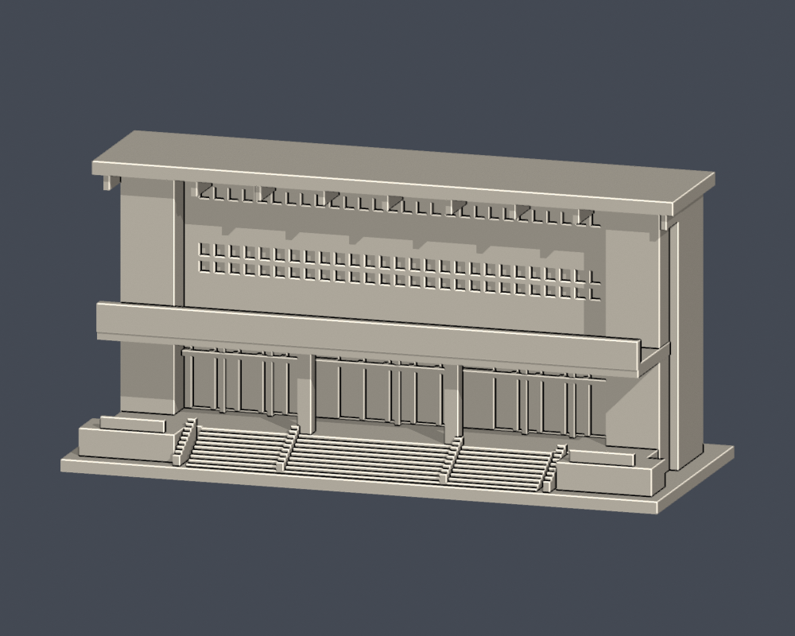
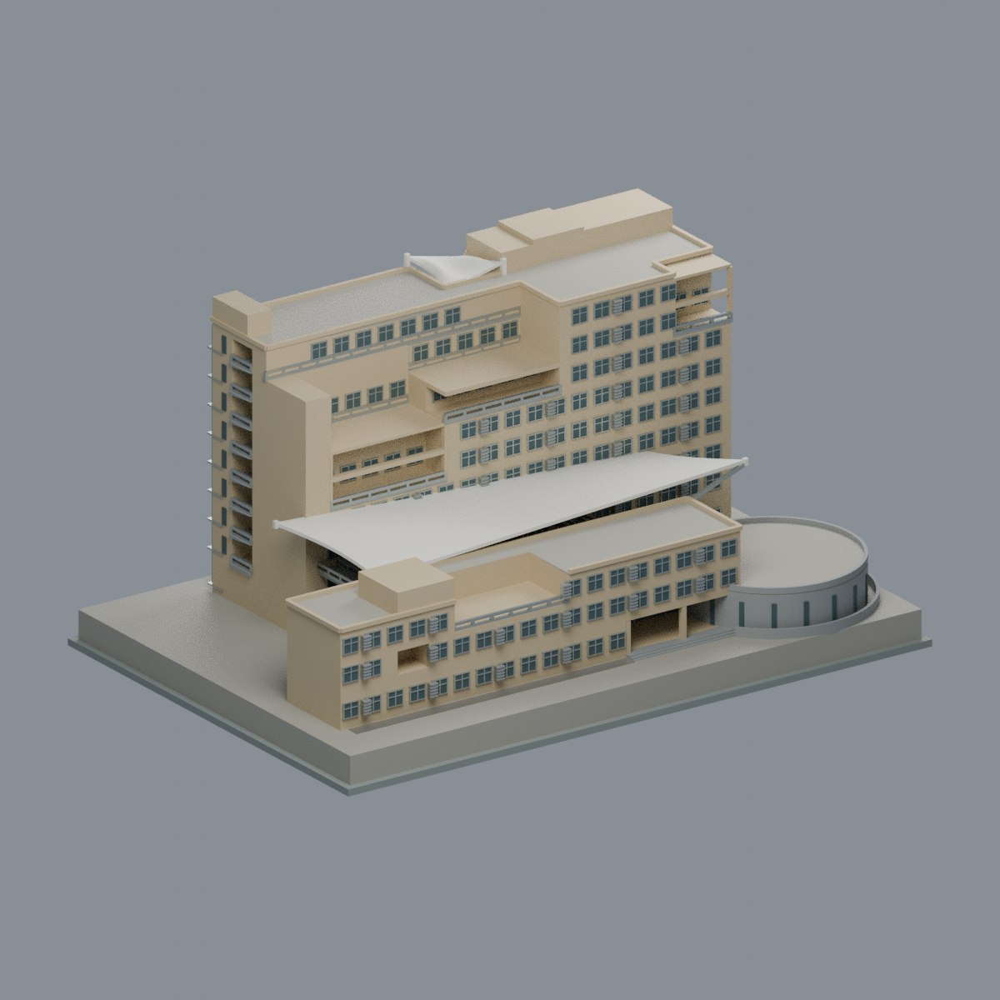

# 國立虎尾科技大學

依公開實拍與官方校圖自建的可3D列印外觀近似。已收錄 **3件**；不是全校完成，其中經國體育館只有正面入口段。未研究校舍及高鐵校區保留在[逐項研究清單](research-inventory.json)與[續接說明](RESEARCH-HANDOFF.md)。

## 模型圖鑑
每列最多3個不同建物；三件分屬第一教學區、運動區與第三教學區。

| 建築模型 | 建築模型 | 建築模型 |
| :---: | :---: | :---: |
|  **[第一教學區校門與警衛室](校本部（第一教學區）/buildings/nfu-main-gate/README.md)** |  **[經國體育館正面入口段](校本部（運動區）/buildings/nfu-chingkuo-entrance/README.md)** |  **[文理暨管理大樓](校本部（第三教學區）/buildings/nfu-cma-building/README.md)** |

## 使用限制
前兩件STL單位毫米，含底座最長150mm、各件獨立近似比例；新文理暨管理大樓為248.4×172.8×125.55mm，另見其QA。底座朝下；雨遮/屋簷/凹窗仍可能需要支撐。數位幾何檢查不等於實際切片或試印，未保證免支撐。

原照片日期未載明，2023/2025是相關文件日期；第三方照片和PDF不隨模型散布。校門不含2025新增虎雕，警衛室未見背面保守封閉；體育館背面是切面，非真實背立面。

校門頂端1層薄件篩檢超過1%提示，已附逐構件留存補查及截面圖，保留警示。來源、SHA、重建、Blend、逐0.2mm截面及薄件腳本均在各件資料夾。

## 文理暨管理大樓新增版本

文理暨管理大樓完整相連主外觀近似：第三教學區北3F/南9F錯位雙翼、圓廳戶外平台、真B1採光院、1–3F異位橋梯、不對稱雙高退臺外框、主曲膜及塔頂小膜。2007官方設計＋六張建築師完成照，照片攝日未知，非竣工測繪或2026現況。248.4×172.8×125.55mm，8色Blend/3MF/STL與5實mesh預覽；103580三角單殼，628有效切層、22空實點及6局部切層，strict材質及Blend頂點存讀、乾淨9件byte一致、獨審通過。小膜z114.8mm有1個0.891mm²薄截層島如實保留，膜/橋梯需支撐、未實印；細部按設計近似，不代表全校完成。

[來源與版本](校本部（第三教學區）/buildings/nfu-cma-building/SOURCES.md) · [驗證與限制](校本部（第三教學區）/buildings/nfu-cma-building/QA.md)。前兩件幾何與QA未改。

## 校區入口
- [校本部（第三教學區）](校本部（第三教學區）/README.md)
- [校本部（第一教學區）](校本部（第一教學區）/README.md)
- [校本部（運動區）](校本部（運動區）/README.md)

高鐵校區與新一舍不在這三件模型範圍；不能以舊校本部圖代替全校現況。[現況差異與未完成清單](RESEARCH-HANDOFF.md)。
