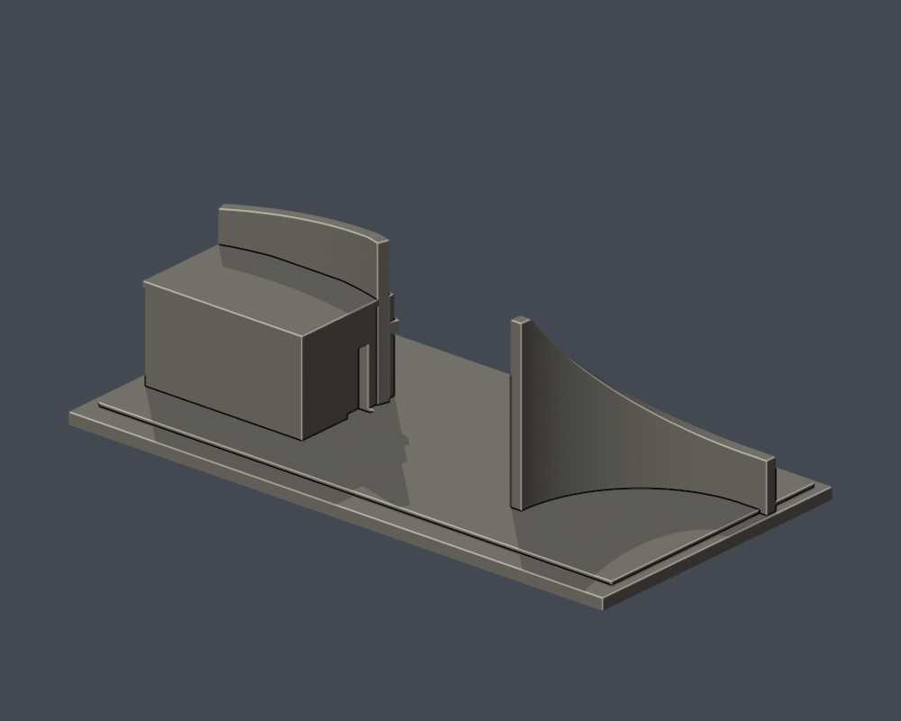

# 國立虎尾科技大學｜第一教學區校門與警衛室

校區：校本部（第一教學區）。研究核對日：2026-10-13。

**只做既有校門曲牆與警衛室，不含後方相鄰教學大樓。不是整個校門廣場現況模型；2025新增虎雕、旗桿與路障未建。**

| 實際 STL 正面 | 實際 STL 背面 |
|---|---|
|  |  |

[上視圖](previews/top.png) · [低角度立面圖](previews/elevation.png)

## 下載與重建
- [毫米 STL](model.stl)（150.0 × 76.0 × 47.8 mm，含3mm底座，各件獨立近似比例）
- [可編輯 Blender 網格](scene.blend)：由實際 STL 匯入，非第三方模型。
- [獨立參數腳本](build_model.py) · [相依套件](requirements.txt)
- `python build_model.py` 重建；`blender -b -t 2 -P render_preview.py` 由實際 STL 重新產生預覽與 Blend。

## 證據與取捨
保留左側升高弧形意象牆、右側警衛室弧形招牌牆與弧形雨遮、街側窗帶和內側門洞。

警衛室背面照片不足，以無開口封閉面保守表示；間距、曲率、牆高與進深為照片近似。不可把此模型當作建築測繪。

來源照片原始攝影日期未載明，文件日期不當作拍攝日期。幾何比例取自公開實拍與官方校圖，不是精密測繪。[來源與用途](sources.json)。第三方照片/PDF不隨公開包散布。

## 列印說明
單位毫米，底座平面朝下。弧形雨遮與凹窗可能需支撐。曲牆厚3mm，最高點加約3mm弧長短平段，避免漸薄頂尖；這是明載列印化改動。 建議先在自己的切片器預覽0.2mm層高及0.4mm噴嘴路徑，檢查橋接與支撐接觸。不得據本件宣稱免支撐或保證可印。

## 數位 QA
- [原STL、重建與Blend驗證](validation.json)：原始面法向/繞序一致、正體積、每邊2面、頂點環單一閉環、單一連通表面殼、無分離封閉內殼；重建SHA與Blend三角形幾何一致。
- [0.2mm原始截面檢查](contour-validity-check.json)：固定z起點0.071mm，每層degree2閉合，個別與合成Polygon均有效。無buffer(0)、make_valid或修復後宣稱通過。
- [0.8mm參考寬度薄件篩檢](thin-feature-check.json)：使用canonical fail-closed v3，1mm取樣；最大opening loss 1.164%。此為輔助篩檢，不是全面最小壁厚保證。
- `python validate_model.py`、`python check_contour_validity.py`、`python check_thin_features.py` 均須exit0。
- 尚未做實體試印、Cura/Prusa真實工具路徑或全面三角面自交檢驗。

### 曲牆頂端薄件提示
1個取樣層超過1% opening loss，並非零警告。[逐構件補充檢查](component-thin-audit.json)及[可重跑腳本](check_component_thin.py)確認全部48個取樣層之各Polygon均留存，0.4mm侵蝕核心未分裂。最不利z=47.071mm只有1個Polygon，11.703887mm²中保留98.836039%；包圍矩形最小寬3.0521mm。設計徑向壁厚3mm，包圍矩形寬不能當全面局部最小壁厚。開運算損失集中於角落，仍須實際切片與試印確認。

[最不利頂端截面圖（自製數位QA）](previews/top-section-qa.png)
