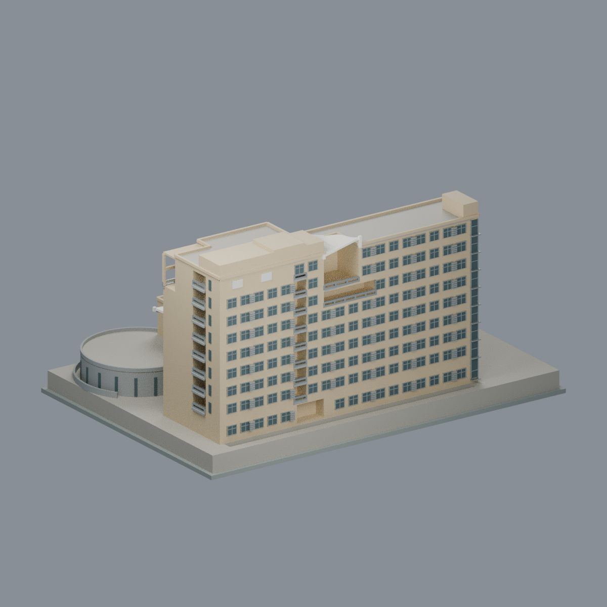
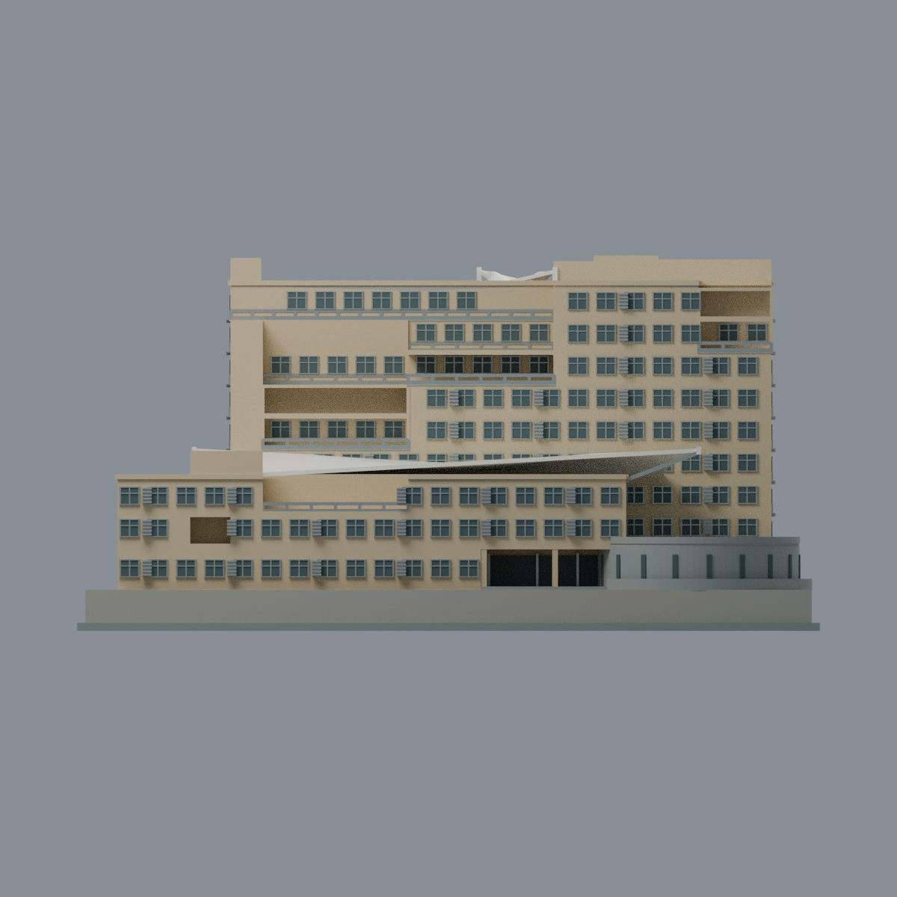
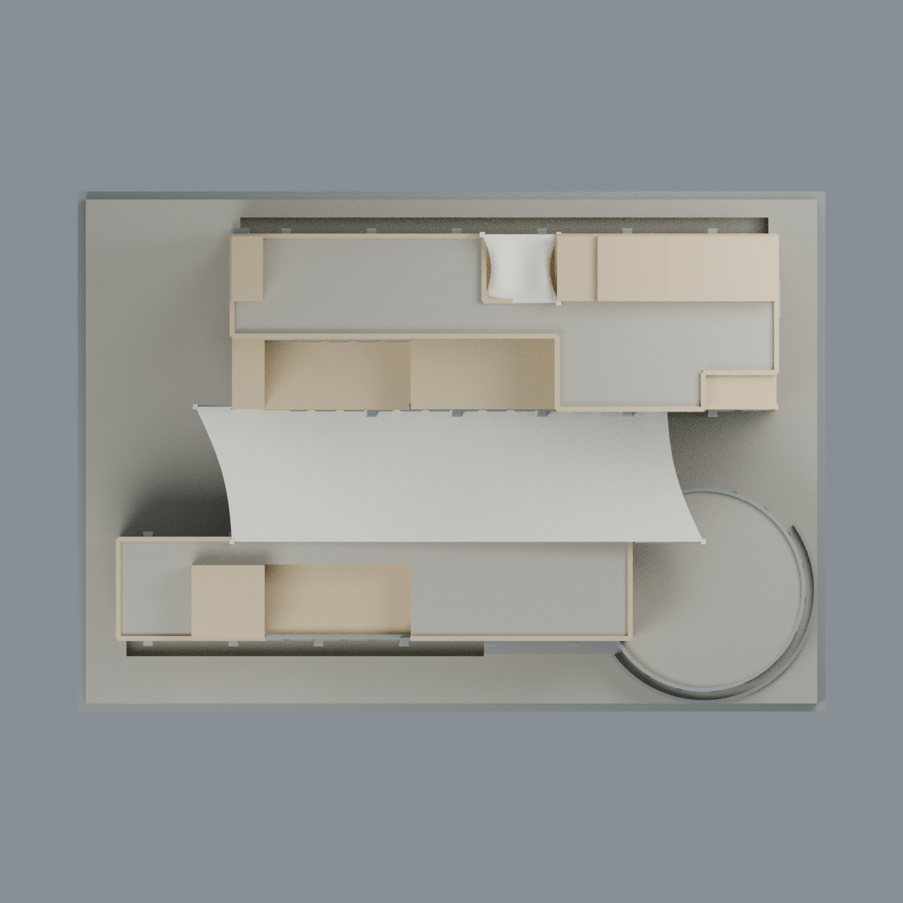
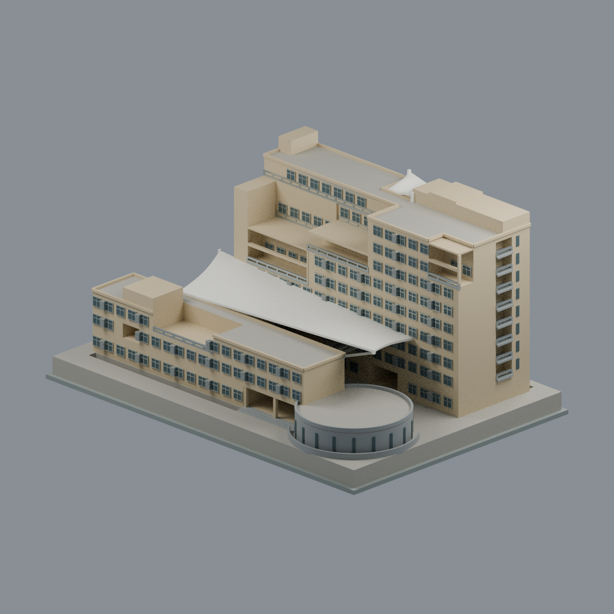

# 國立虎尾科技大學｜文理暨管理大樓

## 模型預覽

| 前側 | 後側 | 正立面 |
| :---: | :---: | :---: |
|  |  |  |

[第三教學區](../../README.md) · [學校模型](../../../README.md) · [全部模型](../../../../README.md)

**完整相連主要外觀近似模型**；校本部（第三教學區，文化路64號）。不是第一教學區校門、經國體育館入口段，亦不是鄰近人文科學大樓。

## 範圍與版本

依2007公開都市設計審議平立剖及建築師六張完成實拍交叉製作。作者頁載2010完成；實拍原始拍攝年月未知，不能以2018上傳路徑當拍攝年，**不宣稱2026現況、竣工測繪或實測尺寸**。設計900公分柱距與各層高程用作名目比例（1設計公尺對2.7展示毫米），未見細部依設計圖簡化。

包含北側3層低翼、南側9層高翼及其錯位關係、低翼圓形報告廳、露出的B1採光中庭和外側採光井、1–3F不同位置連橋與院內階梯、低翼3F露臺、南翼不對稱逐層退臺、半戶外樓梯、屋突服務區、主院曲面膜與塔頂小膜。屋突不是完整第10層；圓廳屋頂是戶外平台，不加玻璃圓頂。中庭、橋下、退臺與樓梯槽是幾何負空間，不以黑面冒充開口。

排除鄰棟、球場、全校道路樹木及地形、封閉地下室內部、室內隔間與家具。底座與外地坪是展示支撐，不是測繪整地。

## 檔案

- `scene.blend`：可編輯三角網格、分面材料、毫米場景及五視角用相機；不是僅供觀看的圖片。
- `model.3mf`：相同實際三角形與8種不透明基礎材料，可改色；須以支援3MF材料的軟體讀取。
- `model.stl`：同形狀單網格，STL本身不儲存色彩或透明度。
- `previews/`：front、rear、elevation、top、left_oblique，皆從實際交付mesh渲染，不是實景照片或概念圖。
- `build_model.py`、`render_model.py`、`rebuild.py`：可重建幾何／材質／五圖。其餘驗證腳本與`qa/`記錄實際檢查。

## 精度／列印

外殼、橋梯、退臺與膜範圍以圖實互證；窗細格、百葉數、磚紋、扶手、膜曲率／縫／連接、機電門窗不是逐件竣工測繪。PDF平面轉世界座標已反射單一水平軸，前後手性以正／背立面與實拍互核。主膜兩長邊錯位約半跨，名目外表高程18.9–22.6設計公尺，曲率和節點屬近似；5F/8F雙高露臺保留空洞並設外緣中間框樑。背面上端兩片白盲板及另一角通高玻璃帶有保留。照片可見材料優先：暖米色翼身、灰圓廳、銀灰金屬、暗玻璃、乳白膜。深色玻璃採不透明微型代理；封閉室內實體化。欄杆與膜為列印加厚，不是結構分析。

**未做實體列印。** 橋、膜、凹口上樑、挑出平台須規劃支撐；水密、切片和交換格式通過不等於免支撐或保證任一機器能成功列印。局部薄件與膜法向厚度的實際數值、檢查範圍見QA，不以全局切片掩蓋局部薄處。

## 重建

建模Python需`numpy scipy trimesh manifold3d shapely rtree`，交換驗證Python另需`lib3mf`；Blender用4.3.2或相容版本。原始照片／PDF不參與重建，亦未打包。

```sh
python build_model.py
blender -b -t 4 --python-exit-code 1 --python render_model.py
python run_all_checks.py --lib3mf-python /path/to/python-with-lib3mf
python rebuild.py --output /new/empty/output --blender blender
```

精確套件版本見`qa/toolchain.json`。`render_detail.py`另從交付Blend內部相機渲染中庭QA圖；只增兩盞檢查用燈，未切割、隱藏或增加mesh，亦不改寫交付Blend。

依賴／Blender／作業環境不同時，不保證渲染byte一致；隨包QA記錄本次乾淨重建及存讀驗證。

## 實際模型預覽


| 模型預覽 | 模型預覽 | 模型預覽 |
| :---: | :---: | :---: |
| 俯視<br> | 另一側斜視<br> |  |
