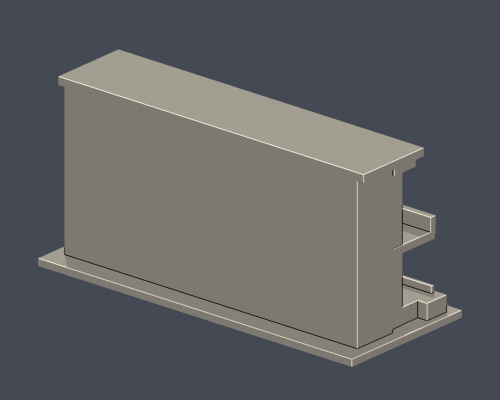
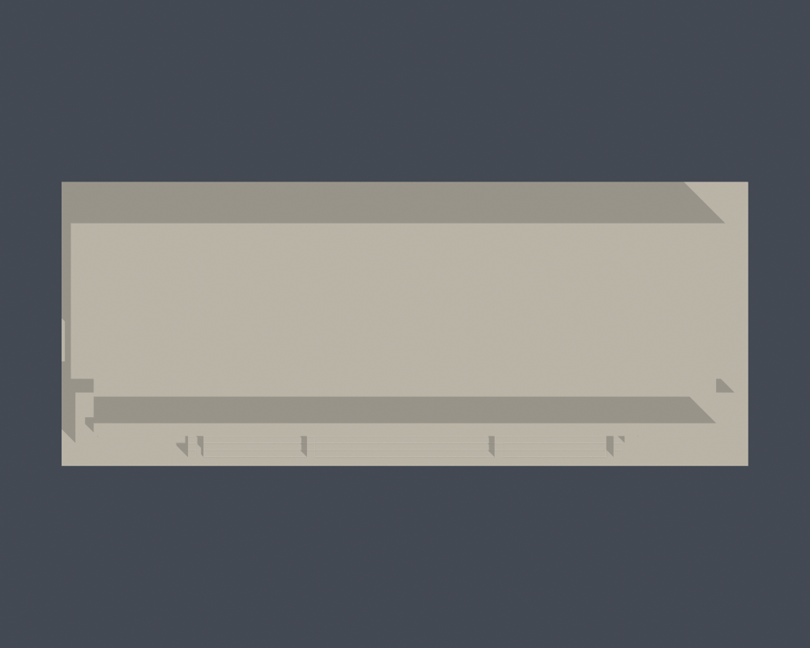
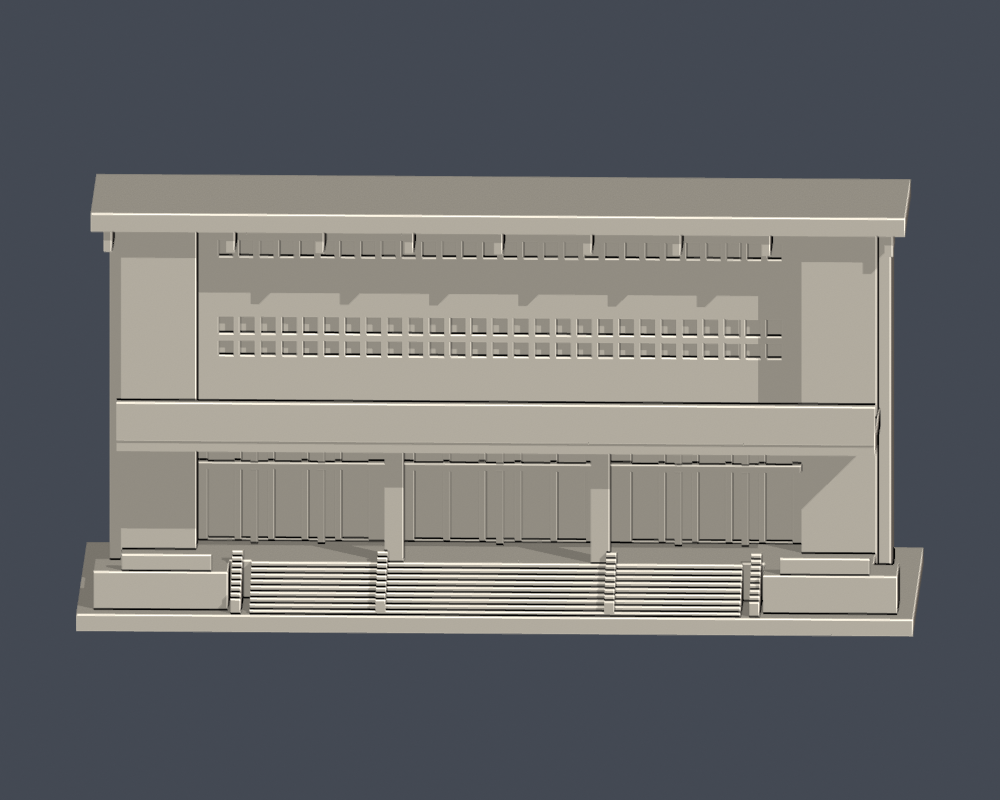

# 國立虎尾科技大學｜經國體育館正面入口段

## 模型預覽

| 模型預覽 | 模型預覽 | 模型預覽 |
| :---: | :---: | :---: |
| 實際 STL 正面  | 實際 STL 背面  |  |

校區：校本部（運動區）。研究核對日：2026-10-13。

**本件只重建體育館正面入口段，非完整體育館。背面平整面是截取邊界，不是真實後立面；模型截取深度自行選定。**

[上視圖](previews/top.png) · [低角度立面圖](previews/elevation.png)

| 模型預覽 | 模型預覽 | 模型預覽 |
| :---: | :---: | :---: |
| 上視圖  | 低角度立面圖  |  |

## 下載與重建
- [毫米 STL](model.stl)（150.0 × 62.0 × 72.4 mm，含3mm底座，各件獨立近似比例）
- [可編輯 Blender 網格](scene.blend)：由實際 STL 匯入，非第三方模型。
- [獨立參數腳本](build_model.py) · [相依套件](requirements.txt)
- `python build_model.py` 重建；`blender -b -t 2 -P render_preview.py` 由實際 STL 重新產生預覽與 Blend。

## 證據與取捨
保存大雨遮、兩支主柱、三條採光窗帶、側邊大扶壁、上屋簷肋條與三段階梯。主要窗格約化為28/27/27小格，以可印尺寸呈現，並非量測逐窗測繪。

屋頂深處、整館平面進深、側背立面與室內未有足夠實拍；一律未假造。空調小支架、字體、標旗、活動拱門與細欄杆不建。

來源照片原始攝影日期未載明，文件日期不當作拍攝日期。幾何比例取自公開實拍與官方校圖，不是精密測繪。[來源與用途](sources.json)。第三方照片/PDF不隨公開包散布。

## 列印說明
單位毫米，底座平面朝下。入口雨遮底面、屋簷和凹窗上緣可能需支撐。細扶手改為1.4–1.8mm連續厚緣。 建議先在自己的切片器預覽0.2mm層高及0.4mm噴嘴路徑，檢查橋接與支撐接觸。不得據本件宣稱免支撐或保證可印。

## 數位 QA
- [原STL、重建與Blend驗證](validation.json)：原始面法向/繞序一致、正體積、每邊2面、頂點環單一閉環、單一連通表面殼、無分離封閉內殼；重建SHA與Blend三角形幾何一致。
- [0.2mm原始截面檢查](contour-validity-check.json)：固定z起點0.071mm，每層degree2閉合，個別與合成Polygon均有效。無buffer(0)、make_valid或修復後宣稱通過。
- [0.8mm參考寬度薄件篩檢](thin-feature-check.json)：使用canonical fail-closed v3，1mm取樣；最大opening loss 0.099%。此為輔助篩檢，不是全面最小壁厚保證。
- `python validate_model.py`、`python check_contour_validity.py`、`python check_thin_features.py` 均須exit0。
- 尚未做實體試印、Cura/Prusa真實工具路徑或全面三角面自交檢驗。
