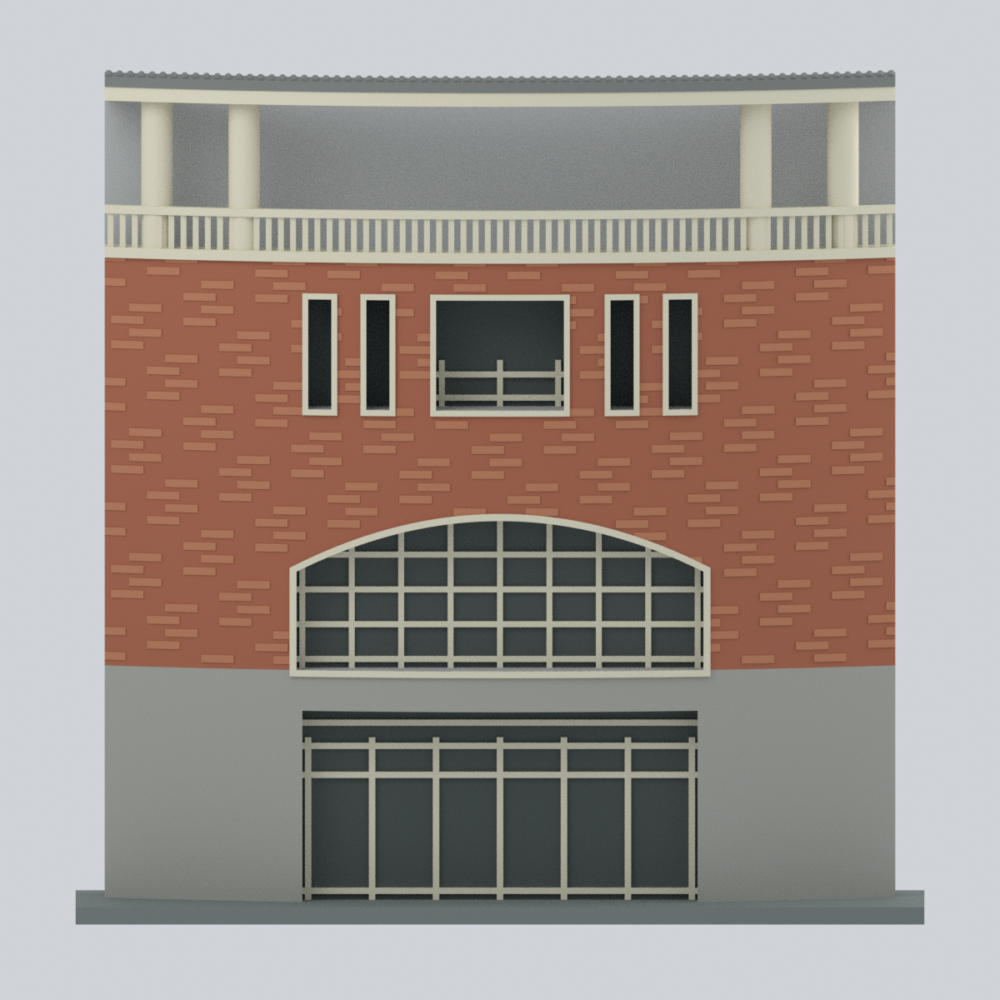

# 國立金門大學

目前2件局部外觀研究模型：楊清廉圖資大樓銃樓段與圓樓正面中央入口立面段。0棟全形；不是完整圓樓，也不代表全校完成。

| 建築模型 | 建築模型 | 建築模型 |
| :---: | :---: | :---: |
|  **[國立金門大學｜楊清廉圖資大樓銃樓段](金寧校本部/buildings/nqu-library-tower-segment/README.md)** 圖資大樓銃樓段正面 |  **[圓樓・正面中央入口立面段（照片近似；非完整建築）](金寧校本部/buildings/nqu-roundhouse-entrance-facade/README.md)** 圓樓中央入口立面段 |  |

[模型、來源與QA](金寧校本部/buildings/nqu-library-tower-segment/README.md)。70×70×150mm含底；已知新側4錯層窄窗與石基開口補入，未知背面/主館未建。數位篩檢非實體試印，支撐與縮小風險見模型頁。本修版已完成獨立數位覆核與限定例外核可；詳模型頁獨立補充。

[圓樓・正面中央入口立面段（照片近似；非完整建築）](金寧校本部/buildings/nqu-roundhouse-entrance-facade/README.md)：照片拍攝日期未知，僅直接可見中央立面；完整環形外殼及屋頂未建，灰色背襯／側切是人工裁切與支撐，非建築實際背面。模型尺寸非測定比例，細框、欄杆與懸簷仍需切片支撐評估；未實體試印。
