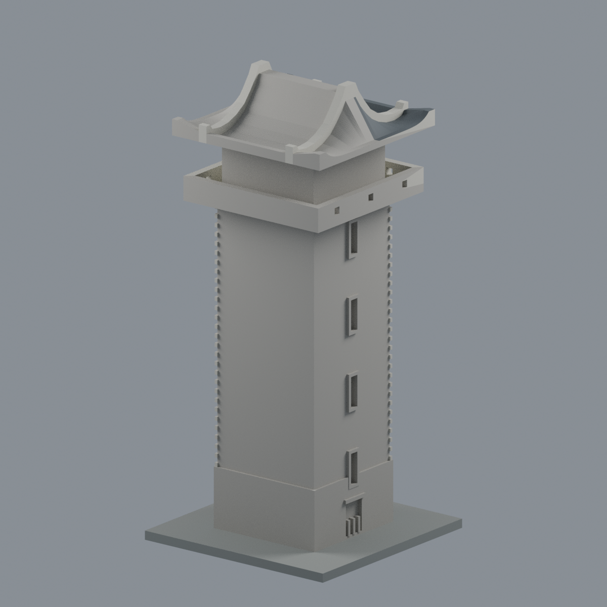

# 國立金門大學｜金寧校本部

既存楊清廉圖資大樓銃樓段補證修版。0棟全形、1件局部，模型與學校計數不增加；全校仍未完成。

| 同件實際STL正面 | 同件實際STL背面 |
|---|---|
|  |  |

[模型、來源與QA](buildings/nqu-library-tower-segment/README.md)。70×70×150mm含底；已知新側4錯層窄窗與石基開口補入，未知背面/主館未建。數位篩檢非實體試印，支撐與縮小風險見模型頁。本修版已完成獨立數位覆核與限定例外核可；詳模型頁獨立補充。
