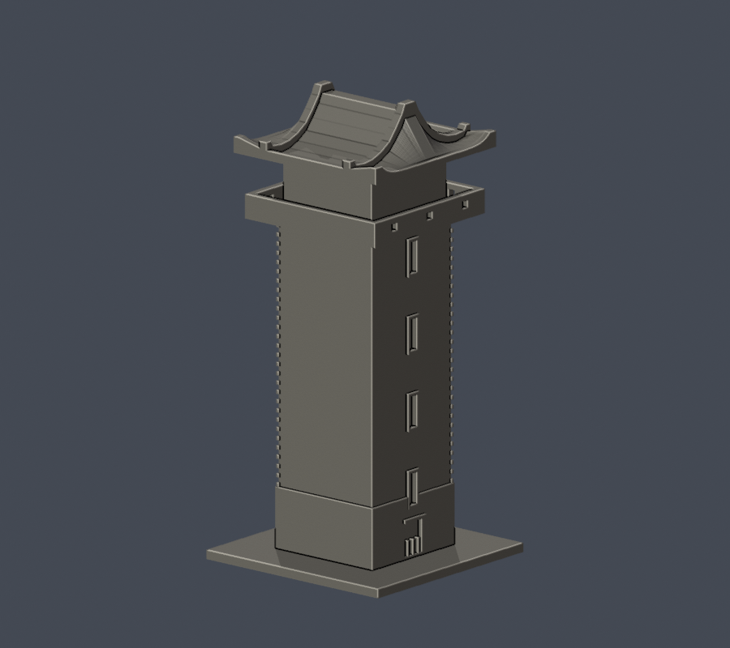

# 國立金門大學｜楊清廉圖資大樓銃樓段

本修版補入2024-09-23新側面實拍證據；本件僅為圖資大樓的**銃樓局部外觀近似**，不是獨立建物、全館測繪或全校完成。以建築師實拍、校方簡報和2019年記者實拍交叉核對，自行以 Python / manifold3d 建立；沒有擷取第三方3D網格。

| 實際STL正面 | 未知背面留白 |
|---|---|
|  |  |

[正立面](previews/elevation.png) · [頂視](previews/top.png) · [屋頂低視角](previews/roof-detail.png)

## 範圍與版本
- 外觀候選：2024側面補證修版v2；保留成對曲線山牆及橫向屋脊。獨立數位驗證已完成，44筆角損及沿面限定證據已核可，不能視為已發布或已試印。
- 保留主塔身三列單窄窗、最上雙窄窗，另一已見立面的三列單窄窗，外挑欄板正面2孔／側面3孔、環繞陽台凹槽、屋頂成對曲線山牆。
- 山牆曲線、相對比例、進深為照片近似；為列印加厚山牆板至3.0mm，脊頂保留約5.0mm寬平台、上翹端保留至少2.0mm端面，並非原建築測量尺寸。
- 新增x負側4錯層單窗（底標高20/45/70/95mm），最低跨z23mm石基線；front石基窄窗；x負石基淺門洞、加粗3竪格及過梁、陽台3小孔。尺寸是照片近似。未知y正背面與接主館段留白，不推造。主館、階梯廣場、山牆主屋群、後翼與室內皆未製作；底座是人工列印底座。
- 不以館內圖書館、李奇茂美術館或電算中心另算建物。圖資大樓正式别名由2025年7月館方樓層導覽確認為楊清廉圖資大樓。
- 建築師記載2008年竣工；照片多未標攝影日期。已查校方現行頁面、2025簡報及修繕關鍵字，未取得能證明2026全棟外牆／屋頂改造完成的資料。未查獲不代表沒有施工。

## 檔案與重建
- [model.stl](model.stl)：毫米，70 × 70 × 150 mm，含底座
- [scene.blend](scene.blend)：由交付STL匯入的可編輯網格，非另造展示模型
- [build_model.py](build_model.py)：獨立參數重建；[requirements.txt](requirements.txt)
- [render_preview.py](render_preview.py)、[render_roof_detail.py](render_roof_detail.py)：由實際交付網格渲染
- [來源與限制](sources.json)、[QA說明](QA.md)、[SHA256](SHA256SUMS.txt)

安裝 requirements 後執行 python build_model.py；用 Blender 4.3.2 執行 blender -b -P render_preview.py，再執行 blender -b -P render_roof_detail.py。驗證以 python run_checks.py 執行；原嚴格失敗會原樣記錄，不能把exit1改綠。

## 列印提醒
底座朝下。外挑陽台、屋簷與屋頂山牆需在切片軟體檢視支撐，細孔、窄窗及壁角石條不宜再任意縮小。這裡的數位網格與0.2mm截面檢查，不是 Cura／PrusaSlicer 工具路徑驗證，也沒有實體試印；不保證免支撐或任何機種均可直接成功。

所有原照片、PDF及CAD參考只用於私下覆核，未隨公開包散布。

## 本次列印源修與未解限制
原谷段屋板90,320密採樣中有22點首段約0.7075–0.7417mm；本版僅底面131.8→131.4mm，頂面曲線不變。新密採樣最小0.999999880791mm，這不是全方向最小壁厚定理。新門格1mm寬、窗框/山牆沿用或加粗，屬列印表達。

44筆原Polygon角損（36山牆端、8屋面外角）最大2.213313498497953%，最少保留97.78668650150205%；原0.8mm opening零消失/分裂，真角0.41mm鄰域外損失0。仍保留原strict false，特定限定裁定見獨立補充。全射線後區間有122條沿面／3551原三角區間，沿面不算實體厚度或開放空氣；詳見QA。

[新增側面](previews/new-side.png) · [側正立面](previews/left.png) · [本次變更](CHANGELOG.md)

獨審補充：15點/原面共135480點；73旗標分71正長度外表面（涵作者原63全）＋2孤立共享邊切觸。作者先前以單點winding判46正常的解釋撤回；原值與strict false保留，詳QA更正。

[獨立修版覆核與限定例外](INDEPENDENT-REVISION-AUDIT.md) · [獨立密面摘要](independent-dense-summary.json)
